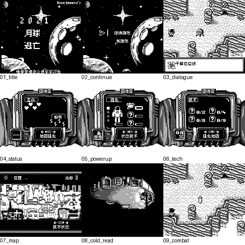

# 2021：月球逃亡：公开反馈

[报告BUG](https://github.com/shiyi1133/youxi-hanhua-releases/issues/new?template=bug_report.md)。请说明实际版本、字号、必要触发步骤和已有截图，不上传ROM、存档、即时状态或私人资料。

当前公开索引尚未登记本作BUG反馈；这不代表没有BUG、已全通或已实机验收。开放问题不等于正在修复。

[贴吧原需求](https://tieba.baidu.com/p/11092365551?pid=154054949091#154054949091)。

## 维护者交付通知：v0.1.0（限定测试版）

[贴吧实际答复](https://tieba.baidu.com/p/11092365551?pid=154064580513#p154064580513)（189楼，PID 154064580513；原关联楼层回复）。

以下为去除下载信息后的维护者通知摘要，不是玩家测试结论，也不是原文全文。

> 《2021：月球逃亡》v0.1.0限定测试版已发布。
> 字号：普通Fusion Pixel 8px；标题图像放大不算大字版，无10px。。
> 范围：用户aftermarket输入，modified_base未知，不据header称日版零售。1791字符串已译，1767静态文本消费者，24遗留未证实可达也有译文；303背景/210精灵审计，12背景21精灵改动。
> 原答复中的ROM下载链接、提取码、网盘目录及下载指示已省略；私库保留完整原文证据。

原答复全文UTF-8 SHA-256：`a2dfdd075580e7624ea360eca2989d61f82a267bbc6061e04a872c3c63c16b46`（279字节）。

2021：月球逃亡 v0.1.0 8px限定测试版；普通Fusion Pixel 8px；标题图像放大不算大字版，无10px。 自然路径与诊断范围见测试说明，不代表全流程。

[贴吧该PID第1张实际公开图片](https://tiebapic.baidu.com/forum/pic/item/acd4972f07082838dec19613fe99a9014d08f111.jpg?tbpicau=2026-11-04-05_525cf1d46b266cfa481c3d29140d0ed8)。

原PNG SHA-256：`0ea2323acead6c99efb08f9fd037b395d025a55af7bcf660b45f572f84d126fc`；贴吧公开图片 SHA-256：`71417b1ea34b9a399a0e18664f4a0339d7ddd90cd66ea0da80b6d63f5ee69754`。

原答复全文与全部图片已按该PID公开核验；此镜像不新增通关、实机、独立QA、源码完整性或BUG全部修复结论。
