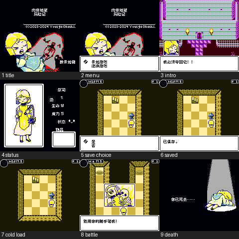

# 肉体地狱历险记 v0.1.0（限定测试版）

[源码与补丁Release](https://github.com/shiyi1133/youxi-hanhua-releases/releases/tag/adventures-in-carnal-hell-v0.1.0) · [公开反馈](feedback.md) · [报告BUG](https://github.com/shiyi1133/youxi-hanhua-releases/issues/new?template=bug_report.md)

原游戏／实际输入：肉体地狱历险记Adventures in Carnal Hell_en_ver1.03.gb

原输入完整SHA-256：`ad19372d2533ea77ceacb463e6c32cd90ed6a289e4efa0a0608bca447f643a8c`（524288字节）。

范围：English v1.03 CGB-only aftermarket，MBC5/RAM/battery/rumble；32场景/252文本消费者/80唯一文本与2选择已处理，标题状态死亡制作名单按键气泡图字已译，版权/HMF数字及内核调试保留。

## 8px v0.1.0

字号范围：Fusion Pixel普通8px，原单tile8px行距，无10px。

目标完整SHA-256：`be79995c91ff4edf3904021bf80cc8021a1ca6fb2a260e40695240f5c83edeaa`（1048576字节）。

补丁：`肉体地狱历险记_v0.1.0_普通8px.bps`，SHA-256 `8d7ee0069b796b3d98c006c0f07b0631d0676e3e33bb81ef2edf6691a8ab66b6`。

[源码（完整性未独立确认）](https://github.com/shiyi1133/youxi-hanhua-releases/releases/download/adventures-in-carnal-hell-v0.1.0/adventures-in-carnal-hell-v0.1.0-source-public-r02.zip) · [补丁包](https://github.com/shiyi1133/youxi-hanhua-releases/releases/download/adventures-in-carnal-hell-v0.1.0/adventures-in-carnal-hell-v0.1.0-patch.zip)

肉体地狱历险记 v0.1.0 8px限定测试版；Fusion Pixel普通8px，原单tile8px行距，无10px。 自然路径与诊断范围见测试说明，不代表全流程。

## 测试及限制

提供者自然路径：开机标题/新游戏、1F状态菜单、水晶治疗、保存先拒绝后同意，新OS电池继续恢复水晶位置/HP/MP；2F战斗恐惧/受阻/攻击受伤/死亡败北回标题。

提供者诊断路径：80唯一文本经合成WRAM原LOAD_TEXT、%d=-32768、843字形像素；制作名单场景诊断非通关。

保存边界：PROVIDER_SELFTEST_CRYSTAL_SAVE_NEW_OS_POSITION_HP_MP_COLD_READ

同一实现者自测，不是独立人员QA；维护未新增ROM运行或源码重建，未宣称实机或完整通关。

- 未验证：自然战斗胜利
- 未验证：全塔与所有结局
- 未验证：252消费者全部自然到达
- 未验证：实机/长期压力
- 未验证：旧英文及其它版本存档兼容
- 核对补丁还原、资产完整SHA和截图字节不等于全部游戏功能验收。

