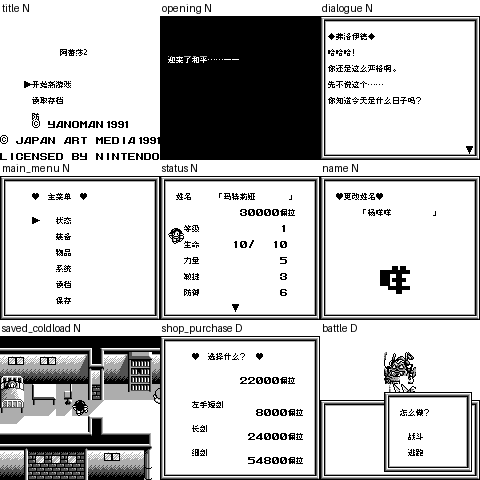

# 阿蕾莎2：公开反馈

[报告BUG](https://github.com/shiyi1133/youxi-hanhua-releases/issues/new?template=bug_report.md)。请说明实际版本、字号、必要触发步骤和已有截图，不上传ROM、存档、即时状态或私人资料。

当前公开索引尚未登记本作BUG反馈；这不代表没有BUG、已全通或已实机验收。开放问题不等于正在修复。

[贴吧原需求](https://tieba.baidu.com/p/11092365551?pid=154054810285#154054810285)。

## 维护者交付通知：v0.1.0（限定测试版）

[贴吧实际答复](https://tieba.baidu.com/p/11092365551?pid=154064609778#p154064609778)（185楼，PID 154064609778；原关联楼层回复）。

以下为去除下载信息后的维护者通知摘要，不是玩家测试结论，也不是原文全文。

> 《阿蕾莎2》v0.1.0限定测试版已发布。
> 字号：Fusion8px；49bit无损压缩恢复完整8×8，非裁大字；无10px，保256KiB/MBC2，无SGB。
> 范围：1646事件文本、253物品/253名称、110UI、开场结尾、标题/旅馆招牌/佩拉货币图；标题/货币实际，旅馆仅静态图块未自然到达
> 原答复中的ROM下载链接、提取码、网盘目录及下载指示已省略；私库保留完整原文证据。

原答复全文UTF-8 SHA-256：`605d149f2461c14ef15a08b2a624d63d4e7b81604c5d35861c6fec3dffd93a75`（253字节）。

阿蕾莎2 v0.1.0 8px限定测试版；Fusion8px；49bit无损压缩恢复完整8×8，非裁大字；无10px，保256KiB/MBC2，无SGB 自然路径与诊断范围见测试说明，不代表全流程。

[贴吧该PID第1张实际公开图片](https://tiebapic.baidu.com/forum/pic/item/bd7a262eb9389b5064c95555c335e5dde7116e2a.jpg?tbpicau=2026-11-04-05_5977cb20194929cd736bef1cb1a41bb1)。

原PNG SHA-256：`28b4f605cc9e112e526dc3490c00fc4f3a573f033255396d701b89da84a04a7c`；贴吧公开图片 SHA-256：`8f379e282e2e2ae818d718781c0695fbbefe9d08991cddd6174867fe924fe531`。

原答复全文与全部图片已按该PID公开核验；此镜像不新增通关、实机、独立QA、源码完整性或BUG全部修复结论。
