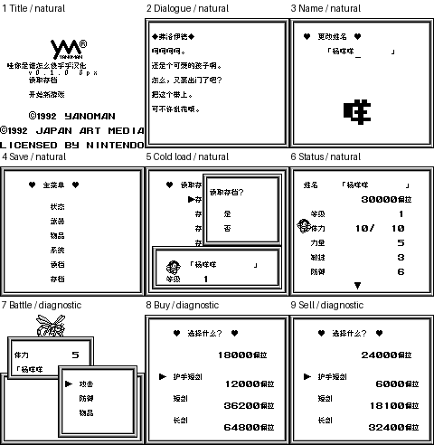

# 阿蕾莎3：公开反馈

[报告BUG](https://github.com/shiyi1133/youxi-hanhua-releases/issues/new?template=bug_report.md)。请说明实际版本、字号、必要触发步骤和已有截图，不上传ROM、存档、即时状态或私人资料。

当前公开索引尚未登记本作BUG反馈；这不代表没有BUG、已全通或已实机验收。开放问题不等于正在修复。

[贴吧原需求](https://tieba.baidu.com/p/11092365551?pid=154054810285#154054810285)。

## 维护者交付通知：v0.1.0（限定测试版）

[贴吧实际答复](https://tieba.baidu.com/p/11092365551?pid=154064610590#p154064610590)（185楼，PID 154064610590；原关联楼层回复）。

以下为去除下载信息后的维护者通知摘要，不是玩家测试结论，也不是原文全文。

> 《阿蕾莎3》v0.1.0限定测试版已发布。
> 字号：Fusion Pixel原生普通8px；无10px。。
> 范围：1134去重语义对白/1458物理字段、249物品技能地名、253敌人NPC、142界面和12选项已处理；已知固定PERA图字已译，尚未逐项解码全部压缩和深层图像，不能称全图像完成。
> 原答复中的ROM下载链接、提取码、网盘目录及下载指示已省略；私库保留完整原文证据。

原答复全文UTF-8 SHA-256：`cfc201e8c674f169a6bc69022fa741b591f0da39441ae3280d5c500be4651c8b`（253字节）。

阿蕾莎3 v0.1.0 8px限定测试版；Fusion Pixel原生普通8px；无10px。 自然路径与诊断范围见测试说明，不代表全流程。

[贴吧该PID第1张实际公开图片](https://tiebapic.baidu.com/forum/pic/item/ab0f4f2309f790527c29f2394af3d7ca7bcbd52b.jpg?tbpicau=2026-11-04-05_375276969d3fdce75ea7cb9073831108)。

原PNG SHA-256：`7c4e7b483cdaa536dbd2c53c750d38ee0988455d32104aadc82f3e193efabe5f`；贴吧公开图片 SHA-256：`9cce23a9c95642b7970d1f85937c0fd5a77d82852a02e46b1f47d87f40fcd3f6`。

原答复全文与全部图片已按该PID公开核验；此镜像不新增通关、实机、独立QA、源码完整性或BUG全部修复结论。
