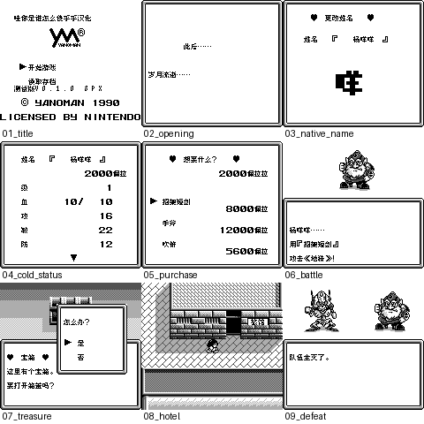

# 阿蕾莎：公开反馈

[报告BUG](https://github.com/shiyi1133/youxi-hanhua-releases/issues/new?template=bug_report.md)。请说明实际版本、字号、必要触发步骤和已有截图，不上传ROM、存档、即时状态或私人资料。

当前公开索引尚未登记本作BUG反馈；这不代表没有BUG、已全通或已实机验收。开放问题不等于正在修复。

[贴吧原需求](https://tieba.baidu.com/p/11092365551?pid=154054810285#154054810285)。

## 维护者交付通知：v0.1.0（限定测试版）

[贴吧实际答复](https://tieba.baidu.com/p/11092365551?pid=154064608946#p154064608946)（185楼，PID 154064608946；原关联楼层回复）。

以下为去除下载信息后的维护者通知摘要，不是玩家测试结论，也不是原文全文。

> 《阿蕾莎》v0.1.0限定测试版已发布。
> 字号：Fusion Pixel普通8px；无10px。。
> 范围：18脚本表1056对白字段、253物品地点标签、127敌名、114固定UI；原事件控制保留。PERA/旅馆/提款机图字已处理；原品牌、作者名及不再调用的遗留词典保留。
> 原答复中的ROM下载链接、提取码、网盘目录及下载指示已省略；私库保留完整原文证据。

原答复全文UTF-8 SHA-256：`a1ba4a9f37d0bd3396ac01ae8cfdbff3175210aa9ef574d0dc5167a4be4fddb7`（251字节）。

阿蕾莎 v0.1.0 8px限定测试版；Fusion Pixel普通8px；无10px。 自然路径与诊断范围见测试说明，不代表全流程。

[贴吧该PID第1张实际公开图片](https://tiebapic.baidu.com/forum/pic/item/828fa218972bd407bdf066fa3d899e510fb30929.jpg?tbpicau=2026-11-04-05_b492929a9031c99befe4bf0e2e07fe33)。

原PNG SHA-256：`5213fb2f537169f8c7253e362241997f1b52fcfcd6bdad8efa23939ecc587068`；贴吧公开图片 SHA-256：`54759bc4487d4aee9b2c6ddd3e6109126989da8d376e78e09c4ceed81c5175b5`。

原答复全文与全部图片已按该PID公开核验；此镜像不新增通关、实机、独立QA、源码完整性或BUG全部修复结论。
