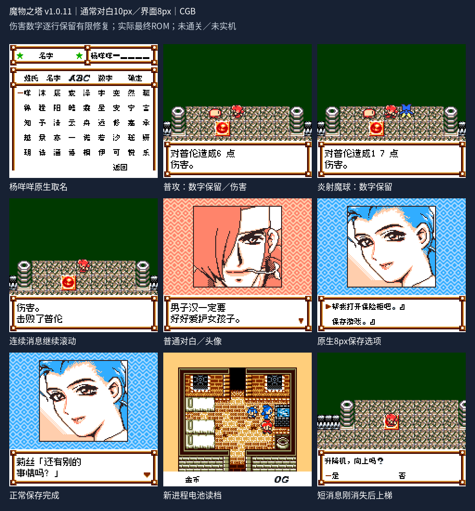
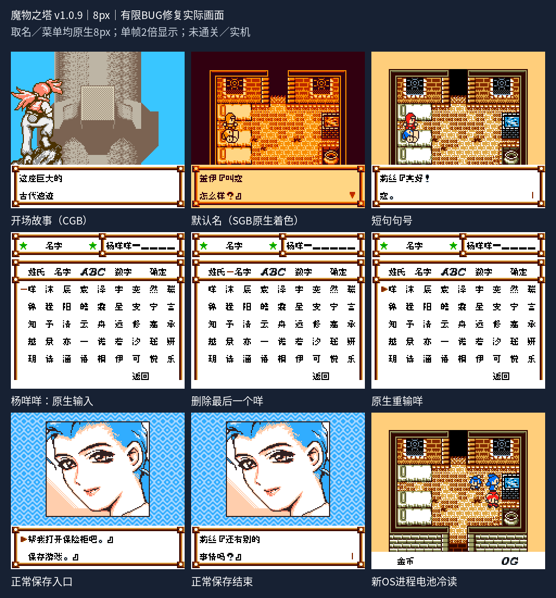

# 魔物之塔

原输入：Other Life - Azure Dreams GB

原输入完整SHA256：`42bba6b43d20fb84daf259499100607ac8b1f401d961cdac21f3a17ed4410e31`。此处“原输入”保留改版、既有汉化或地区修订身份，不一律称干净零售ROM。

| 字号 | 当前版本 | 音频 | 输出完整SHA256 |
| --- | --- | --- | --- |
| 8px | v1.0.9 | unchanged | `bdfc61ac6c46fc2d2efd17b938a211b4ac92d56532be93ea3494236a524e823b` |
| 10px | v1.0.11 | unchanged | `7bd560a35d6c35cc7ed6033e6f5715d0bdf2587149d9962cc628c79765e246ca` |

## 源码与补丁

- 8px／v1.0.9／unchanged：完整修改源码：[下载](https://github.com/shiyi1133/youxi-hanhua-releases/releases/download/source-migration-20261022/azure-dreams-current-source-e38a9f827f91-public-r02.zip)（ZIP SHA256 `47e33ffc635e522e4f0b15e034b2f36958240732db44c8f850c75123bafa23d3`）；补丁：[下载](https://github.com/shiyi1133/youxi-hanhua-releases/releases/download/patch-migration-20261022/azure-dreams-current-patches.zip)（ZIP SHA256 `cd36c05c63f4a898d61790c372f8ff769d905879193bc3fc6fbfc32c22768f9d`）。
- 10px／v1.0.11／unchanged：完整修改源码：[下载](https://github.com/shiyi1133/youxi-hanhua-releases/releases/download/source-migration-20261022/azure-dreams-current-source-9aa3e23a1c32-public-r02.zip)（ZIP SHA256 `929ef14dc9224c8f66c8f7e357d759f6a262a417bc1df4cff4d4871f6291f3f6`）；补丁：[下载](https://github.com/shiyi1133/youxi-hanhua-releases/releases/download/patch-migration-20261022/azure-dreams-current-patches.zip)（ZIP SHA256 `cd36c05c63f4a898d61790c372f8ff769d905879193bc3fc6fbfc32c22768f9d`）。

补丁须直接应用于完整SHA一致的实际原输入；普通字、大字和音乐变体分别核对。公开源码归档不表示本轮重新构建或通过新的运行验收。原作、字体、已有翻译及工具依赖的权利与许可，依各包对应许可保留。

## 范围与验证边界

- 8px／v1.0.9：保持原生8px。
- 10px／v1.0.11：通常对白10px；菜单/取名/密集/能力与融合界面保持原生8px；其它变量消费者未称全部验收。

本次资料搬运未新增模拟器、实机或全通验收；未记录或未测试的范围不写成通过。问题单开放只表示尚未关闭，已关闭也不单独证明全部场景都修复。

[公开反馈及问题状态](feedback.md) · [报告BUG](https://github.com/shiyi1133/youxi-hanhua-releases/issues/new?template=bug_report.md)

## 对应版本截图

10px v1.0.11 actual CGB; physical/magic damage row retention, native name/save/cold, elevator regression; limited scope

图像SHA256：`708dadeb9f4ce62825595b847323b7a82189e442b693c01f0570f02058f41ebc`；绑定ROM SHA256：`7bd560a35d6c35cc7ed6033e6f5715d0bdf2587149d9962cc628c79765e246ca`。

8px v1.0.9实际CGB，8px另含真实原生SGB预设着色；有限姓名/保存冷读

图像SHA256：`c238e28c87f2ef482aa3c074ac4993b5d6aaf5fa10663084e01d150162045b94`；绑定ROM SHA256：`bdfc61ac6c46fc2d2efd17b938a211b4ac92d56532be93ea3494236a524e823b`。

