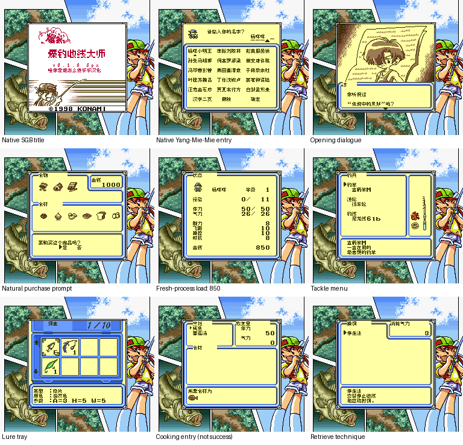

# 爆钓少年王

原输入：Bakuchou Retrieve Master

原输入完整SHA256：`ead03c064b8592297772c999e8538b8b1e90b5909a7fe567c238b947c9f71a74`。此处“原输入”保留改版、既有汉化或地区修订身份，不一律称干净零售ROM。

| 字号 | 当前版本 | 音频 | 输出完整SHA256 |
| --- | --- | --- | --- |
| 8px | v0.1.0限定测试版 | unchanged | `17b7915aa63bbcb17d1d8d0673062e624bbfcae757ad1ae2b06f51ba1d96dbae` |

## 源码与补丁

- 8px／v0.1.0限定测试版／unchanged：完整修改源码：[下载](https://github.com/shiyi1133/youxi-hanhua-releases/releases/download/source-migration-20261022/bakuchou-retrieve-master-current-source-ae6d785835e4-public-r02.zip)（ZIP SHA256 `5a97ae677ce359fd17a4aabfa6db80e400445ecc4cebdcb03669cdd0e87dd1ed`）；补丁：[下载](https://github.com/shiyi1133/youxi-hanhua-releases/releases/download/patch-migration-20261022/bakuchou-retrieve-master-current-patches.zip)（ZIP SHA256 `207dd39d1f01233bc7c3ddddde0c8f10a1a6def5a8aa9efac8247c42825221e2`）。

补丁须直接应用于完整SHA一致的实际原输入；普通字、大字和音乐变体分别核对。公开源码归档不表示本轮重新构建或通过新的运行验收。原作、字体、已有翻译及工具依赖的权利与许可，依各包对应许可保留。

## 范围与验证边界

- 8px／v0.1.0限定测试版：原生普通8px Fusion Pixel；无额外10px或大字版本。
  普通原生8px限定测试：1243/1254个已识别文本槽、已定位标题/菜单/鱼名/说明；原生SGB画面。
  地图内烘焙日文图像、未明鱼名与debug文字仍有保留；不是全汉化。
  深层流程、实际钓获/烹饪成功、锦标赛、通信、死亡/删除、通关及实机未验证。
  提供方运行证据与维护侧静态核验/净源码重建分列；未新增维护侧模拟器实玩或独立人员QA。

本次资料搬运未新增模拟器、实机或全通验收；未记录或未测试的范围不写成通过。问题单开放只表示尚未关闭，已关闭也不单独证明全部场景都修复。

[公开反馈及问题状态](feedback.md) · [报告BUG](https://github.com/shiyi1133/youxi-hanhua-releases/issues/new?template=bug_report.md)

## 对应版本截图

v0.1.0普通8px；最终ROM原生SGB真实运行九宫格，原始PNG/来源/最终ROM全SHA与拼接像素已核；未重跑模拟器。地图日文与未测深层流程仍保留。

图像SHA256：`f8f36f6ce43305b2e663eb47c09219c4f748065e4d1636436ab1c0e41904b81d`；绑定ROM SHA256：`17b7915aa63bbcb17d1d8d0673062e624bbfcae757ad1ae2b06f51ba1d96dbae`。

