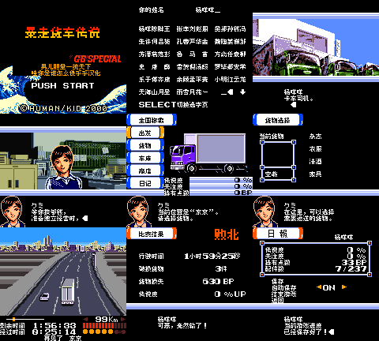

# 暴走货车传说GB特别版

原输入：Bakusou Dekotora Densetsu GB Special - Otoko Dokyou no Tenka Touitsu (Japan)

原输入完整SHA256：`3cff4a025a86425bf4fa7659859ae836eaf25dc769982c12d9503ed4ccbcfd3c`。此处“原输入”保留改版、既有汉化或地区修订身份，不一律称干净零售ROM。

| 字号 | 当前版本 | 音频 | 输出完整SHA256 |
| --- | --- | --- | --- |
| 8px | v0.1.0 | unchanged | `156f3986db428dab7347f42aec8f3d6105903d07430eea07cdca1ac0dc89864f` |

## 源码与补丁

- 8px／v0.1.0／unchanged：完整修改源码：[下载](https://github.com/shiyi1133/youxi-hanhua-releases/releases/download/source-migration-20261022/bakusou-dekotora-densetsu-gb-special-current-source-c996ef5ef5f9-public-r02.zip)（ZIP SHA256 `da46a57c936d6b657a1fd652dd3ffab84ca8bb9b10a7790e01602466a5149c76`）；补丁：[下载](https://github.com/shiyi1133/youxi-hanhua-releases/releases/download/patch-migration-20261022/bakusou-dekotora-densetsu-gb-special-current-patches.zip)（ZIP SHA256 `82f73ec5c5d9505fe88012ae82d34107ddb6469dd45b7e36a1ab1196f0273d23`）。

补丁须直接应用于完整SHA一致的实际原输入；普通字、大字和音乐变体分别核对。公开源码归档不表示本轮重新构建或通过新的运行验收。原作、字体、已有翻译及工具依赖的权利与许可，依各包对应许可保留。

## 范围与验证边界

- 8px／v0.1.0：普通原生8px；CGB-only，无大字版。
  普通Fusion Pixel 8px限定验证测试版。提供方记录5261条精确偏移译文、154项图像补丁及80个姓名常用字；计数不等同全部可达剧情。包内同一最终ROM证据覆盖自然开场、原生4格玩家名／8格卡车名、杨咩咩与陈胖胖正反向输入、原ASCII页、HQ／货物／调校入口、首场驾驶及失败、33 BP原生保存与新进程冷读。维护独立完成原件／BPS／校验和／截图像素静态核验，未运行源码或游戏。
  仅普通8px，无大字版。未完成首场胜利、全路线、全部购买改装、全结局、全部最长变量、实机或联机验收；提供方自测不是独立人员QA。保留原8KiB SRAM和4／8格姓名容量；旧日文姓名可能映射成汉字，新中文姓名回原版可能显示假名，任意外部旧档兼容未保证。先备份自己的电池存档，跨版本不要使用即时状态。

本次资料搬运未新增模拟器、实机或全通验收；未记录或未测试的范围不写成通过。问题单开放只表示尚未关闭，已关闭也不单独证明全部场景都修复。

[公开反馈及问题状态](feedback.md) · [报告BUG](https://github.com/shiyi1133/youxi-hanhua-releases/issues/new?template=bug_report.md)

## 对应版本截图

v0.1.0 普通8px最终ROM真实九宫格；CGB原生色彩，提供方有限自然流程，维护未重跑。

图像SHA256：`691cea1696bd818c639c59aa428c7308eaa57feb7c6c2d657e6afa33a3d94a48`；绑定ROM SHA256：`156f3986db428dab7347f42aec8f3d6105903d07430eea07cdca1ac0dc89864f`。

