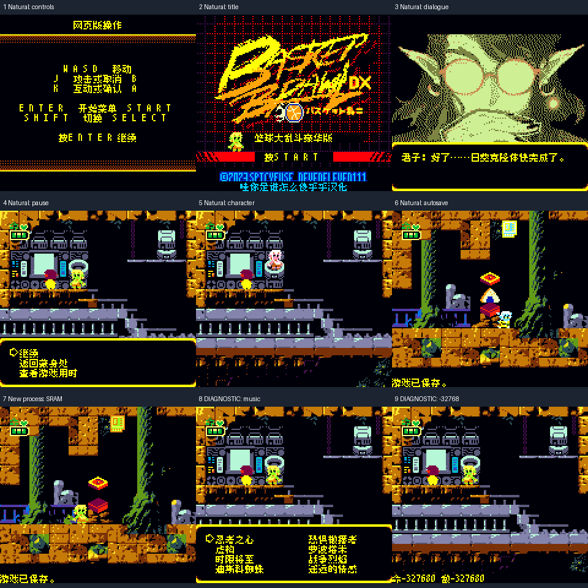

# 篮球大乱斗 豪华版 v0.1.0（限定测试版）

[源码与补丁Release](https://github.com/shiyi1133/youxi-hanhua-releases/releases/tag/basketbrawl-deluxe-edition-v0.1.0) · [公开反馈](feedback.md) · [报告BUG](https://github.com/shiyi1133/youxi-hanhua-releases/issues/new?template=bug_report.md)

原游戏／实际输入：篮球大乱斗Basketbrawl - Deluxe Edition (World) (Aftermarket) (Unl)_20261021_112018.gbc

原输入完整SHA-256：`682fb33d56bcee40a5df5e6b7ab8a75085564652c815caa224fe65e45b6f2466`（1048576字节）。

范围：CGB-only aftermarket，1MiB扩2MiB保持MBC3/RTC/32KiB SRAM。93候选场景/568文本消费者；564槽译文，4原生内部占位保留；HUD、教程菜单和图字纳入，原作者品牌按键保留。

## 8px v0.1.0

字号范围：Fusion中文普通8px、ASCII字距4px；无10px。

目标完整SHA-256：`a1b72f228170abe591d3e8fc32cc5da5518a15fa0b7c808f2d6468ee2cd9dc08`（2097152字节）。

补丁：`Basketbrawl_Deluxe_zh_CN_v0.1.0_8px.bps`，SHA-256 `21b0f7e92afbc20aa947be99afd1cd1a5bf4a4c4c4eb4070673c243dec4bca74`。

[源码（完整性未独立确认）](https://github.com/shiyi1133/youxi-hanhua-releases/releases/download/basketbrawl-deluxe-edition-v0.1.0/basketbrawl-deluxe-edition-v0.1.0-source-public-r02.zip) · [补丁包](https://github.com/shiyi1133/youxi-hanhua-releases/releases/download/basketbrawl-deluxe-edition-v0.1.0/basketbrawl-deluxe-edition-v0.1.0-patch.zip)

篮球大乱斗 豪华版 v0.1.0 8px限定测试版；Fusion中文普通8px、ASCII字距4px；无10px。 自然路径与诊断范围见测试说明，不代表全流程。

## 测试及限制

提供者自然路径：启动指南、标题、开场据点、START暂停/A返回、SELECT换角色、移动跳跃、正常切区自动保存；有场景进度的SRAM新OS冷启继续。

提供者诊断路径：音乐比赛菜单、衣服颜色-32768最长数值、三分量时间、长剧情/教程/加载/制作名单原VM诊断；不代表自然解锁。

保存边界：PROVIDER_SELFTEST_NATURAL_AREA_AUTO_SAVE_NEW_OS_COLD_READ

同一实现者自测，不是独立人员QA；维护未新增ROM运行或源码重建，未宣称实机或完整通关。

- 未验证：完整首关
- 未验证：全部篮球比赛战斗死亡路线
- 未验证：全剧情衣服秘密日志自然解锁
- 未验证：结局
- 未验证：联机和实机
- 未验证：原版及旧汉化所有历史档兼容
- 核对补丁还原、资产完整SHA和截图字节不等于全部游戏功能验收。

