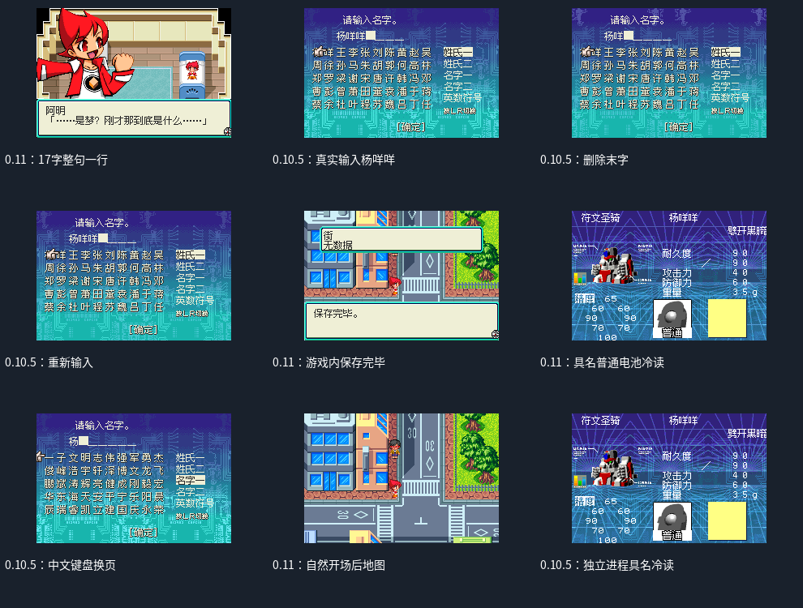

# 兽斗射手

原输入：Beast Shooter: Mezase Beast King! (Japan)

原输入完整SHA256：`e3a06c5f35d663cb83f6a8ef99cb767096a30507c73b6eb0016b3f8f6dc4e4f7`。此处“原输入”保留改版、既有汉化或地区修订身份，不一律称干净零售ROM。

| 字号 | 当前版本 | 音频 | 输出完整SHA256 |
| --- | --- | --- | --- |
| 12px | v1.0.1原生12px开场排版限定修订测试版 | unchanged | `f070fcba782f95960cde8d9c5b55fc6ce032f4a356770bbfb49e4a8260c6774b` |

## 源码与补丁

- 12px／v1.0.1原生12px开场排版限定修订测试版／unchanged：完整修改源码：[下载](https://github.com/shiyi1133/youxi-hanhua-releases/releases/download/source-migration-20261022/beast-shooter-gba-current-source-ac37a215e079-public-r02.zip)（ZIP SHA256 `46f97d19616d1573ebb9d8c8786f772a994a4ad0e1f895aeb154e6f0010c2ab4`）；补丁：[下载](https://github.com/shiyi1133/youxi-hanhua-releases/releases/download/patch-migration-20261022/beast-shooter-gba-current-patches.zip)（ZIP SHA256 `9a34075b107af787f6c58cfaee00d3f5cf202208e67521d43c5f07ccd7e44483`）。

补丁须直接应用于完整SHA一致的实际原输入；普通字、大字和音乐变体分别核对。公开源码归档不表示本轮重新构建或通过新的运行验收。原作、字体、已有翻译及工具依赖的权利与许可，依各包对应许可保留。

## 范围与验证边界

- 12px／v1.0.1原生12px开场排版限定修订测试版：原生12px对白/主要菜单；窄UI8px。

本次资料搬运未新增模拟器、实机或全通验收；未记录或未测试的范围不写成通过。问题单开放只表示尚未关闭，已关闭也不单独证明全部场景都修复。

[公开反馈及问题状态](feedback.md) · [报告BUG](https://github.com/shiyi1133/youxi-hanhua-releases/issues/new?template=bug_report.md)

## 对应版本截图

v1.0.1真实原生12px九宫格：17字开场/0.10.5真实中文输入删重输/0.11实际保存与具名冷读；各SDK标明，不是全通

图像SHA256：`44cfe9cefaf1fef31653147e5e0f9014e53abc1063773bc632af68c818328807`；绑定ROM SHA256：`f070fcba782f95960cde8d9c5b55fc6ce032f4a356770bbfb49e4a8260c6774b`。

