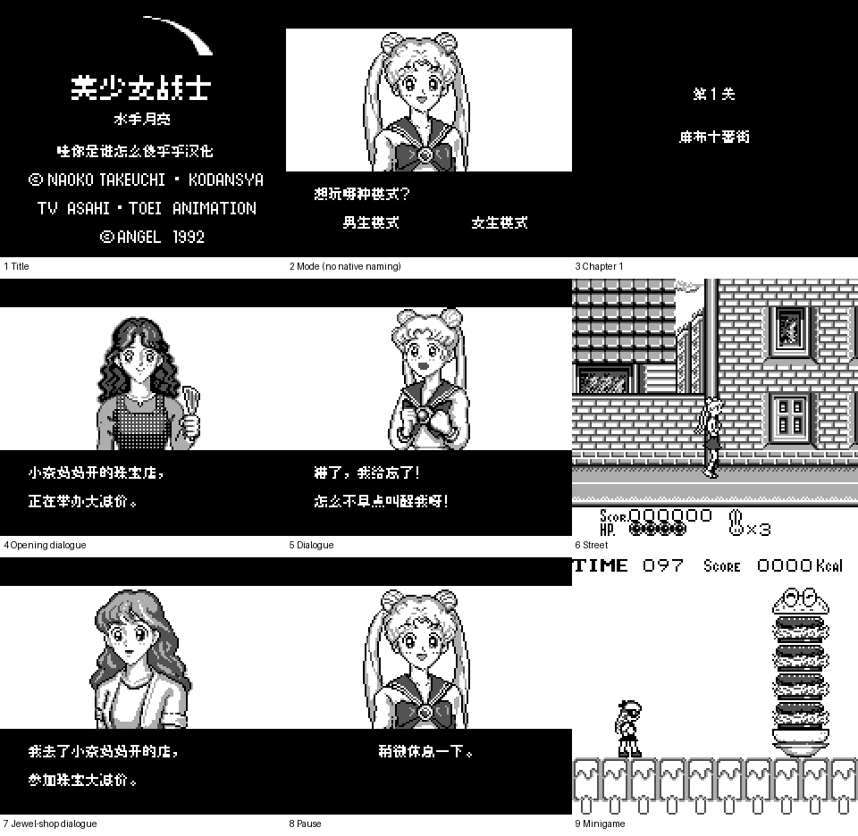

# 美少女战士

原输入：Bishoujo Senshi Sailor Moon (Japan)

原输入完整SHA256：`b1090ad4909f8222e4c325d8f939cb8b80de6430f80343fda501edc9166ce847`。此处“原输入”保留改版、既有汉化或地区修订身份，不一律称干净零售ROM。

| 字号 | 当前版本 | 音频 | 输出完整SHA256 |
| --- | --- | --- | --- |
| 8px | v0.1.0限定验证测试版 | unchanged | `36338d2f3b2591bac77b969b08f7afd3e27a503847657334e6fe0ff4ba07eeee` |

## 源码与补丁

- 8px／v0.1.0限定验证测试版／unchanged：完整修改源码：[下载](https://github.com/shiyi1133/youxi-hanhua-releases/releases/download/source-migration-20261022/bishoujo-senshi-sailor-moon-current-source-52f1ef4f525b-public-r02.zip)（ZIP SHA256 `13907a1d6fdd474e6b74cfc20d9ac8e056de81ac036cca962e60b5b60590446b`）；补丁：[下载](https://github.com/shiyi1133/youxi-hanhua-releases/releases/download/patch-migration-20261022/bishoujo-senshi-sailor-moon-current-patches.zip)（ZIP SHA256 `a75958735a32615d85c3dc86850c257ca7ebfbb5d72166e92cd2bb4309b356af`）。

补丁须直接应用于完整SHA一致的实际原输入；普通字、大字和音乐变体分别核对。公开源码归档不表示本轮重新构建或通过新的运行验收。原作、字体、已有翻译及工具依赖的权利与许可，依各包对应许可保留。

## 范围与验证边界

- 8px／v0.1.0限定验证测试版：普通Fusion Pixel 8px，DMG原灰阶；没有10px、命名界面或电池存档。。
  普通Fusion Pixel 8px，144项剧情/模式选择/占卜文本及标题/4章关卡标题/暂停日文字幕；保原英语与版权像素。提供方自然启动、模式选择、开场/街道/珠宝店/小游戏及暂停等有限自测；144文本与74地图首屏、占卜/战斗/续关诊断单列，不作自然全通证明。原DMG，无玩家命名及电池存档；无10px。维护仅静态审计/补丁还原/图与像素来源，不运行ROM或重建。
  自然全流程/全部事件道具结局/所有地图位置和选择组合未验
  自然战斗胜败与续关路线、实机未验
  144文本/74地图等诊断不是自然全剧情
  单一实现者自测，非独立人员QA；维护未重跑
  无原生命名/电池RAM，相关命名/保存测试不适用，未新增
  10px未交付，不能缩放8px冒充大字
  旧即时状态与本版字库/指针不兼容，应重新开局
  Source/依赖/源码/诊断材料只本地保留，未授权上传完整混包
  诊断字体hash记录于F3分页后，24/144匹配初始ID字库、120/144不同；不能据此声称维护独立验证全部144字体，亦未证实为ROM错误

本次资料搬运未新增模拟器、实机或全通验收；未记录或未测试的范围不写成通过。问题单开放只表示尚未关闭，已关闭也不单独证明全部场景都修复。

[公开反馈及问题状态](feedback.md) · [报告BUG](https://github.com/shiyi1133/youxi-hanhua-releases/issues/new?template=bug_report.md)

## 对应版本截图

美少女战士 v0.1.0限定验证测试版 普通8px最终ROM九格；提供方有限测试，维护未运行，来源分层及诊断限制见说明。

图像SHA256：`e6136db3bfc23cbbf3fdb6f5ed22cac2e96f4bca0440224330d370c3f69ec7c5`；绑定ROM SHA256：`36338d2f3b2591bac77b969b08f7afd3e27a503847657334e6fe0ff4ba07eeee`。

