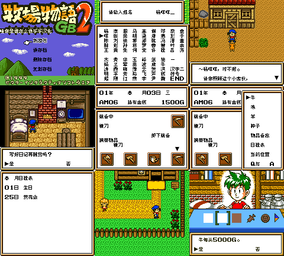

# 牧场物语GB2

原输入：Bokujou Monogatari GB2 (Japan)

原输入完整SHA256：`9db8a6fbdbd9492a03fa66b1cb0635a35070d21c2d3f4a6878aac2dfeceeb9fe`。此处“原输入”保留改版、既有汉化或地区修订身份，不一律称干净零售ROM。

| 字号 | 当前版本 | 音频 | 输出完整SHA256 |
| --- | --- | --- | --- |
| 8px | v0.1.0 | unchanged | `8d0fe69eec6fbe7c9984289636879c2e99dd1ac6d4dd4496bac2f6a8de2a3b2e` |

## 源码与补丁

- 8px／v0.1.0／unchanged：完整修改源码：[下载](https://github.com/shiyi1133/youxi-hanhua-releases/releases/download/source-migration-20261022/bokujou-monogatari-gb2-current-source-20af383c88c7-public-r02.zip)（ZIP SHA256 `02347011e9c2e07ea2efc9f2c0d7a35c630b458a9453a4b23df861cb83a46b77`）；补丁：[下载](https://github.com/shiyi1133/youxi-hanhua-releases/releases/download/patch-migration-20261022/bokujou-monogatari-gb2-current-patches.zip)（ZIP SHA256 `afb133d504acd7eb6ae31c4f77e37671f68a36b04d412b0e69f88909da58b5d4`）。

补丁须直接应用于完整SHA一致的实际原输入；普通字、大字和音乐变体分别核对。公开源码归档不表示本轮重新构建或通过新的运行验收。原作、字体、已有翻译及工具依赖的权利与许可，依各包对应许可保留。

## 范围与验证边界

- 8px／v0.1.0：普通原生8×8 Fusion Pixel；无10px版。
  普通原生8px限定测试版：包内1505条已提取指针记录有译文，涉及已识别剧情、菜单、物品、动物／地点／节庆及若干UI文字；并非全部画面已汉化。主角与宠物中文取名、删除重输、正常保存及新进程电池冷读有作者回执；维护仅静态核验，未重跑游戏或构建。
  仅普通8px，无10px大字。牛取名及称呼仅诊断首购条件测试；牛保存冷读、羊马／出生等其它命名字段、全剧情三年结局、全部最长变量／四季／交易／建造／节庆／通信／实机未验。九格第4格日记和第8、9格村庄／商店实际回执含同ROM状态恢复（后两格另有旧候选电池），不能称全部自然开机。备份原电池，日文姓名可能按中文别名字显示，不保证原版或未来／任意旧档兼容。

本次资料搬运未新增模拟器、实机或全通验收；未记录或未测试的范围不写成通过。问题单开放只表示尚未关闭，已关闭也不单独证明全部场景都修复。

[公开反馈及问题状态](feedback.md) · [报告BUG](https://github.com/shiyi1133/youxi-hanhua-releases/issues/new?template=bug_report.md)

## 对应版本截图

牧场物语GB2 v0.1.0 普通8px最终ROM九宫格；3格自然输入、3格普通电池读档、3格同ROM状态恢复，后两格另有旧候选电池；作者有限测试，维护未运行。

图像SHA256：`0f578e7c8b0125da2d5ba262ae6c162bf6571cf200eb561d36ec3251cd142805`；绑定ROM SHA256：`8d0fe69eec6fbe7c9984289636879c2e99dd1ac6d4dd4496bac2f6a8de2a3b2e`。

