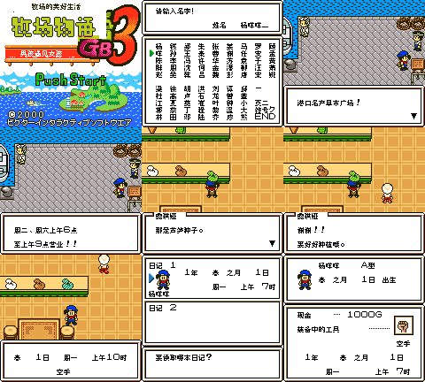

# 牧场物语GB3：男孩遇见女孩 v0.1.1（限定测试版）

[源码与补丁Release](https://github.com/shiyi1133/youxi-hanhua-releases/releases/tag/bokujou-monogatari-gb3-v0.1.1) · [公开反馈](feedback.md) · [报告BUG](https://github.com/shiyi1133/youxi-hanhua-releases/issues/new?template=bug_report.md)

原游戏／实际输入：Bokujou Monogatari GB3 - Boy Meets Girl (Japan; requester filename/header identity)

原输入完整SHA-256：`6f7453df659f9d11ac773d9d14cb9f4a5d7ef6333d2bfb5da873673fc1d4aa62`（2097152字节）。

范围：修复港口路牌共享指针别名、种子介绍内嵌名称、星期/上午下午消费者；原生普通8px限定修复测试版。

## 8px v0.1.1

字号范围：原生普通8px；无另行大字版；CGB原生彩色，非SGB验收。

目标完整SHA-256：`753a95c7c02e486da33612e6a5fb12b8ee8388d8099002b4d2aaaba2a7fc4df5`（4194304字节）。

补丁：`bokujou-monogatari-gb3-v0.1.1-8px.bps`，SHA-256 `fdede0a5021995e26225d4e3fbdc4e5d698d0bc50913d4ac2c282cfaa179b617`。

[源码（完整性未独立确认）](https://github.com/shiyi1133/youxi-hanhua-releases/releases/download/bokujou-monogatari-gb3-v0.1.1/bokujou-monogatari-gb3-v0.1.1-8px-SOURCE-public-r02.zip) · [补丁包](https://github.com/shiyi1133/youxi-hanhua-releases/releases/download/bokujou-monogatari-gb3-v0.1.1/bokujou-monogatari-gb3-v0.1.1-8px-PATCH-public.zip)

v0.1.1 原生普通8px最终ROM真实九宫格；自然/受控诊断消费者分层见说明，不作全流程/实机证明。

## 测试及限制

提供者自然路径：提供者自然按键自测：玩家/伙伴/宠物三字段中文命名、正常保存及新进程冷读；坐船港口路牌两页及10次开关、购物中心芦笋介绍购买和背包、星期一上午HUD/日记卡。

提供者诊断路径：提供者诊断：七星期×上午下午14画面，背包芜菁ID4，32个动物/命名/片尾CPU消费者；未冒称自然获得或自然结局。

保存边界：提供者自测与诊断按上述边界区分；维护未运行ROM/源码，建议先备份存档、跨版本不用即时状态。

同一实现者自测，不是独立人员QA；维护未新增ROM运行或源码重建，未宣称实机或完整通关。

- 未验证：无玩家实际ROM完整SHA或掌机整屏花屏全部触发条件；照片动物/鸡具体疑点未建立复现。
- 未验证：标题仍Push Start英文；无10px；动物/子女自然命名、全部最长变量、全剧情/结局、实机/联机未测。
- 未验证：Issue33音乐连续、80第三方鱼名、82玩法建议不在本次修复范围。
- 核对补丁还原、资产完整SHA和截图字节不等于全部游戏功能验收。

