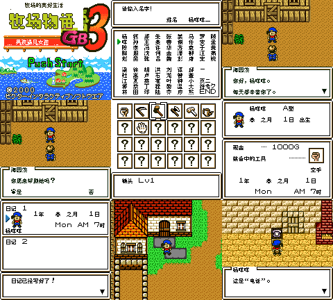

# 牧场物语GB3：男孩遇见女孩

原输入：Bokujou Monogatari GB3 - Boy Meets Girl (Japan; requester filename/header identity)

原输入完整SHA256：`6f7453df659f9d11ac773d9d14cb9f4a5d7ef6333d2bfb5da873673fc1d4aa62`。此处“原输入”保留改版、既有汉化或地区修订身份，不一律称干净零售ROM。

| 字号 | 当前版本 | 音频 | 输出完整SHA256 |
| --- | --- | --- | --- |
| 8px | v0.1.0 | unchanged | `3eb0202d1a90c5617b22f78e8f6e2e42ed2eff908ff0305b319e633c329ea012` |

## 源码与补丁

- 8px／v0.1.0／unchanged：完整修改源码：[下载](https://github.com/shiyi1133/youxi-hanhua-releases/releases/download/source-migration-20261022/bokujou-monogatari-gb3-current-source-9bd7130ca7b1-public-r02.zip)（ZIP SHA256 `aa7950c58544daaee74cbb393fb04e78ba69d8aa4493478b00d2f33b06d7eed9`）；补丁：[下载](https://github.com/shiyi1133/youxi-hanhua-releases/releases/download/patch-migration-20261022/bokujou-monogatari-gb3-current-patches.zip)（ZIP SHA256 `f0a5606fb609b61ffdb1287469ac7fbedad581856dd2c09e02d7297ad1144336`）。

补丁须直接应用于完整SHA一致的实际原输入；普通字、大字和音乐变体分别核对。公开源码归档不表示本轮重新构建或通过新的运行验收。原作、字体、已有翻译及工具依赖的权利与许可，依各包对应许可保留。

## 范围与验证边界

- 8px／v0.1.0：原生Fusion Pixel 8px；10px尚未实现，不交付大字。。
  原生Fusion Pixel普通8px限定测试版：提供方1705条已识别索引译文、12条片尾职务、18条动物状态/种类及37个人物标签；计数不是全剧情可达证明。主角、伙伴、宠物三设置字段有杨咩咩/陈胖胖、重复、删除重输、四字容量和电池新进程冷读的提供方记录。九宫格5格自然控制路线、1格电池冷读、3格同ROM状态恢复续行；维护只静态核验、BPS还原与原帧像素对照，未运行游戏或源码。
  只有原生8px，真10px安全tile/显存分配尚未实现，未交付大字；CGB专用，无原生SGB，DMG仅警告不可玩。
86条未证实可达调试/编辑记录、9条疑似非文本表尾保留；29条原作者/公司署名保留，不能称全ROM穷尽汉化。
两套姓名profile沿同一初始按键路线，不作为男女主角各一套通过；另一性别完整自然路线/保存冷读没有独立证据。
动物购买/出生、两个子女字段的自然输入/保存冷读、全部最长变量、所有深层剧情/婚姻/自然结局片尾、联机/实机未验。
18种状态/动物文字、注入动物姓名和12个片尾职务是CPU/VRAM诊断，不是自然购买、动物取名或自然通关证据。
九宫格第5/8/9格实际同ROM状态恢复、第6格电池冷读；第7格是写日记完成提示。提供方自然/电池/状态来源分层，不称全九格自然开局。
旧原版/其它汉化电池姓名显示兼容未保证，先备份原存档；跨版本不要使用即时状态。
既有反馈地图切换BGM连续播放需求仍待调查，本版没有该问题已修或已复现的验收证明。
提供方自测不等同独立人员QA；维护未运行源码、ROM或模拟器，未独立重建，未上传Source/存档/状态/混包。

本次资料搬运未新增模拟器、实机或全通验收；未记录或未测试的范围不写成通过。问题单开放只表示尚未关闭，已关闭也不单独证明全部场景都修复。

[公开反馈及问题状态](feedback.md) · [报告BUG](https://github.com/shiyi1133/youxi-hanhua-releases/issues/new?template=bug_report.md)

## 对应版本截图

牧场物语GB3 v0.1.0 普通8px最终ROM九宫格：5格提供方自然控制、1格原生电池冷读、3格同ROM状态恢复；维护只看图/静态核验，非全流程。

图像SHA256：`513f0fb24c316a95b9517a7d972019c852dfc4ecb98d9613cf5a7f2a21b6bded`；绑定ROM SHA256：`3eb0202d1a90c5617b22f78e8f6e2e42ed2eff908ff0305b319e633c329ea012`。

