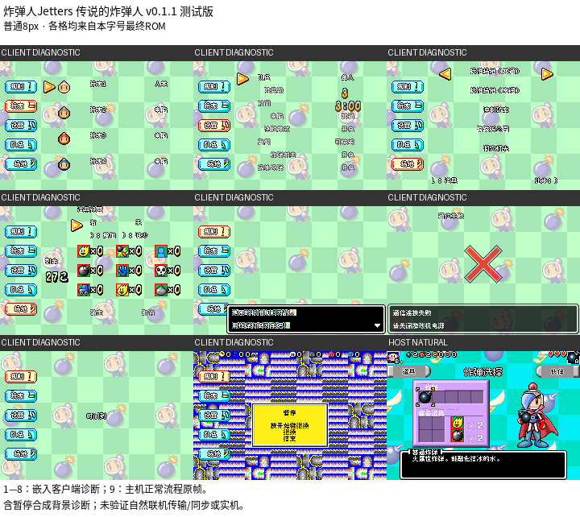

# 炸弹人Jetters 传说的炸弹人

原输入：Bomberman Jetters - Densetsu no Bomberman (Japan)

原输入完整SHA256：`8627870dbe38e1fbc732ae9e07005000790687a766311e49a09d07cdf1734b5f`。此处“原输入”保留改版、既有汉化或地区修订身份，不一律称干净零售ROM。

| 字号 | 当前版本 | 音频 | 输出完整SHA256 |
| --- | --- | --- | --- |
| 8px | v0.1.1 | unchanged | `a565eaa10f47618afaa1b31ca0638542ba0489e212b6784fd355898cb9e27513` |

## 源码与补丁

- 8px／v0.1.1／unchanged：源码包（完整性未独立确认）：[下载](https://github.com/shiyi1133/youxi-hanhua-releases/releases/download/source-migration-20261022-02a/bomberman-jetters-current-source-d2c57a56a13b-public-r01.zip)（ZIP SHA256 `d517fa7042db38f9b5cf8cc360810bc5f85d25c195908fd8c83bdf489e656b17`）；补丁：[下载](https://github.com/shiyi1133/youxi-hanhua-releases/releases/download/patch-migration-20261022/bomberman-jetters-current-patches.zip)（ZIP SHA256 `b1c156375354f5cdcd957bc3b751cb07c429265ccaaa705663da3cdb49f2be6b`）。
  该包已核对对应版本与字节安全；完整修改源码覆盖范围未独立确认。

补丁须直接应用于完整SHA一致的实际原输入；普通字、大字和音乐变体分别核对。公开源码归档不表示本轮重新构建或通过新的运行验收。原作、字体、已有翻译及工具依赖的权利与许可，依各包对应许可保留。

## 范围与验证边界

- 8px／v0.1.1：普通8px；客户端受控入口分层验证，不等于自然联机。。
  继承主机汉化；本版修订嵌入multiboot客户端菜单/帮助、连接失败、暂停及部分OBJ文字。
  提供方主机新档/冷读/CPU战有限自然路线；7个client菜单/5组帮助首页、连接失败、synthetic暂停背景及OBJ关键帧均诊断。
  自然multiboot传输、多人客户端同步、完整client比赛、全部动画、真实串口帮助翻页/重试与实机未测。

本次资料搬运未新增模拟器、实机或全通验收；未记录或未测试的范围不写成通过。问题单开放只表示尚未关闭，已关闭也不单独证明全部场景都修复。

[公开反馈及问题状态](feedback.md) · [报告BUG](https://github.com/shiyi1133/youxi-hanhua-releases/issues/new?template=bug_report.md)

## 对应版本截图

炸弹人Jetters 传说的炸弹人 v0.1.1 8px；普通8px；客户端受控入口分层验证，不等于自然联机。 1—8：嵌入客户端诊断；9：主机正常流程原帧。 含暂停合成背景诊断；未验证自然联机传输/同步或实机。

图像SHA256：`0d74fff95283364493a7adc57642f51480e6e98f038657532a4e2a89177b50d3`；绑定ROM SHA256：`a565eaa10f47618afaa1b31ca0638542ba0489e212b6784fd355898cb9e27513`。

