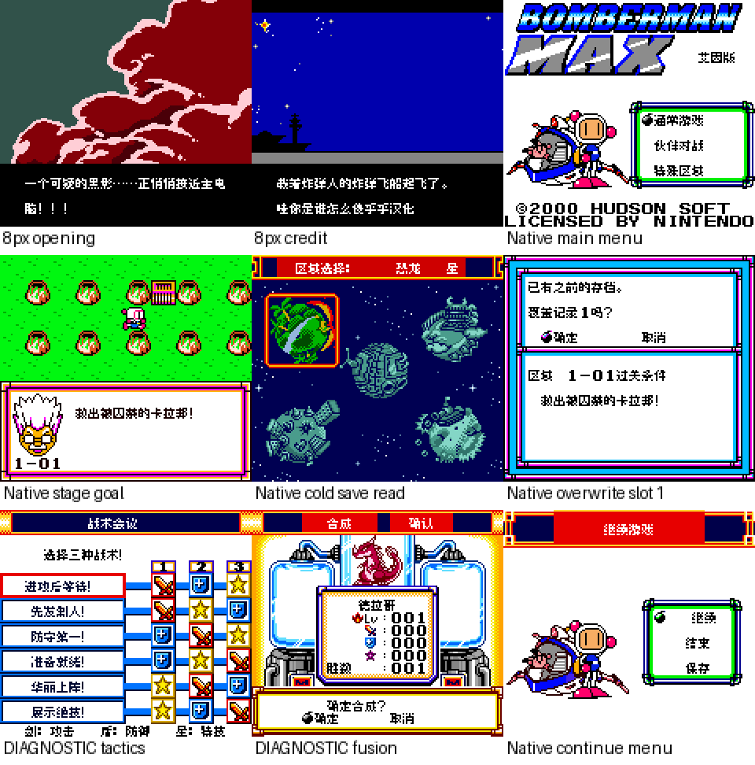
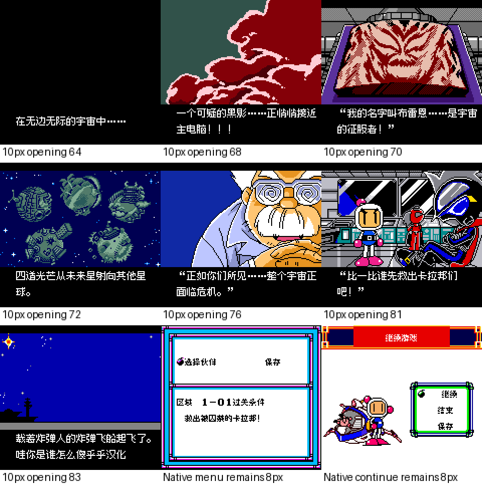

# 炸弹人MAX艾因版

原输入：Bomberman Max - Ain Version

原输入完整SHA256：`41529aff78a11f826824abe2a9b0646c0fa9196f8c8df1aaee6d6d161159eac7`。此处“原输入”保留改版、既有汉化或地区修订身份，不一律称干净零售ROM。

| 字号 | 当前版本 | 音频 | 输出完整SHA256 |
| --- | --- | --- | --- |
| 8px | v0.1.0 | unchanged | `856b10ab53d215ae6863486f28ed5f768450905746379ac80de5e13cb9486a91` |
| opening10px | v0.1.0 | unchanged | `ff474d5643327ba2e1bba3c5a15fae7f76dccb66820bbddf4afec751b468d954` |

## 源码与补丁

- 8px／v0.1.0／unchanged：完整修改源码：[下载](https://github.com/shiyi1133/youxi-hanhua-releases/releases/download/source-migration-20261022/bomberman-max-ain-current-source-7d8ea73bd61c-public-r02.zip)（ZIP SHA256 `c87b46eeefd4137d3245733337c41bd3f7ce7999d235b063c9b9387aa0b73e38`）；补丁：[下载](https://github.com/shiyi1133/youxi-hanhua-releases/releases/download/patch-migration-20261022/bomberman-max-ain-current-patches.zip)（ZIP SHA256 `3408900ba786aeff86f7fc88b937f67f78f05643ecd2fda481b84d88e2f9b2c4`）。
- opening10px／v0.1.0／unchanged：完整修改源码：[下载](https://github.com/shiyi1133/youxi-hanhua-releases/releases/download/source-migration-20261022/bomberman-max-ain-current-source-7d8ea73bd61c-public-r02.zip)（ZIP SHA256 `c87b46eeefd4137d3245733337c41bd3f7ce7999d235b063c9b9387aa0b73e38`）；补丁：[下载](https://github.com/shiyi1133/youxi-hanhua-releases/releases/download/patch-migration-20261022/bomberman-max-ain-current-patches.zip)（ZIP SHA256 `3408900ba786aeff86f7fc88b937f67f78f05643ecd2fda481b84d88e2f9b2c4`）。

补丁须直接应用于完整SHA一致的实际原输入；普通字、大字和音乐变体分别核对。公开源码归档不表示本轮重新构建或通过新的运行验收。原作、字体、已有翻译及工具依赖的权利与许可，依各包对应许可保留。

## 范围与验证边界

- 8px／v0.1.0：普通8px / 仅开场18段10px，其余仍8px。
- opening10px／v0.1.0：普通8px / 仅开场18段10px，其余仍8px。

本次资料搬运未新增模拟器、实机或全通验收；未记录或未测试的范围不写成通过。问题单开放只表示尚未关闭，已关闭也不单独证明全部场景都修复。

[公开反馈及问题状态](feedback.md) · [报告BUG](https://github.com/shiyi1133/youxi-hanhua-releases/issues/new?template=bug_report.md)

## 对应版本截图

最终ROM真实截图；自然与诊断边界见范围回执；非SGB

图像SHA256：`08d2cdaef4bc1083baed298243385483ceb514eaf884669c8addc661e4f6f282`；绑定ROM SHA256：`856b10ab53d215ae6863486f28ed5f768450905746379ac80de5e13cb9486a91`。

最终ROM真实截图；自然与诊断边界见范围回执；非SGB

图像SHA256：`ccd254417f87f94fc8d24cd1c05349cf28204264c98cdd069b4eb8742cc0075a`；绑定ROM SHA256：`ff474d5643327ba2e1bba3c5a15fae7f76dccb66820bbddf4afec751b468d954`。

