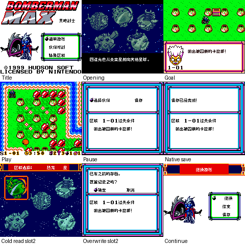
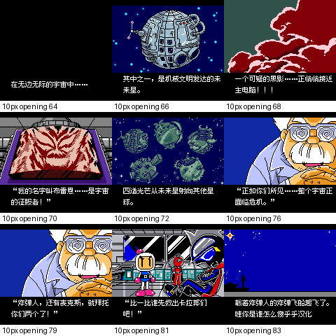

# 炸弹人MAX黑暗战士

原输入：Bomberman Max - Yami no Senshi

原输入完整SHA256：`65f2488ae1a5be5a2e0a7392e950ca1d48f4912bf0566ca29d32dd7fda8068e4`。此处“原输入”保留改版、既有汉化或地区修订身份，不一律称干净零售ROM。

| 字号 | 当前版本 | 音频 | 输出完整SHA256 |
| --- | --- | --- | --- |
| 8px | v0.1.0 | unchanged | `fcfff5686bdca53ab0f9f3d7b1eb6ee99ac7e639b981bd112f041d7093184cd4` |
| opening10px | v0.1.0 | unchanged | `fb4eccf8f6489ffa5ac19b8af91de5516c7b78820f1c38c2f9cf677db591bbcc` |

## 源码与补丁

- 8px／v0.1.0／unchanged：完整修改源码：[下载](https://github.com/shiyi1133/youxi-hanhua-releases/releases/download/source-migration-20261022/bomberman-max-yami-current-source-640e0863d920-public-r02.zip)（ZIP SHA256 `79ce1c3d8f0edfb90e3f3a3e51dd88e82d4836775229b3261eb4c43bb691b579`）；补丁：[下载](https://github.com/shiyi1133/youxi-hanhua-releases/releases/download/patch-migration-20261022/bomberman-max-yami-current-patches.zip)（ZIP SHA256 `0ca2cc1452a7abf65a51e35013d97451ee3982a34e8b4bf9ef96cf3a91c73a25`）。
- opening10px／v0.1.0／unchanged：完整修改源码：[下载](https://github.com/shiyi1133/youxi-hanhua-releases/releases/download/source-migration-20261022/bomberman-max-yami-current-source-640e0863d920-public-r02.zip)（ZIP SHA256 `79ce1c3d8f0edfb90e3f3a3e51dd88e82d4836775229b3261eb4c43bb691b579`）；补丁：[下载](https://github.com/shiyi1133/youxi-hanhua-releases/releases/download/patch-migration-20261022/bomberman-max-yami-current-patches.zip)（ZIP SHA256 `0ca2cc1452a7abf65a51e35013d97451ee3982a34e8b4bf9ef96cf3a91c73a25`）。

补丁须直接应用于完整SHA一致的实际原输入；普通字、大字和音乐变体分别核对。公开源码归档不表示本轮重新构建或通过新的运行验收。原作、字体、已有翻译及工具依赖的权利与许可，依各包对应许可保留。

## 范围与验证边界

- 8px／v0.1.0：普通8px / 仅开场18段10px，其余仍8px。
- opening10px／v0.1.0：普通8px / 仅开场18段10px，其余仍8px。

本次资料搬运未新增模拟器、实机或全通验收；未记录或未测试的范围不写成通过。问题单开放只表示尚未关闭，已关闭也不单独证明全部场景都修复。

[公开反馈及问题状态](feedback.md) · [报告BUG](https://github.com/shiyi1133/youxi-hanhua-releases/issues/new?template=bug_report.md)

## 对应版本截图

最终ROM真实截图；自然与诊断边界见范围回执；非SGB

图像SHA256：`35e01d242ae58859ed32dcb61f5deede756d92e61b0ab97ff386c1540b2bb2c8`；绑定ROM SHA256：`fcfff5686bdca53ab0f9f3d7b1eb6ee99ac7e639b981bd112f041d7093184cd4`。

最终ROM真实截图；自然与诊断边界见范围回执；非SGB

图像SHA256：`2f24346c18c05548a1328d6c848e61f75eb39cd6ec98ba876cf4f8bd59cac5cd`；绑定ROM SHA256：`fb4eccf8f6489ffa5ac19b8af91de5516c7b78820f1c38c2f9cf677db591bbcc`。

