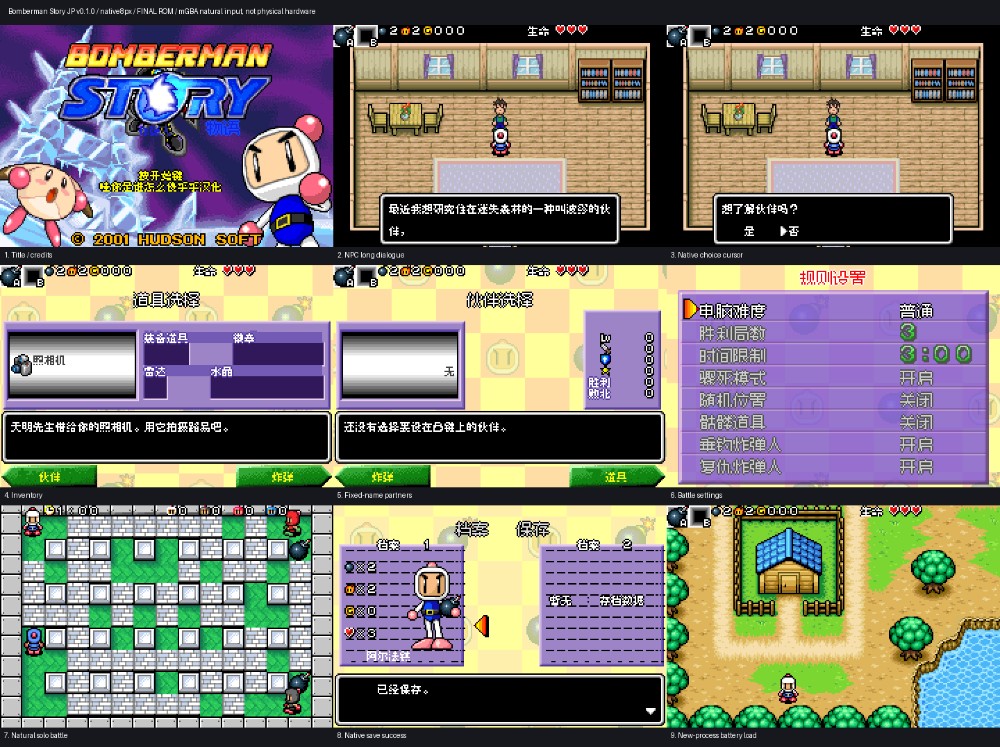

# 炸弹人物语

原输入：Bomberman Story (Japan)

原输入完整SHA256：`138df33ff85dbfdc5c0e75b2e1c091982e898f8137e1de94057df757fadc1ba8`。此处“原输入”保留改版、既有汉化或地区修订身份，不一律称干净零售ROM。

| 字号 | 当前版本 | 音频 | 输出完整SHA256 |
| --- | --- | --- | --- |
| 8px | v0.1.0 | unchanged | `2d4e24139fa4644f36b373c4d7a09764097aae8dd6622d604391999d226f23a2` |

## 源码与补丁

- 8px／v0.1.0／unchanged：完整修改源码：[下载](https://github.com/shiyi1133/youxi-hanhua-releases/releases/download/source-migration-20261022/bomberman-story-current-source-11045e20d52e-public-r02.zip)（ZIP SHA256 `81fb0f2c723baf7737d74e3eefd7e3fc9d97cd799d3286a9edcc8d3e10e0726f`）；补丁：[下载](https://github.com/shiyi1133/youxi-hanhua-releases/releases/download/patch-migration-20261022/bomberman-story-current-patches.zip)（ZIP SHA256 `d6624dce3594bd685c2f1ac9bb3672a2cf08a692a645bad44110c417b9807fb9`）。

补丁须直接应用于完整SHA一致的实际原输入；普通字、大字和音乐变体分别核对。公开源码归档不表示本轮重新构建或通过新的运行验收。原作、字体、已有翻译及工具依赖的权利与许可，依各包对应许可保留。

## 范围与验证边界

- 8px／v0.1.0：普通原生8px；无独立大字版。

本次资料搬运未新增模拟器、实机或全通验收；未记录或未测试的范围不写成通过。问题单开放只表示尚未关闭，已关闭也不单独证明全部场景都修复。

[公开反馈及问题状态](feedback.md) · [报告BUG](https://github.com/shiyi1133/youxi-hanhua-releases/issues/new?template=bug_report.md)

## 对应版本截图

最终ROM真实截图；自然与诊断边界见范围回执；非SGB

图像SHA256：`28071926f0550077d5f0d1099130b9ba7ba0afb1a6f47c8291ddb7dcf84ea24c`；绑定ROM SHA256：`2d4e24139fa4644f36b373c4d7a09764097aae8dd6622d604391999d226f23a2`。

