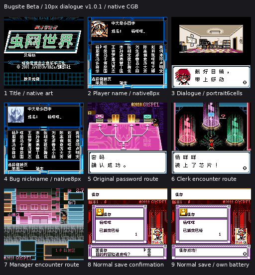
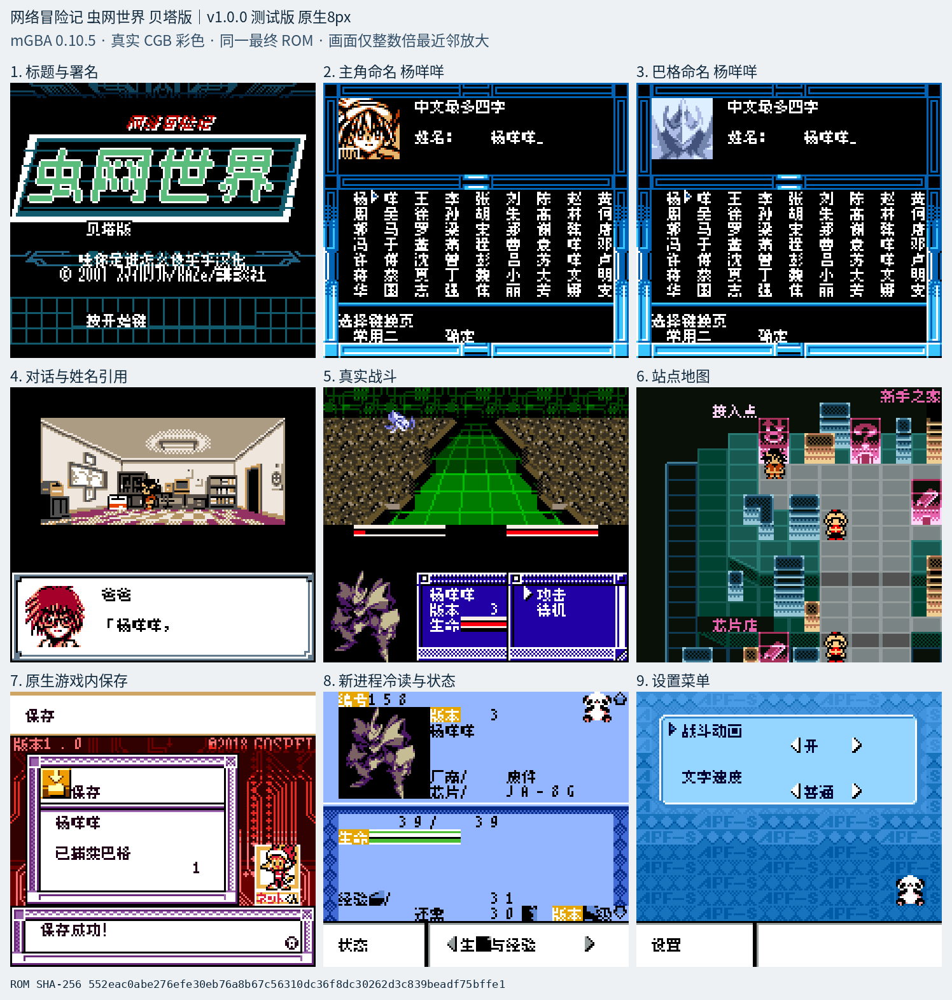

# 网络冒险记 虫网世界 贝塔版

原输入：Network Boukenki Bugsite - Beta Version (Japan)

原输入完整SHA256：`fd7b902f7c7dc0ac0ef425b17995bdb1196eda0920b0a5bbbd65b0e13b72ea50`。此处“原输入”保留改版、既有汉化或地区修订身份，不一律称干净零售ROM。

| 字号 | 当前版本 | 音频 | 输出完整SHA256 |
| --- | --- | --- | --- |
| 8px | v1.0.0测试版 | unchanged | `552eac0abe276efe30eb76a8b67c56310dc36f8dc30262d3c839beadf75bffe1` |
| 10px-dialogue | v1.0.1大字号排版限定修订测试版 | unchanged | `a6a99001a4c152da690ead867b1ddcf0588db92254a3991d3d4552d042ec01aa` |

## 源码与补丁

- 8px／v1.0.0测试版／unchanged：完整修改源码：[下载](https://github.com/shiyi1133/youxi-hanhua-releases/releases/download/source-migration-20261022/bugsite-beta-current-source-c1113e6a7564-public-r02.zip)（ZIP SHA256 `5dcb386ad77f6225b2035700486752ddaeacf5d97cf6013d92e141f330fa22c2`）；补丁：[下载](https://github.com/shiyi1133/youxi-hanhua-releases/releases/download/patch-migration-20261022/bugsite-beta-current-patches.zip)（ZIP SHA256 `0a2b3802b13def87b84b500edddaec5cc5f372303e006a9b8c0f285c2e8fede9`）。
- 10px-dialogue／v1.0.1大字号排版限定修订测试版／unchanged：完整修改源码：[下载](https://github.com/shiyi1133/youxi-hanhua-releases/releases/download/source-migration-20261022/bugsite-beta-current-source-83b7583b9083-public-r02.zip)（ZIP SHA256 `c09e6428513d7b2353b53f42a3a86c490e8d3e75bd2cc7d20cd644f6435b117c`）；补丁：[下载](https://github.com/shiyi1133/youxi-hanhua-releases/releases/download/patch-migration-20261022/bugsite-beta-current-patches.zip)（ZIP SHA256 `0a2b3802b13def87b84b500edddaec5cc5f372303e006a9b8c0f285c2e8fede9`）。

补丁须直接应用于完整SHA一致的实际原输入；普通字、大字和音乐变体分别核对。公开源码归档不表示本轮重新构建或通过新的运行验收。原作、字体、已有翻译及工具依赖的权利与许可，依各包对应许可保留。

## 范围与验证边界

- 8px／v1.0.0测试版：8px / 10px-dialogue。
- 10px-dialogue／v1.0.1大字号排版限定修订测试版：CGB标准对白真10px/16px单元；头像6格/宽框9格，菜单/姓名/特殊框8px；CGB专用。

本次资料搬运未新增模拟器、实机或全通验收；未记录或未测试的范围不写成通过。问题单开放只表示尚未关闭，已关闭也不单独证明全部场景都修复。

[公开反馈及问题状态](feedback.md) · [报告BUG](https://github.com/shiyi1133/youxi-hanhua-releases/issues/new?template=bug_report.md)

## 对应版本截图

v1.0.1实际CGB普通对白10px九宫格；菜单/姓名原生8px；原生操作和自建保存，非实机全通

图像SHA256：`143a19764ab2bcea853eadc1c341aa2f8d7b21a2d5004d4b8537a319a8041b7e`；绑定ROM SHA256：`a6a99001a4c152da690ead867b1ddcf0588db92254a3991d3d4552d042ec01aa`。

v1.0.0测试版 · 8px · 最终ROM对应模拟器截图

图像SHA256：`31827d77341d21e94d939a6521976bf6905445dd43493c89b06f846b2ddc9574`；绑定ROM SHA256：`552eac0abe276efe30eb76a8b67c56310dc36f8dc30262d3c839beadf75bffe1`。

