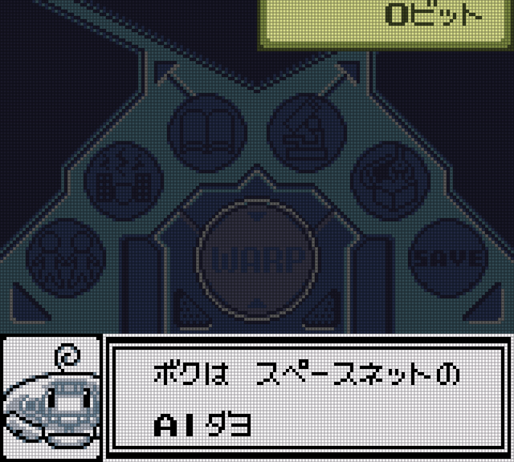
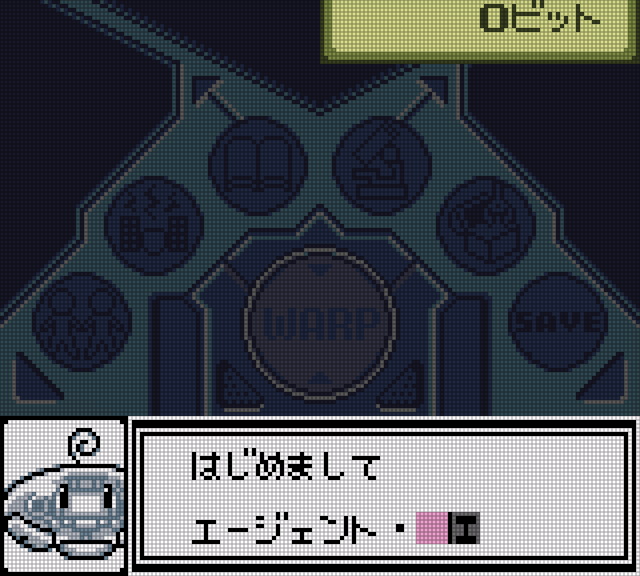

# 网络冒险记 虫网世界 贝塔版：公开反馈

以下为已公开证据摘录，不能自动当成已经复现或修复。下载／存档分享地址、本机路径或项目署名文字省略时逐条标记。

## 问题状态

当前导出未取得可关联的正式问题单；这不表示已完成全面测试。

问题单开放不等于正在修复；关闭不自动代表所有报告症状全部验收。玩家实际ROM SHA未知时仍保留未知，当前版本的参考SHA见[游戏页面](README.md)。

## 20261024-0412 公开反馈补充

公开 BUG 入口：[提交反馈](https://github.com/shiyi1133/youxi-hanhua-releases/issues/new/choose)。

36楼 · bantuwang1 · [原回帖](https://tieba.baidu.com/p/11092365551?pid=154064536603#154064536603)

> rom：bugsite_zh_v1.0.1_10px，游戏开始不久截图这里有几段没翻译

- [覆盖反馈] 虫网世界贝塔版10px v1.0.1：开场机器人自我介绍残留日文：已记录，开放待核。

[已公开登记答复](https://tieba.baidu.com/p/11092365551?pid=154064804218#154064804218)：@bantuwang1 10px v1.0.1这两处日文对白已记录，后续排查。

除另注已实收核验的译版 ROM 外，玩家实际输入/输出 SHA 未核定。图片与通关描述仅为玩家反馈；本次没有新增维护运行复现、修复或完整流程验收。
