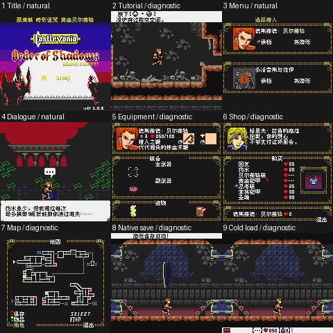

# 恶魔城：暗影诅咒 黄金贝尔蒙特 v0.1.1（限定测试版）

[源码与补丁Release](https://github.com/shiyi1133/youxi-hanhua-releases/releases/tag/castlevania-order-of-shadows-golden-belmont-v0.1.1) · [公开反馈](feedback.md) · [报告BUG](https://github.com/shiyi1133/youxi-hanhua-releases/issues/new?template=bug_report.md)

原游戏／实际输入：Castlevania OoS GBc Golden Belmont

原输入完整SHA-256：`640757eda116be779f2c3b42971ca72864c86ce4b3c3c89a5deef2cdec762c1e`（2097152字节）。

范围：v0.1.1普通8px限定测试：移除START前单个残留S；恢复5处教程↓/A图标；中文标题移到上方黑带并恢复城堡，原logo/版本/版权保留。基于用户提供同人Golden Belmont build1.0.5，非零售原版。

## 8px v0.1.1

字号范围：普通8px；用户提供GBC同人/自制Golden Belmont基底，中文槽和已定位共享图像；无独立大字或SGB。

目标完整SHA-256：`52b64df33cb2aca9c853fbe8e156b1303dbd238b6ed323c87720d60caf56a494`（2097152字节）。

补丁：`CastlevaniaOoS_GoldenBelmont_zh_v0.1.1_8px.bps`，SHA-256 `b8b6a42440e91624282a567c9ccdbc9c1a6ab8b769cd962ccb400871154a2367`。

[源码（完整性未独立确认）](https://github.com/shiyi1133/youxi-hanhua-releases/releases/download/castlevania-order-of-shadows-golden-belmont-v0.1.1/castlevania-order-of-shadows-golden-belmont-v0.1.1-8px-SOURCE-public.zip) · [补丁包](https://github.com/shiyi1133/youxi-hanhua-releases/releases/download/castlevania-order-of-shadows-golden-belmont-v0.1.1/castlevania-order-of-shadows-golden-belmont-v0.1.1-8px-PATCH.zip)

提供方：自然标题、前期移动攻击受伤死亡、对话及菜单；不包含自然到达保存点的证明。 提供方19项有界自测、672入口/402120像素诊断；房间/坐标设置后的教程、装备、商店、地图、保存与冷读为诊断场景。 九宫格逐格与提供方最终ROM原生帧像素一致。

## 测试及限制

提供者自然路径：提供方：自然标题、前期移动攻击受伤死亡、对话及菜单；不包含自然到达保存点的证明。

提供者诊断路径：提供方19项有界自测、672入口/402120像素诊断；房间/坐标设置后的教程、装备、商店、地图、保存与冷读为诊断场景。

保存边界：提供方诊断房间/坐标后原生保存与新进程电池冷读；不是自然解锁保存点或自然全流程。

同一实现者自测，不是独立人员QA；维护未新增ROM运行或源码重建，未宣称实机或完整通关。

- 未验证：未自然到达保存点；全剧情/支线/全地图、全部变量、实机、GB打印机未验。
- 未验证：原作者完整GB Studio项目不在包内；本包是对应中文改版的重建工程，不冒称上游完整原作工程。
- 未验证：中文槽替代原英语；其它三语言正文保留。玩家所用ROM的完整SHA未知。
- 核对补丁还原、资产完整SHA和截图字节不等于全部游戏功能验收。

