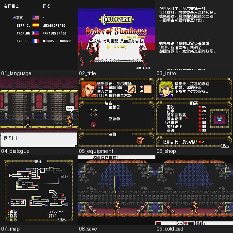

# 恶魔城：暗影诅咒 黄金贝尔蒙特

原输入：Castlevania OoS GBc Golden Belmont

原输入完整SHA256：`640757eda116be779f2c3b42971ca72864c86ce4b3c3c89a5deef2cdec762c1e`。此处“原输入”保留改版、既有汉化或地区修订身份，不一律称干净零售ROM。

| 字号 | 当前版本 | 音频 | 输出完整SHA256 |
| --- | --- | --- | --- |
| 8px | v0.1.0 | unchanged | `5b5e9a96e6d1ff65b7e69729e21bd7d3efa6f31a524623f60f0f8de4f01d7818` |

## 源码与补丁

- 8px／v0.1.0／unchanged：源码包（完整性未独立确认）：[下载](https://github.com/shiyi1133/youxi-hanhua-releases/releases/download/source-migration-20261022-02a/castlevania-order-of-shadows-golden-belmont-current-source-154e22378317-public-r01.zip)（ZIP SHA256 `f7c36c32101c5427a156eab897f348ff51edeecaeec624cf8546a24f7285a56e`）；补丁：[下载](https://github.com/shiyi1133/youxi-hanhua-releases/releases/download/patch-migration-20261022/castlevania-order-of-shadows-golden-belmont-current-patches.zip)（ZIP SHA256 `35359b486a728a618a95d0d329611cf756272ddb2d04fafe0183a7544562cba9`）。
  该包已核对对应版本与字节安全；完整修改源码覆盖范围未独立确认。

补丁须直接应用于完整SHA一致的实际原输入；普通字、大字和音乐变体分别核对。公开源码归档不表示本轮重新构建或通过新的运行验收。原作、字体、已有翻译及工具依赖的权利与许可，依各包对应许可保留。

## 范围与验证边界

- 8px／v0.1.0：普通8px；用户提供GBC同人/自制Golden Belmont基底，中文槽和已定位共享图像；无独立大字或SGB。。
  普通8px；用户提供GBC同人/自制Golden Belmont基底，中文槽和已定位共享图像；无独立大字或SGB。
  未自然到达保存点；诊断原生保存冷读不是自然解锁证明。
  全流程/支线/第二角色长线、全部动态变量/敌人、实机/打印机未验；原作者未提供GB Studio工程不冒称包含。

本次资料搬运未新增模拟器、实机或全通验收；未记录或未测试的范围不写成通过。问题单开放只表示尚未关闭，已关闭也不单独证明全部场景都修复。

[公开反馈及问题状态](feedback.md) · [报告BUG](https://github.com/shiyi1133/youxi-hanhua-releases/issues/new?template=bug_report.md)

## 对应版本截图

v0.1.0 普通8px；用户提供GBC同人/自制Golden Belmont基底，中文槽和已定位共享图像；无独立大字或SGB。 音频：unchanged；九宫格含自然与场景切换诊断；原生帧与保存诊断按提供方记录标明。

图像SHA256：`a77214257d6b6e6be782433f4f04bfc6ac6e5f105624da23525d3221d63e202b`；绑定ROM SHA256：`5b5e9a96e6d1ff65b7e69729e21bd7d3efa6f31a524623f60f0f8de4f01d7818`。

