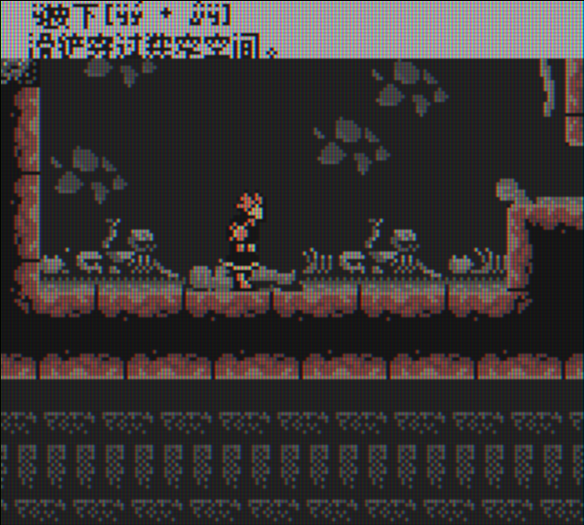
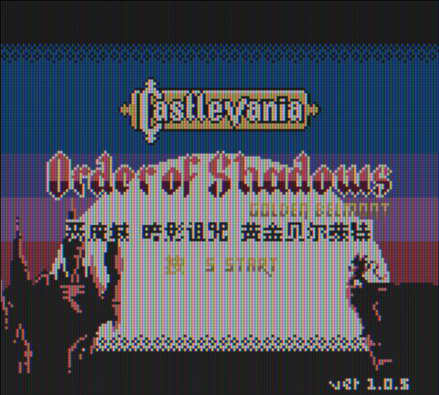

# 恶魔城：暗影诅咒 黄金贝尔蒙特：公开反馈

以下为已公开证据摘录，不能自动当成已经复现或修复。下载／存档分享地址、本机路径或项目署名文字省略时逐条标记。

## 问题状态

当前导出未取得可关联的正式问题单；这不表示已完成全面测试。

问题单开放不等于正在修复；关闭不自动代表所有报告症状全部验收。玩家实际ROM SHA未知时仍保留未知，当前版本的参考SHA见[游戏页面](README.md)。

## 20261023-0416 公开反馈补充

110楼 · 可可洛图书馆 · [原回帖](https://tieba.baidu.com/p/11092365551?pid=154060525752#154060525752)

> 主角+姐妹双模式都能正常通关，只有标题和一段教程文字有点小显示问题。已整理RA模拟器Gambatte核心的即时存档和相关反馈截图。

已省略原件/ROM/即时状态下载链接、提取码、客户端附文及本机路径；保留反馈原话，其余全文可回原楼查阅。

- [BUG待复现] 黄金贝尔蒙特：标题START前额外S样字符、蜥蜴之尾滑铲教程文字异常：开放待核；本次没有新增维护复现、修复或完整流程验收。

双模式通关为玩家证词，未升级为维护通关或实机验收；图底v1.0.5是同人基底画面版本，玩家实际汉化版本及SHA仍未知。静态纹理不能直接判为ROM损坏或根因。

[已公开答复](https://tieba.baidu.com/p/11092365551?pid=154061180057#154061180057)：@可可洛图书馆 收到主角、姐妹双模式通关反馈。你分享里的两张截图已核对，标题START前多字和蜥蜴之尾滑铲教程文字异常已记录，后续排查。

玩家实际输入/输出完整SHA保持未知；公开答复属于登记/信息回复，不是ROM新交付或修复完成通知。
