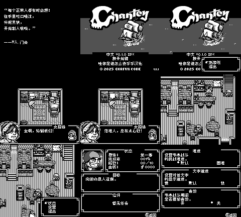

# Chantey：海盗节奏 v0.1.0（限定测试版）

[源码与补丁Release](https://github.com/shiyi1133/youxi-hanhua-releases/releases/tag/chantey-v0.1.0) · [公开反馈](feedback.md) · [报告BUG](https://github.com/shiyi1133/youxi-hanhua-releases/issues/new?template=bug_report.md)

原游戏／实际输入：Chantey (World) (v1.1).gb

原输入完整SHA-256：`8c42f44b1d7a20a29736349093f94ead6a58aa13b58337e02fc837f00765745f`（4194304字节）。

范围：World v1.1 aftermarket黑白GB基底译文及已识别图字，头地区字段不能证明日版零售身份。

## 8px v0.1.0

字号范围：普通8px；原标题艺术字不算独立大字版。无10px。

目标完整SHA-256：`38a6c56551a2f9128c0e1ef8c49cb0159963ca0f7d2a86d84d1860a5288ae2cb`（4194304字节）。

补丁：`Chantey_World_v1.1_zh_v0.1.0_8px.bps`，SHA-256 `aab53f9e5e15e38a8e9d05fbf27aa150335cdabda0d960272a0a915d8066024b`。

[源码（完整性未独立确认）](https://github.com/shiyi1133/youxi-hanhua-releases/releases/download/chantey-v0.1.0/chantey-v0.1.0-source-public-r02.zip) · [补丁包](https://github.com/shiyi1133/youxi-hanhua-releases/releases/download/chantey-v0.1.0/chantey-v0.1.0-patch.zip)

Chantey：海盗节奏 v0.1.0 8px限定测试版；普通8px；原标题艺术字不算独立大字版。无10px。 自然路径与诊断范围见测试说明，不代表全流程。

## 测试及限制

提供者自然路径：新游戏、酒馆对白、START状态和设置；九图均自然按键路径。

提供者诊断路径：节奏战斗/船员/玩家/音乐库页面为场景指针诊断，3296 CPU用例采用IE=0夹具，不能代表完整中断时序。

保存边界：没有有效进度保存冷读证明。

同一实现者自测，不是独立人员QA；维护未新增ROM运行或源码重建，未宣称实机或完整通关。

- 未验证：自然战斗胜败和商店
- 未验证：有效进度保存冷读及覆盖
- 未验证：全路线、最大变量、实机
- 核对补丁还原、资产完整SHA和截图字节不等于全部游戏功能验收。

