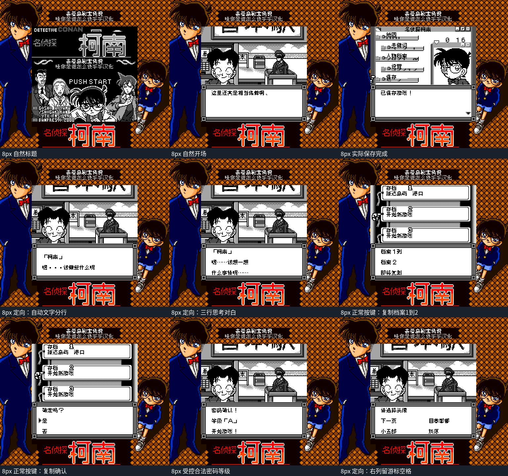

# 名侦探柯南：奇岩岛秘宝传说

原输入：Meitantei Conan - Kigantou Hihou Densetsu

原输入完整SHA256：`72b99a05d52d5e658a757ac2051f2fd6c4c2f138950ba9bbb7d27d481911e548`。此处“原输入”保留改版、既有汉化或地区修订身份，不一律称干净零售ROM。

| 字号 | 当前版本 | 音频 | 输出完整SHA256 |
| --- | --- | --- | --- |
| 8px | v1.0.3 | unchanged | `66546613be071e7f36a42f1760e12d457f5fbb1699336c66ffc47968de9021a0` |
| 10px | v1.0.3 | unchanged | `d02a528e6f5452dd593a62faf5e62d1a369b20e77e62f6c0bba372746afe0979` |

## 源码与补丁

- 8px／v1.0.3／unchanged：完整修改源码：[下载](https://github.com/shiyi1133/youxi-hanhua-releases/releases/download/source-migration-20261022/conan-island-current-source-9eddf0c6a3b1-public-r02.zip)（ZIP SHA256 `527ba4d995034605933b3fb5799ce40ad380340077a8202e0ac2d67a0b90cca3`）；补丁：[下载](https://github.com/shiyi1133/youxi-hanhua-releases/releases/download/patch-migration-20261022/conan-island-current-patches.zip)（ZIP SHA256 `31860ba5a4e1f5a6666c290330a2672f5ed3b930baaaa4168a76b797072c041f`）。
- 10px／v1.0.3／unchanged：完整修改源码：[下载](https://github.com/shiyi1133/youxi-hanhua-releases/releases/download/source-migration-20261022/conan-island-current-source-9eddf0c6a3b1-public-r02.zip)（ZIP SHA256 `527ba4d995034605933b3fb5799ce40ad380340077a8202e0ac2d67a0b90cca3`）；补丁：[下载](https://github.com/shiyi1133/youxi-hanhua-releases/releases/download/patch-migration-20261022/conan-island-current-patches.zip)（ZIP SHA256 `31860ba5a4e1f5a6666c290330a2672f5ed3b930baaaa4168a76b797072c041f`）。

补丁须直接应用于完整SHA一致的实际原输入；普通字、大字和音乐变体分别核对。公开源码归档不表示本轮重新构建或通过新的运行验收。原作、字体、已有翻译及工具依赖的权利与许可，依各包对应许可保留。

## 范围与验证边界

- 8px／v1.0.3：8px 普通版／10px 大字版。
- 10px／v1.0.3：8px 普通版／10px 大字版。

本次资料搬运未新增模拟器、实机或全通验收；未记录或未测试的范围不写成通过。问题单开放只表示尚未关闭，已关闭也不单独证明全部场景都修复。

[公开反馈及问题状态](feedback.md) · [报告BUG](https://github.com/shiyi1133/youxi-hanhua-releases/issues/new?template=bug_report.md)

## 对应版本截图

8px v1.0.3原生SGB：自然标题/开场/实际保存、纯按键复制界面；定向自动对白/密码等级/头像选项。特殊入口仍8px，非自然全剧情

图像SHA256：`8bbb2e9c56ba0d177b8564804ab3ce4e961a4f7e552703d9c4bfabccbd420b28`；绑定ROM SHA256：`66546613be071e7f36a42f1760e12d457f5fbb1699336c66ffc47968de9021a0`。

10px v1.0.3原生SGB：自然标题/开场/实际保存、纯按键复制界面；定向自动对白/密码等级/头像选项。特殊入口仍8px，非自然全剧情

图像SHA256：`4aaef7aa127febcf8faecaf5994c0b17e1f17dfa033290043a7332716c607189`；绑定ROM SHA256：`d02a528e6f5452dd593a62faf5e62d1a369b20e77e62f6c0bba372746afe0979`。

