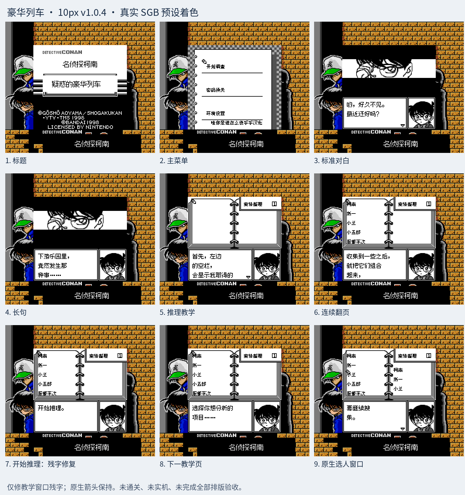
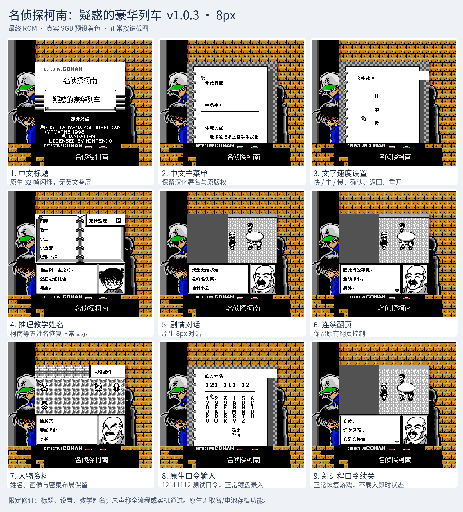

# 名侦探柯南：疑惑的豪华列车

原输入：Meitantei Conan - Giwaku no Gouka Ressha

原输入完整SHA256：`f2bc6aa3b75a69ee1d970218921fd8dec67d63231a1f8f32b6b0dbf18214e604`。此处“原输入”保留改版、既有汉化或地区修订身份，不一律称干净零售ROM。

| 字号 | 当前版本 | 音频 | 输出完整SHA256 |
| --- | --- | --- | --- |
| 8px | v1.0.3 | unchanged | `539afdded9e89e0fdd0076f23cb99db768215ea016bad3835b5fe67379d9c70c` |
| 10px | v1.0.4 | unchanged | `d48608ec1bea379180aa56361b7a4a55eadbd34db95ff8e8a3c3b15e6efe2828` |

## 源码与补丁

- 8px／v1.0.3／unchanged：完整修改源码：[下载](https://github.com/shiyi1133/youxi-hanhua-releases/releases/download/source-migration-20261022/conan-train-current-source-46532c456653-public-r02.zip)（ZIP SHA256 `bb5b1fbd3ece4617093ca1a6592cad4f0ab1fcd6e22cb7f16c35121ff296f45d`）；补丁：[下载](https://github.com/shiyi1133/youxi-hanhua-releases/releases/download/patch-migration-20261022/conan-train-current-patches.zip)（ZIP SHA256 `2152f4743830263a2a9553bd7f0078e902799216cfcdd3943dde8b3a066cbf71`）。
- 10px／v1.0.4／unchanged：完整修改源码：[下载](https://github.com/shiyi1133/youxi-hanhua-releases/releases/download/source-migration-20261022/conan-train-current-source-ad9d3805179a-public-r02.zip)（ZIP SHA256 `8d71d794fae4f79d791640bc1f4d1ed6ec5d8e69ed31a49077208b89d921325e`）；补丁：[下载](https://github.com/shiyi1133/youxi-hanhua-releases/releases/download/patch-migration-20261022/conan-train-current-patches.zip)（ZIP SHA256 `2152f4743830263a2a9553bd7f0078e902799216cfcdd3943dde8b3a066cbf71`）。

补丁须直接应用于完整SHA一致的实际原输入；普通字、大字和音乐变体分别核对。公开源码归档不表示本轮重新构建或通过新的运行验收。原作、字体、已有翻译及工具依赖的权利与许可，依各包对应许可保留。

## 范围与验证边界

- 8px／v1.0.3：保持原生8px。
- 10px／v1.0.4：常规对白10px；菜单、密集姓名/资料及复杂窗口保持8px。

本次资料搬运未新增模拟器、实机或全通验收；未记录或未测试的范围不写成通过。问题单开放只表示尚未关闭，已关闭也不单独证明全部场景都修复。

[公开反馈及问题状态](feedback.md) · [报告BUG](https://github.com/shiyi1133/youxi-hanhua-releases/issues/new?template=bug_report.md)

## 对应版本截图

10px v1.0.4 真实SGB预设着色，教学本子残字限定修复

图像SHA256：`c3626df639c9bb634cb1c3e7fd2bd2a19d1c8cf197149c703f2823d6db3e7b1e`；绑定ROM SHA256：`d48608ec1bea379180aa56361b7a4a55eadbd34db95ff8e8a3c3b15e6efe2828`。

8px v1.0.3 真实SGB预设着色，标题/设置/教学姓名有限修复

图像SHA256：`a381c715d46abab8feaea4ced0efa6946432b90ef7cadeac088740f32a897e3e`；绑定ROM SHA256：`539afdded9e89e0fdd0076f23cb99db768215ea016bad3835b5fe67379d9c70c`。

