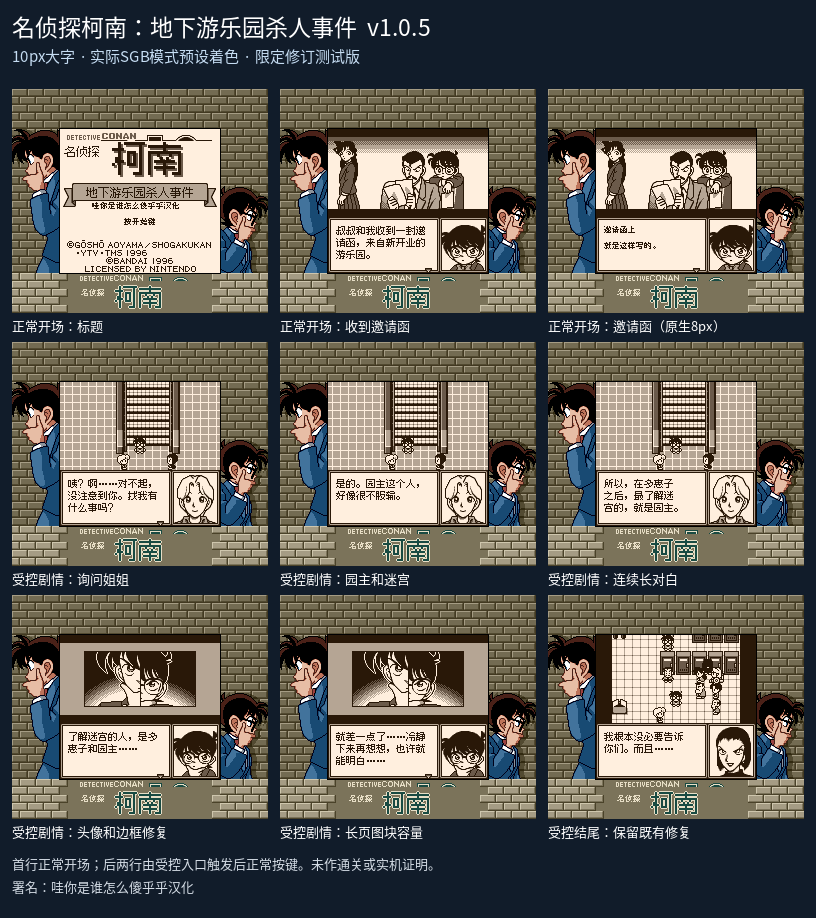

# 名侦探柯南：地下游乐园杀人事件

原输入：Meitantei Conan - Chika Yuuenchi Satsujin Jiken

原输入完整SHA256：`1d171bb6a5d3b3f0101d5581f29e1e86dcfec37bc1e9ba16a3ded4e4a11d6ac2`。此处“原输入”保留改版、既有汉化或地区修订身份，不一律称干净零售ROM。

| 字号 | 当前版本 | 音频 | 输出完整SHA256 |
| --- | --- | --- | --- |
| 8px | v1.0 | unchanged | `c2882fbf7542f0ed4b0980becf952f975a40dcf0f58ff343b7aaad5d70388e8c` |
| 10px | v1.0.5 | unchanged | `202a9d602fbe48f0f0412eb01b7268a3bd7213d70af35e47afee5a4586aba098` |

## 源码与补丁

- 8px／v1.0／unchanged：完整修改源码：[下载](https://github.com/shiyi1133/youxi-hanhua-releases/releases/download/source-migration-20261022/conan-underground-current-source-9f853beb1015-public-r02.zip)（ZIP SHA256 `74bcc1e8372fc6ca20f2b100dfd2cb0a3581ec951b01eed3c2e5ac33af4c4653`）；补丁：[下载](https://github.com/shiyi1133/youxi-hanhua-releases/releases/download/patch-migration-20261022/conan-underground-current-patches.zip)（ZIP SHA256 `dcf038de4efbe4da83389f4700b4aac5e4a0967c1b2682584e5773a7e86f71c5`）。
- 10px／v1.0.5／unchanged：完整修改源码：[下载](https://github.com/shiyi1133/youxi-hanhua-releases/releases/download/source-migration-20261022/conan-underground-current-source-343657423d72-public-r02.zip)（ZIP SHA256 `83506fdac81156daf5351c3875a662d705176fd7b5ce213853611d10f0e957de`）；补丁：[下载](https://github.com/shiyi1133/youxi-hanhua-releases/releases/download/patch-migration-20261022/conan-underground-current-patches.zip)（ZIP SHA256 `dcf038de4efbe4da83389f4700b4aac5e4a0967c1b2682584e5773a7e86f71c5`）。

补丁须直接应用于完整SHA一致的实际原输入；普通字、大字和音乐变体分别核对。公开源码归档不表示本轮重新构建或通过新的运行验收。原作、字体、已有翻译及工具依赖的权利与许可，依各包对应许可保留。

## 范围与验证边界

- 8px／v1.0：8px v1.0／10px v1.0.5限定修订测试版。
- 10px／v1.0.5：通常对白真10px保留原96×40/9×3/pitch12；已核场景17可逆51块；选项17_14、邀请函00_01/02及原密集小字仍8px；其它原生调用者待核。

本次资料搬运未新增模拟器、实机或全通验收；未记录或未测试的范围不写成通过。问题单开放只表示尚未关闭，已关闭也不单独证明全部场景都修复。

[公开反馈及问题状态](feedback.md) · [报告BUG](https://github.com/shiyi1133/youxi-hanhua-releases/issues/new?template=bug_report.md)

## 对应版本截图

10px v1.0.5实际SGB模式预设着色；首行正常开场，后两行受控剧情入口后正常按键；未冒充自然通关

图像SHA256：`2cba096fa21184fe14a2ea40591ba0eb4f7c68cffeb77506017413321eec50c9`；绑定ROM SHA256：`202a9d602fbe48f0f0412eb01b7268a3bd7213d70af35e47afee5a4586aba098`。

