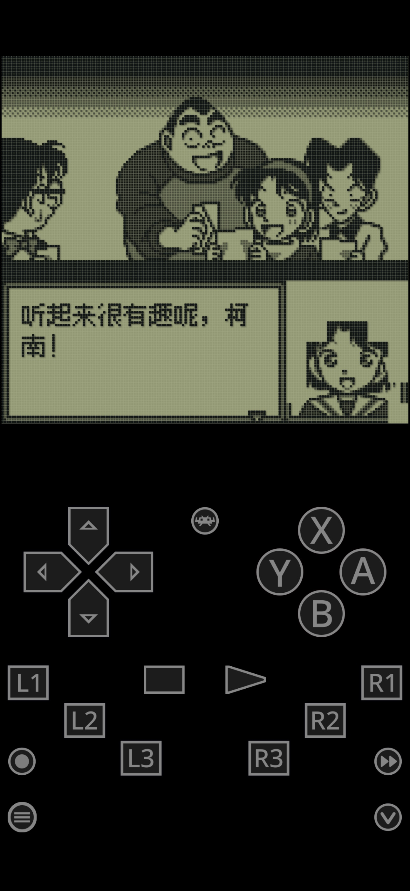
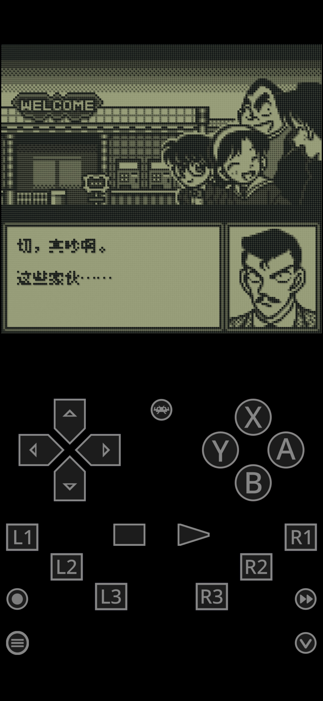
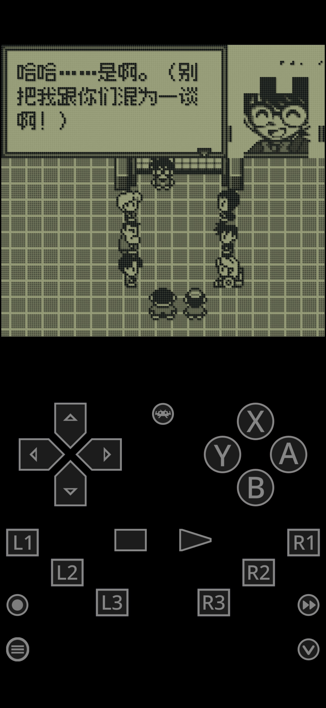
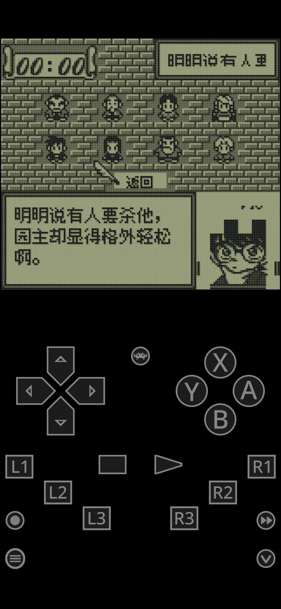
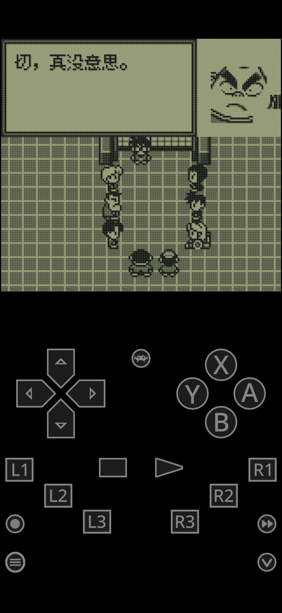

# 名侦探柯南：地下游乐园杀人事件：公开反馈

以下为已公开证据摘录，不能自动当成已经复现或修复。下载／存档分享地址、本机路径或项目署名文字省略时逐条标记。

## 154021775365

25楼 · 贴吧用户_03XKJKX · [原回帖](https://tieba.baidu.com/p/11092365551?pid=154021775365#154021775365)

> 名侦探柯南_地下游乐园杀人事件 请验收：

仅摘录公开反馈；下载／存档分享地址或本机路径已省略。

[玩家公开图片](https://tiebapic.baidu.com/forum/pic/item/1bf99122720e0cf35a40a1fd4c46f21fbf09aaa9.jpg)（玩家反馈图，不作当前最终ROM运行证明）

## 154021792505

25楼 · 贴吧用户_03XKJKX · [原回帖](https://tieba.baidu.com/p/11092365551?pid=154021792505#154021792505)

> 名侦探柯南_奇岩岛秘宝传说 请验收：

仅摘录公开反馈；下载／存档分享地址或本机路径已省略。

[玩家公开图片](https://tiebapic.baidu.com/forum/pic/item/38b2e2c4b74543a9c9ba15ca58178a82b80114ba.jpg)（玩家反馈图，不作当前最终ROM运行证明）

## 154021796153

25楼 · 贴吧用户_03XKJKX · [原回帖](https://tieba.baidu.com/p/11092365551?pid=154021796153#154021796153)

> 名侦探柯南_疑惑的豪华列车。请验收：

仅摘录公开反馈；下载／存档分享地址或本机路径已省略。

[玩家公开图片](https://tiebapic.baidu.com/forum/pic/item/a65ee9fe9925bc31bbffee9e18df8db1ca137046.jpg)（玩家反馈图，不作当前最终ROM运行证明）

## 154021797118

25楼 · 贴吧用户_03XKJKX · [原回帖](https://tieba.baidu.com/p/11092365551?pid=154021797118#154021797118)

> 可以验收了哦，三个都好了

## 154021817349

25楼 · une21 · [原回帖](https://tieba.baidu.com/p/11092365551?pid=154021817349#154021817349)

> 收到，万分万分的感激，最最崇高的敬意，终于圆梦了下下来统一测试，有问题会收集一起反馈到该楼层

## 154021866424

25楼 · 贴吧用户_03XKJKX · [原回帖](https://tieba.baidu.com/p/11092365551?pid=154021866424#154021866424)

> 我明天会更新对话大字版本（尽可能大）到网盘~你可以先看看汉化的效果~字体大小问题先忽略。

## 154022106232

25楼 · une21 · [原回帖](https://tieba.baidu.com/p/11092365551?pid=154022106232#154022106232)

> 收到，目前还是发现了一部分问题，在模拟器里截图了，明天抽空汇总上传一下

## 154022265597

25楼 · 贴吧用户_03XKJKX · [原回帖](https://tieba.baidu.com/p/11092365551?pid=154022265597#154022265597)

> 好的，哪一类问题呀？

## 154024676666

25楼 · bantuwang1 · [原回帖](https://tieba.baidu.com/p/11092365551?pid=154024676666#154024676666)

> 我试了下 豪华列车，用的寨机模拟器，每句对话刷新时，上一段文字会有一点残留，不过刚开始玩，感觉不是大问题，可以等层主一起反馈了再说。

[玩家公开图片](https://tiebapic.baidu.com/forum/pic/item/0c7d2e7f9e2f070873c7fb06af24b899a801f226.jpg)（玩家反馈图，不作当前最终ROM运行证明）

## 154024823863

25楼 · 贴吧用户_03XKJKX · [原回帖](https://tieba.baidu.com/p/11092365551?pid=154024823863#154024823863)

> @bantuwang1 《豪华列车》对白刷新后旧字残留已记录，截图也保存了，会继续排查。方便补一下你用的ROM文件名或版本，以及普通字还是大字版吗？不用重复发截图哈～

## 154024933944

25楼 · une21 · [原回帖](https://tieba.baidu.com/p/11092365551?pid=154024933944#154024933944)

> 不好意思，白天工作实在太忙，现已初步收集了一部分问题，请您查收

仅摘录公开反馈；下载／存档分享地址或本机路径已省略。

## 154024938853

25楼 · une21 · [原回帖](https://tieba.baidu.com/p/11092365551?pid=154024938853#154024938853)

> 补充一下，是测试的小字体初版，后面还没来得及用大字体测试，但压缩包里的问题应该都是通用的，建议您以大字体版本进行后续更新，小字体版看着太吃力了

## 154024985272

25楼 · 贴吧用户_03XKJKX · [原回帖](https://tieba.baidu.com/p/11092365551?pid=154024985272#154024985272)

> 我发现了AI处理大字的时候的一个批量问题，正在让它批量修复。后面会全量更新，辛苦反馈了。

## 154025035583

25楼 · une21 · [原回帖](https://tieba.baidu.com/p/11092365551?pid=154025035583#154025035583)

> 您客气了，ai大时代让更多有生之年游戏重见天日，但如果没有复古情怀+共享精神的加持，真的是不敢奢求太多

## 154025621701

25楼 · une21 · [原回帖](https://tieba.baidu.com/p/11092365551?pid=154025621701#154025621701)

> 刚刚下载了疑惑列车与地下游乐园的1.0.1大字体版，经测试，今天上传的图片压缩包里的问题，还有今晚在本楼反馈的问题均继续存在，ROM名就是这两作的大字体1.0.1版本

## 154025456656

25楼 · une21 · [原回帖](https://tieba.baidu.com/p/11092365551?pid=154025456656#154025456656)

> 刚刚重新下载了大字体版，简单玩了下疑惑的汉化列车，继续反馈个问题，游戏内的对话字体时而大时而小，且小字体下一句是大字体的时候，音乐会有卡顿

## 154025489598

25楼 · une21 · [原回帖](https://tieba.baidu.com/p/11092365551?pid=154025489598#154025489598)

> 继续报告，1，疑惑的汉化列车不光有大小字体随机切换的问题，就算是持续出现大字体也会有音乐卡顿的情况而且非常频繁。2，地下游乐园大字体版，每句话翻页时都会有花屏一闪而过，由于太快了没法截图，另外部分时候右下方画面会有如图的缺失

[玩家公开图片](https://tiebapic.baidu.com/forum/pic/item/246870310a55b319d03b507305a98226cefc1725.jpg)（玩家反馈图，不作当前最终ROM运行证明）

## 154025496511

25楼 · 贴吧用户_03XKJKX · [原回帖](https://tieba.baidu.com/p/11092365551?pid=154025496511#154025496511)

> @bantuwang1 《豪华列车》大字10px v1.0.1已更新，针对连续对白刷新后旧字残留补全了对白区域清理；普通8px仍是v1.0。有限自然对白和口令续关已检查，尚未在你那台设备上验证，其它三作的泛化反馈继续排查。附普通8px v1.0和大字10px v1.0.1各自实际SGB九宫格，大字图为预设着色；未完整通关或实机验收。大字新版已加入原网盘目录，辛苦重新下载试试～ 大字版更容易出现拖慢、刷新残留等问题，遇到请及时在这楼反馈。

[玩家公开图片](https://tiebapic.baidu.com/forum/pic/item/628fb199a9014c083317f5a34c7b02087bf4f430.jpg)（玩家反馈图，不作当前最终ROM运行证明）

[玩家公开图片](https://tiebapic.baidu.com/forum/pic/item/01b86a2762d0f703fd9e48da4efa513d2697c530.jpg)（玩家反馈图，不作当前最终ROM运行证明）

## 154025584113

25楼 · 贴吧用户_03XKJKX · [原回帖](https://tieba.baidu.com/p/11092365551?pid=154025584113#154025584113)

> @une21 音乐卡顿、翻页闪屏和缺图已记录。麻烦发一下《豪华列车》和《地下游乐园》目前的ROM文件名（含版本号）。

## 154029272038

25楼 · une21 · [原回帖](https://tieba.baidu.com/p/11092365551?pid=154029272038#154029272038)

> 第二轮测试已完成，请您查收压缩包，内含图片及问题说明，如果从技术上无法妥善处理，也只能全部调整为原版的小字体

仅摘录公开反馈；下载／存档分享地址或本机路径已省略。

## 154029311607

25楼 · une21 · [原回帖](https://tieba.baidu.com/p/11092365551?pid=154029311607#154029311607)

> @哇你是谁怎么傻乎乎 已反馈，详见网盘压缩包

## 154038716314

25楼 · ♬肚皮吸碗🎶 · [原回帖](https://tieba.baidu.com/p/11092365551?pid=154038716314#154038716314)

> 地下游园的头像经常缺块，画面还总闪烁，顶部有的字还会缺少一部分

[玩家公开图片](https://tiebapic.baidu.com/forum/pic/item/e72a890a19d8bc3e0b3829cdc48ba61ea8d34534.jpg)（玩家反馈图，不作当前最终ROM运行证明）

[玩家公开图片](https://tiebapic.baidu.com/forum/pic/item/b06c963df8dcd1006aacd726348b4710b9122f34.jpg)（玩家反馈图，不作当前最终ROM运行证明）

[玩家公开图片](https://tiebapic.baidu.com/forum/pic/item/5d23dd3f8794a4c2a313c82c48f41bd5ad6e3934.jpg)（玩家反馈图，不作当前最终ROM运行证明）

[玩家公开图片](https://tiebapic.baidu.com/forum/pic/item/3d565b66d016092440158d1c920735fae6cd3434.jpg)（玩家反馈图，不作当前最终ROM运行证明）

## 154038977448

25楼 · une21 · [原回帖](https://tieba.baidu.com/p/11092365551?pid=154038977448#154038977448)

> 地下游乐园大字体v1.0.2、奇岩岛大字体v1.0.1、豪华列车大字体v1.0.4，

## 154048566900

166楼 · 楚接舆😍 · [原回帖](https://tieba.baidu.com/p/11092365551?pid=154048566900#154048566900)

> 柯南地下游乐园，对话人物脸出现斑块缺失是BUG么？

## 154051129293

166楼 · 楚接舆😍 · [原回帖](https://tieba.baidu.com/p/11092365551?pid=154051129293#154051129293)

> 名侦探柯南_地下游乐园杀人事件_简体中文_10px大字版_v1.0.5.0A

## 问题状态

- 柯南三作反馈待补具体截图与操作；柯南第二轮：标题／头像／菜单图块和速度设置残留日文：开放；公开问题单待单独建档。
- 鬼太郎10px对白框下沿冒头、疑缺字；黑之书10px v1.0.1对白出现第二行溢出；海贼王省略号或声响描述附近文字缺失；柯南地下游乐园v1.0.2：推理摘要显示不全；柯南奇岩岛v1.0.1：玩家报告混合字号，切换现象待核；柯南豪华列车v1.0.3：对白下方笔画残留；DT：章标题字底截断、长对白快速跳末句（玩家已补v1.0.0文件名）；黑之书：10px v1.0.3第二行/文本范围排版反馈（9张截图）待复现；怪兽旅行者：大字对白姓名错位待核（实际ROM版本待补；动态姓名保留8px属当前范围）；实际左栏文字到右缘后不完整，原话称语句不通或显示不全。；合入既有反馈待复现，不另建排版重复Issue；只记录这一游戏/字号/版本范围，不宣称总批完成。；切换地图的标题被报告显示越界。；玩家要求统一战斗指令及目的地“召唤兽馆”等名称左对齐。；“学习网球知识”等模式说明要求与“查看角色等信息”统一左对齐。；8px v0.9.2默认名古比后有多空格，姓名与标点间不自然。；玩家报角色名与后续对白之间多余空字符；9图引用含1张完全相同的重复图，8张不同原图。；玩家报自定义姓名与后续对白间有多个空字符，2张原图。：开放；公开问题单待单独建档。

问题单开放不等于正在修复；关闭不自动代表所有报告症状全部验收。玩家实际ROM SHA未知时仍保留未知，当前版本的参考SHA见[游戏页面](README.md)。

## 20261023-0416 公开反馈补充

25楼 · ♬肚皮吸碗🎶 · [原回帖](https://tieba.baidu.com/p/11092365551?pid=154060592146#154060592146)

> 经测试，名侦探柯南_地下游乐园杀人事件_简体中文_10px大字版_v1.0.5 仍有部分问题。 图1是游戏开始时，右下角头像会有缺块现象，此问题贯穿始终。 图2是在游戏中随机出现的大字突然变小字。 图3是在游戏第一个场景入口处，头像不止有缺块，并且在缺块的地方有乱码。 图4是在第一个场景入口处，和周围一圈的npc对话结束后，按start键选择凶手推理选项，右上角的地点名称显示错误。 图5是在游戏第一个场景入口处，头像出现缺块时，每次对话框内容翻页，游戏画面就会闪烁一下，速度太快截不到闪烁图。

- 地下游乐园10px v1.0.5：头像缺块、混字号、推理位置异常及翻页闪屏：开放待核；本次没有新增维护复现、修复或完整流程验收。

本次仅对应地下游乐园10px v1.0.5，五张原图已登记；此前聚合记录中的待图描述不套到这份反馈或其它两款柯南。

[已公开答复](https://tieba.baidu.com/p/11092365551?pid=154061175621#154061175621)：@♬肚皮吸碗🎶 地下游乐园10px v1.0.5的头像缺块、字号切换、推理位置文字和翻页闪屏已一起记录，截图够用，后续逐项排查。

玩家实际输入/输出完整SHA保持未知；公开答复属于登记/信息回复，不是ROM新交付或修复完成通知。

## 20261025-1619 公开反馈更新

按当前实际未关闭问题去重：纯BUG 2 项，建议/覆盖等 0 项，分类待核 0 项。开放不代表正在修复。

玩家实际完整ROM字节未知时仍保留未知；自然流程、原生消费者诊断及静态证据分别记录，不外推实机或全流程。
