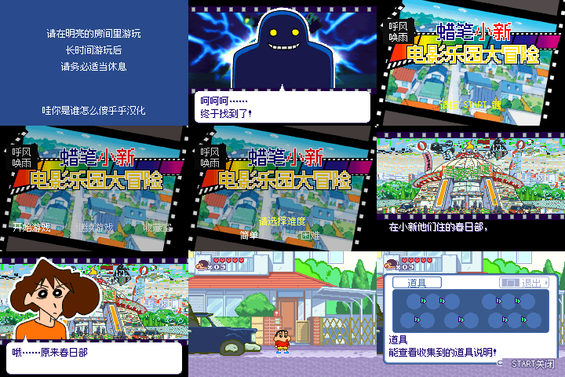

# 蜡笔小新 电影乐园大冒险

原输入：KURESHIN2004（提供原件头部标题）

原输入完整SHA256：`68398055267634e5521b79c0e5249bc7629ae2800c635b897aee66aede85770a`。此处“原输入”保留改版、既有汉化或地区修订身份，不一律称干净零售ROM。

| 字号 | 当前版本 | 音频 | 输出完整SHA256 |
| --- | --- | --- | --- |
| 12px | v0.1.0 | unchanged | `14d99ee5a66abf33ec85939560fe48f86e8bf0588ec73a431a3e7b78b5f61f9e` |

## 源码与补丁

- 12px／v0.1.0／unchanged：源码包（完整性未独立确认）：[下载](https://github.com/shiyi1133/youxi-hanhua-releases/releases/download/source-migration-20261022-04/crayon-shin-chan-cinema-land-gba-current-scope-source-public-r01.zip)（ZIP SHA256 `494ad7b025cf1f1fdc6263b6c4035571e142c75538c85651e9ab62d4b8cd811c`）；补丁：[下载](https://github.com/shiyi1133/youxi-hanhua-releases/releases/download/patch-migration-20261022/crayon-shin-chan-cinema-land-gba-current-patches.zip)（ZIP SHA256 `27e0070c7148f5fa16843b56e8dbca03dd1cbecc765c2fc173a89a23143b2f5d`）。
  该包已核对对应版本与字节安全；完整修改源码覆盖范围未独立确认。

补丁须直接应用于完整SHA一致的实际原输入；普通字、大字和音乐变体分别核对。公开源码归档不表示本轮重新构建或通过新的运行验收。原作、字体、已有翻译及工具依赖的权利与许可，依各包对应许可保留。

## 范围与验证边界

- 12px／v0.1.0：普通原尺寸12px正文，汉字12px步进；原8×16列存储，无另制大字版。。
  普通原尺寸12px正文，汉字12px步进；原8×16列存储，无另制大字版。
  自然游戏存读未达到；EEPROM仅协议诊断；少量无法识别图中微字仍保留；未全通、未验证全部后期场景或实机。

本次资料搬运未新增模拟器、实机或全通验收；未记录或未测试的范围不写成通过。问题单开放只表示尚未关闭，已关闭也不单独证明全部场景都修复。

[公开反馈及问题状态](feedback.md) · [报告BUG](https://github.com/shiyi1133/youxi-hanhua-releases/issues/new?template=bug_report.md)

## 对应版本截图

9格均为提供方报告的自然冷启动按键路线；独立原生单帧PNG未随附件提供。；对应 v0.1.0 12px 最终ROM。

图像SHA256：`39b32375393c5e549e73453684325079c2caeee7c955083a6a862a9d4229b367`；绑定ROM SHA256：`14d99ee5a66abf33ec85939560fe48f86e8bf0588ec73a431a3e7b78b5f61f9e`。

