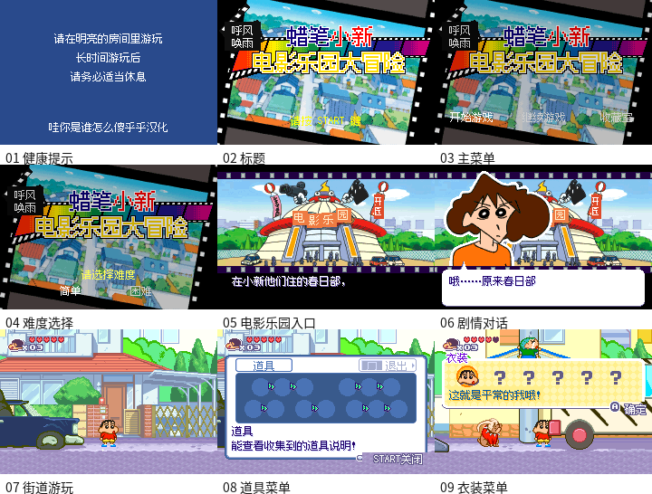

# 蜡笔小新 电影乐园大冒险 v0.1.2（限定测试版）

[源码与补丁Release](https://github.com/shiyi1133/youxi-hanhua-releases/releases/tag/crayon-shin-chan-cinema-land-gba-v0.1.2) · [公开反馈](feedback.md) · [报告BUG](https://github.com/shiyi1133/youxi-hanhua-releases/issues/new?template=bug_report.md)

原游戏／实际输入：KURESHIN2004（提供原件头部标题）

原输入完整SHA-256：`68398055267634e5521b79c0e5249bc7629ae2800c635b897aee66aede85770a`（16777216字节）。

范围：原生普通12px限定修复测试版；保留v011 VRAM LZ77和共享标签修正，v012纠正结构误当文本指针的引用并验event36。

## 12px v0.1.2

字号范围：原生普通12px；无另行大字版；GBA原生彩色。

目标完整SHA-256：`d9595f0204473f6b46c6a391ac1dac166172b9a8f53a25129c6cd8b98bd4a66b`（33554432字节）。

补丁：`CrayonCinema_zhCN_v0.1.2.bps`，SHA-256 `99cb77c40590f7006d9213014cedf1a6680c9f7f94c9dfe64920123721fd53a2`。

[源码（完整性未独立确认）](https://github.com/shiyi1133/youxi-hanhua-releases/releases/download/crayon-shin-chan-cinema-land-gba-v0.1.2/crayon-shin-chan-cinema-land-gba-v0.1.2-12px-SOURCE-public-r02.zip) · [补丁包](https://github.com/shiyi1133/youxi-hanhua-releases/releases/download/crayon-shin-chan-cinema-land-gba-v0.1.2/crayon-shin-chan-cinema-land-gba-v0.1.2-12px-PATCH-public.zip)

v0.1.2 原生普通12px最终ROM真实九宫格；自然/受控诊断消费者分层见说明，不作全流程/实机证明。

## 测试及限制

提供者自然路径：提供者自然冷启动按键：健康提示、标题、主菜单、难度、开局入口、剧情、街道、道具与衣装菜单。

提供者诊断路径：收藏数量/拥有位、46资源VRAM解压和event36原生过场选择为明确诊断；EEPROM协议测试不等于自然进度存读。

保存边界：提供者自测与诊断按上述边界区分；维护未运行ROM/源码，建议先备份存档、跨版本不用即时状态。

同一实现者自测，不是独立人员QA；维护未新增ROM运行或源码重建，未宣称实机或完整通关。

- 未验证：Issue107仅event36原生引擎诊断完成与原件对照，未证明玩家未知版本/原自然路线全部触发已解决。
- 未验证：Issue126家人菜单及底部提示自然摆放未验收；仍有open_inventory细字/附属标签未完成。
- 未验证：未自然达到进度保存/读档、全通或实机。
- 核对补丁还原、资产完整SHA和截图字节不等于全部游戏功能验收。

