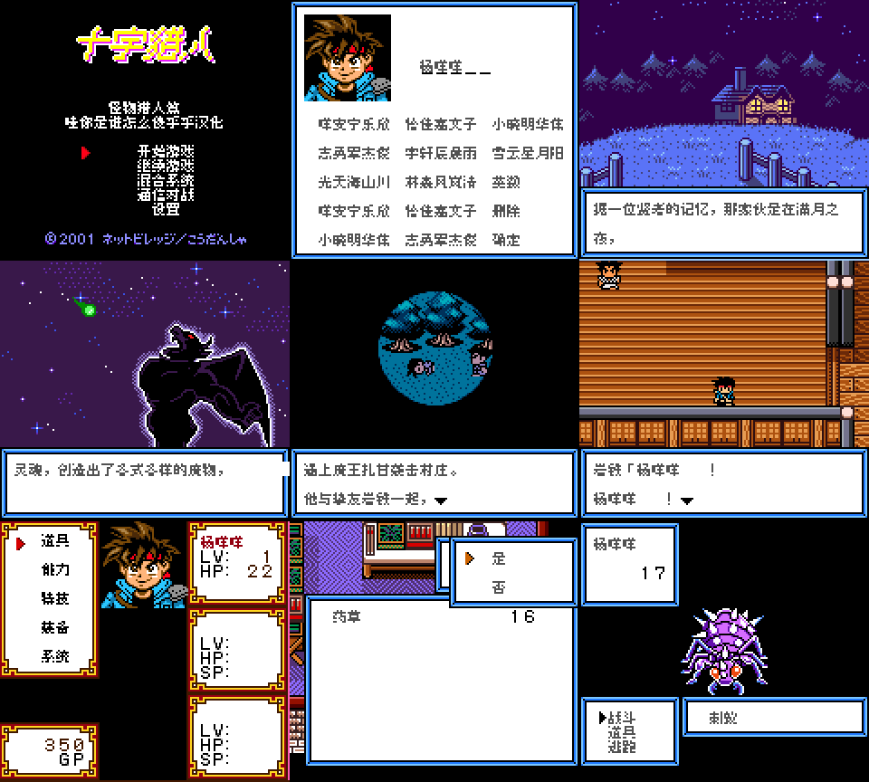
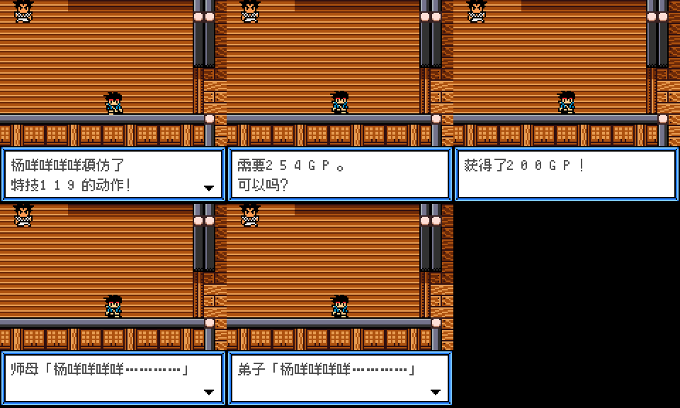
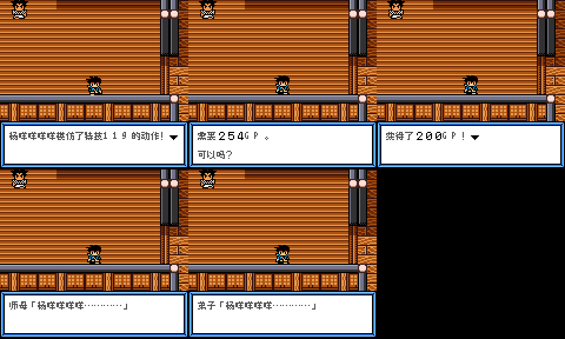
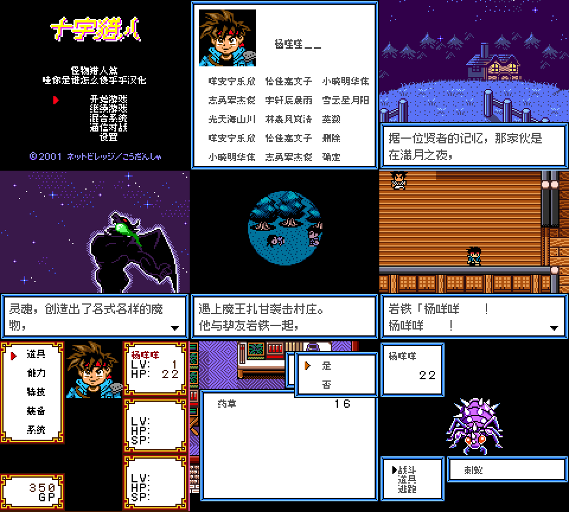

# 十字猎人：怪物猎人篇

原输入：Cross Hunter - Monster Hunter Version (Japan)

原输入完整SHA256：`332b2bb70e080baacce644de32478e712aaee4653eb8f2ce37ce36e3e9958d2b`。此处“原输入”保留改版、既有汉化或地区修订身份，不一律称干净零售ROM。

| 字号 | 当前版本 | 音频 | 输出完整SHA256 |
| --- | --- | --- | --- |
| 8px | v1.0.2普通字对白排版修订测试版 | unchanged | `5f781935034da48599048b7ea24e5d8e5c1ff7b6aef0126782137bf2532952b9` |
| 10px-dialogue | v1.0.3大字号对白排版修订测试版 | unchanged | `3751b1f58cf1ece8c0f33acfe8fd44391cda75de59a1e00c2d61d826b20e6f8d` |

## 源码与补丁

- 8px／v1.0.2普通字对白排版修订测试版／unchanged：完整修改源码：[下载](https://github.com/shiyi1133/youxi-hanhua-releases/releases/download/source-migration-20261022/cross-hunter-monster-current-source-ca56b5ec1176-public-r02.zip)（ZIP SHA256 `bc01f07cf26d8b8c87094a87d8c0ae1ca1267a4ef6d338916869ff1f339e661e`）；补丁：[下载](https://github.com/shiyi1133/youxi-hanhua-releases/releases/download/patch-migration-20261022/cross-hunter-monster-current-patches.zip)（ZIP SHA256 `b2c314a9fb8b5d31d01e99458751b72dfa7a7bb617e3017dce7a5a07ed579309`）。
- 10px-dialogue／v1.0.3大字号对白排版修订测试版／unchanged：完整修改源码：[下载](https://github.com/shiyi1133/youxi-hanhua-releases/releases/download/source-migration-20261022/cross-hunter-monster-current-source-ca56b5ec1176-public-r02.zip)（ZIP SHA256 `bc01f07cf26d8b8c87094a87d8c0ae1ca1267a4ef6d338916869ff1f339e661e`）；补丁：[下载](https://github.com/shiyi1133/youxi-hanhua-releases/releases/download/patch-migration-20261022/cross-hunter-monster-current-patches.zip)（ZIP SHA256 `b2c314a9fb8b5d31d01e99458751b72dfa7a7bb617e3017dce7a5a07ed579309`）。

补丁须直接应用于完整SHA一致的实际原输入；普通字、大字和音乐变体分别核对。公开源码归档不表示本轮重新构建或通过新的运行验收。原作、字体、已有翻译及工具依赖的权利与许可，依各包对应许可保留。

## 范围与验证边界

- 8px／v1.0.2普通字对白排版修订测试版：8px / 10px-dialogue。
- 10px-dialogue／v1.0.3大字号对白排版修订测试版：8px / 10px-dialogue。

本次资料搬运未新增模拟器、实机或全通验收；未记录或未测试的范围不写成通过。问题单开放只表示尚未关闭，已关闭也不单独证明全部场景都修复。

[公开反馈及问题状态](feedback.md) · [报告BUG](https://github.com/shiyi1133/youxi-hanhua-releases/issues/new?template=bug_report.md)

## 对应版本截图

v1.0.2普通字对白排版修订测试版 CGB 实际自然运行九宫格；菜单/取名仍8px

图像SHA256：`d59081540f26c7a3adf07feadd71fab2018bd61f967f0fb8859acb034e6a3e76`；绑定ROM SHA256：`5f781935034da48599048b7ea24e5d8e5c1ff7b6aef0126782137bf2532952b9`。

v1.0.3大字号对白排版修订测试版 CGB 5个受控变量窗口，末格空白；非原事件自然触发

图像SHA256：`ff886b763a344d988a139f9d21a4870df4ff294d6181e5782366d99b2badf232`；绑定ROM SHA256：`3751b1f58cf1ece8c0f33acfe8fd44391cda75de59a1e00c2d61d826b20e6f8d`。

v1.0.2普通字对白排版修订测试版 CGB 5个受控变量窗口，末格空白；非原事件自然触发

图像SHA256：`e9fbcb4f9659da65ee14dcac75fcef9681130400cb5990855890ea9a63ad72c3`；绑定ROM SHA256：`5f781935034da48599048b7ea24e5d8e5c1ff7b6aef0126782137bf2532952b9`。

v1.0.3大字号对白排版修订测试版 CGB 实际自然运行九宫格；菜单/取名仍8px

图像SHA256：`7b2ab924a404db3f32c36e15e4d98ba7516bc8da27b52aa71eca0ff736eacb41`；绑定ROM SHA256：`3751b1f58cf1ece8c0f33acfe8fd44391cda75de59a1e00c2d61d826b20e6f8d`。

