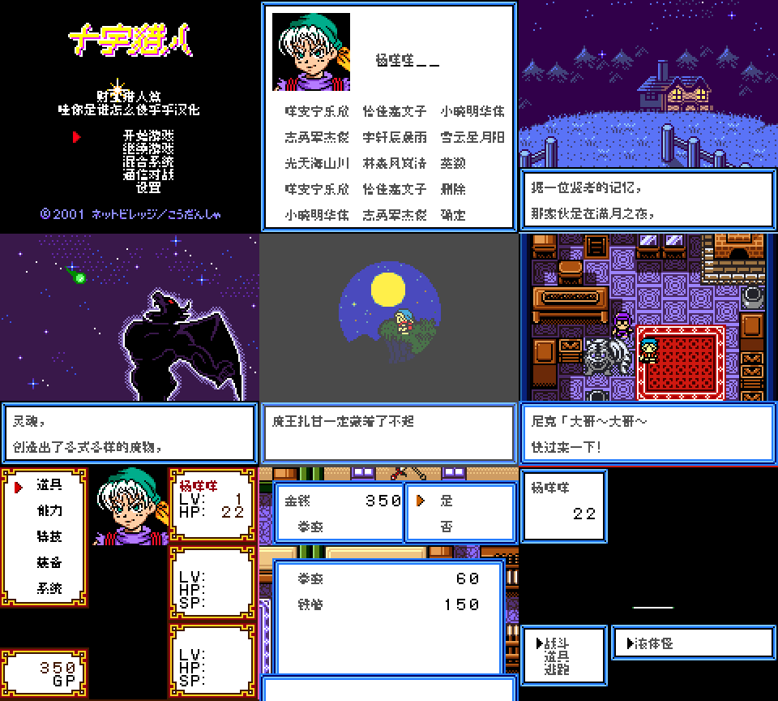
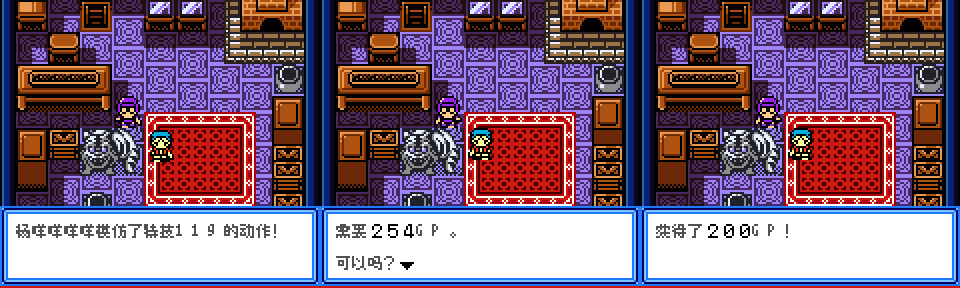
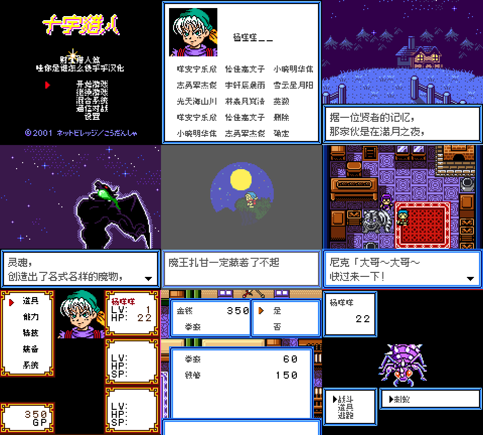
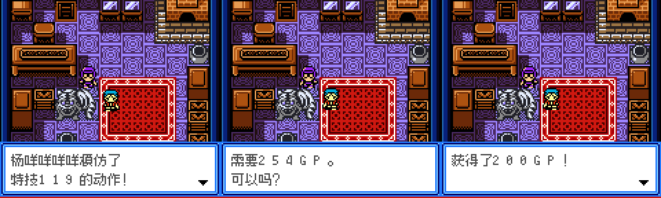

# 十字猎人：财宝猎人篇

原输入：Cross Hunter - Treasure Hunter Version (Japan)

原输入完整SHA256：`e82bde1a7832301df1c28cd14923cd0b1084d99f5e20a0e203e1713be468d55a`。此处“原输入”保留改版、既有汉化或地区修订身份，不一律称干净零售ROM。

| 字号 | 当前版本 | 音频 | 输出完整SHA256 |
| --- | --- | --- | --- |
| 8px | v1.0.4普通字全文排版限定修订测试版 | unchanged | `d21da502a17466f07acfec159f7232307a545f5cf47e1983bfac612308e43103` |
| 10px-dialogue | v1.0.5大字号全文排版限定修订测试版 | unchanged | `4c55d272ce208f9432e4b4086a403aaf65975be61e998e71ba6c787ca8cd855e` |

## 源码与补丁

- 8px／v1.0.4普通字全文排版限定修订测试版／unchanged：完整修改源码：[下载](https://github.com/shiyi1133/youxi-hanhua-releases/releases/download/source-migration-20261022/cross-hunter-treasure-current-source-c4723be5580c-public-r02.zip)（ZIP SHA256 `fcc164045c8a555208325e988e635b2c4176b54cbda78789ac31bca4775e844c`）；补丁：[下载](https://github.com/shiyi1133/youxi-hanhua-releases/releases/download/patch-migration-20261022/cross-hunter-treasure-current-patches.zip)（ZIP SHA256 `f86b84f85ef0acb32f81d24b714d63b16cb63e8e96a0795a0b2624beaa5076f7`）。
- 10px-dialogue／v1.0.5大字号全文排版限定修订测试版／unchanged：完整修改源码：[下载](https://github.com/shiyi1133/youxi-hanhua-releases/releases/download/source-migration-20261022/cross-hunter-treasure-current-source-c4723be5580c-public-r02.zip)（ZIP SHA256 `fcc164045c8a555208325e988e635b2c4176b54cbda78789ac31bca4775e844c`）；补丁：[下载](https://github.com/shiyi1133/youxi-hanhua-releases/releases/download/patch-migration-20261022/cross-hunter-treasure-current-patches.zip)（ZIP SHA256 `f86b84f85ef0acb32f81d24b714d63b16cb63e8e96a0795a0b2624beaa5076f7`）。

补丁须直接应用于完整SHA一致的实际原输入；普通字、大字和音乐变体分别核对。公开源码归档不表示本轮重新构建或通过新的运行验收。原作、字体、已有翻译及工具依赖的权利与许可，依各包对应许可保留。

## 范围与验证边界

- 8px／v1.0.4普通字全文排版限定修订测试版：8px / 10px-dialogue。
- 10px-dialogue／v1.0.5大字号全文排版限定修订测试版：8px / 10px-dialogue。

本次资料搬运未新增模拟器、实机或全通验收；未记录或未测试的范围不写成通过。问题单开放只表示尚未关闭，已关闭也不单独证明全部场景都修复。

[公开反馈及问题状态](feedback.md) · [报告BUG](https://github.com/shiyi1133/youxi-hanhua-releases/issues/new?template=bug_report.md)

## 对应版本截图

v1.0.4普通字全文排版限定修订测试版 CGB 实际自然运行九宫格；菜单/取名仍8px

图像SHA256：`4c3f1be3f6932522a20549ef94adf5adbec0f164874a6112514042ed6ce5bfb7`；绑定ROM SHA256：`d21da502a17466f07acfec159f7232307a545f5cf47e1983bfac612308e43103`。

v1.0.4普通字全文排版限定修订测试版 CGB 3个受控变量窗口；非原事件自然触发

图像SHA256：`2029d151dd53299fe70246dabbed338c5beabfd6e6401cb202257137e408adc3`；绑定ROM SHA256：`d21da502a17466f07acfec159f7232307a545f5cf47e1983bfac612308e43103`。

v1.0.5大字号全文排版限定修订测试版 CGB 实际自然运行九宫格；菜单/取名仍8px

图像SHA256：`d421dc18a23608527319bc1bc9018f36b92fdabde06f73828e009fecb2f5891a`；绑定ROM SHA256：`4c55d272ce208f9432e4b4086a403aaf65975be61e998e71ba6c787ca8cd855e`。

v1.0.5大字号全文排版限定修订测试版 CGB 3个受控变量窗口；非原事件自然触发

图像SHA256：`d4365c56a30c34f605601f7baa5646560cbe7b49f2823691a62132517ad7975d`；绑定ROM SHA256：`4c55d272ce208f9432e4b4086a403aaf65975be61e998e71ba6c787ca8cd855e`。

