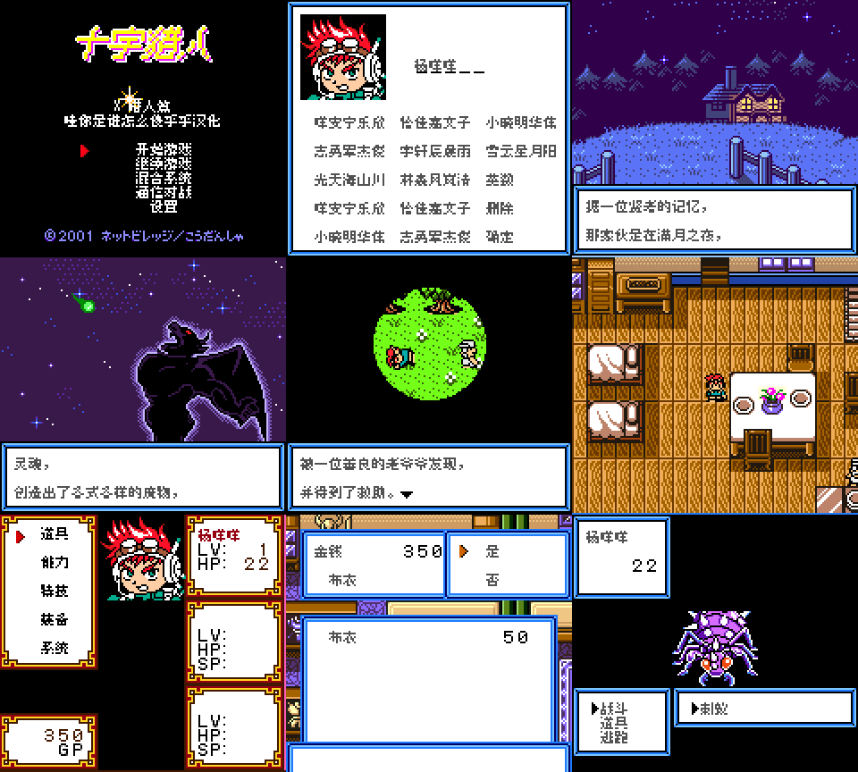
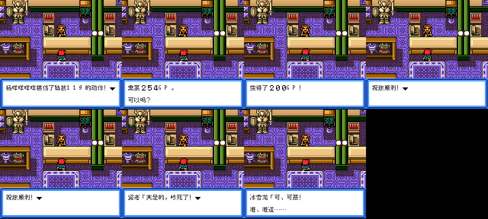
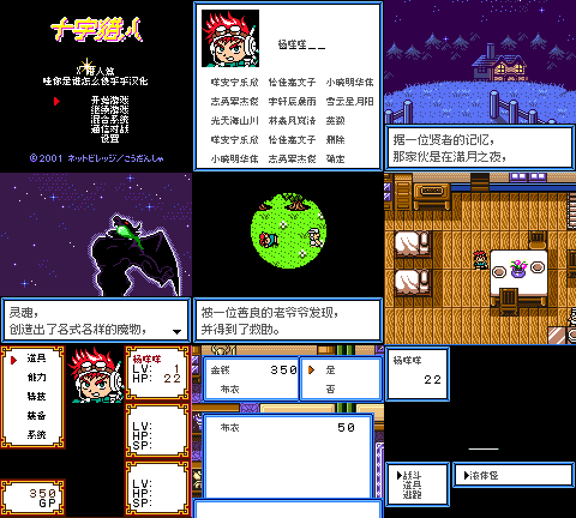
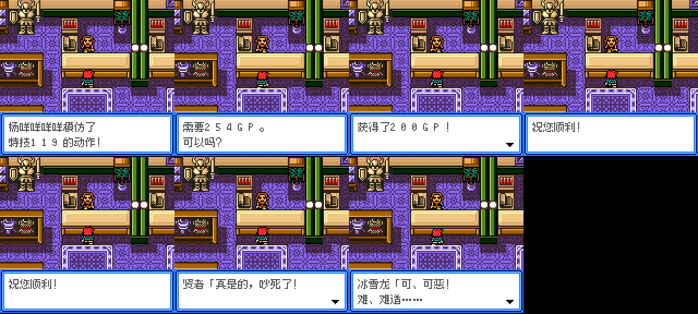

# 十字猎人：X猎人篇

原输入：Cross Hunter - X Hunter Version (Japan)

原输入完整SHA256：`af01d67235cf2c049a1bf62aa3f7c6887b8db019fead786e2f4f55f721838971`。此处“原输入”保留改版、既有汉化或地区修订身份，不一律称干净零售ROM。

| 字号 | 当前版本 | 音频 | 输出完整SHA256 |
| --- | --- | --- | --- |
| 8px | v1.0.2普通字全文排版限定修订测试版 | unchanged | `1286daaaef796c9b1a122783cf3d2f80698b083a9c7960c1ccb3f3e27beb17ef` |
| 10px-dialogue | v1.0.3大字号全文排版限定修订测试版 | unchanged | `a0fdb0dee55ade728a01d09886907aec2ccd1cedf636341c0cb6ec30cb996d7d` |

## 源码与补丁

- 8px／v1.0.2普通字全文排版限定修订测试版／unchanged：完整修改源码：[下载](https://github.com/shiyi1133/youxi-hanhua-releases/releases/download/source-migration-20261022/cross-hunter-x-current-source-45db6e435813-public-r02.zip)（ZIP SHA256 `962ebe88b48c51451bfba256a6b5da178ba68cfb6b44badb3ba3ed867ce5b6ba`）；补丁：[下载](https://github.com/shiyi1133/youxi-hanhua-releases/releases/download/patch-migration-20261022/cross-hunter-x-current-patches.zip)（ZIP SHA256 `93c5c4bd41a8dcb20013949ddc04cc6d07fed33086198fbdf9ac5eec89edebbf`）。
- 10px-dialogue／v1.0.3大字号全文排版限定修订测试版／unchanged：完整修改源码：[下载](https://github.com/shiyi1133/youxi-hanhua-releases/releases/download/source-migration-20261022/cross-hunter-x-current-source-45db6e435813-public-r02.zip)（ZIP SHA256 `962ebe88b48c51451bfba256a6b5da178ba68cfb6b44badb3ba3ed867ce5b6ba`）；补丁：[下载](https://github.com/shiyi1133/youxi-hanhua-releases/releases/download/patch-migration-20261022/cross-hunter-x-current-patches.zip)（ZIP SHA256 `93c5c4bd41a8dcb20013949ddc04cc6d07fed33086198fbdf9ac5eec89edebbf`）。

补丁须直接应用于完整SHA一致的实际原输入；普通字、大字和音乐变体分别核对。公开源码归档不表示本轮重新构建或通过新的运行验收。原作、字体、已有翻译及工具依赖的权利与许可，依各包对应许可保留。

## 范围与验证边界

- 8px／v1.0.2普通字全文排版限定修订测试版：8px / 10px-dialogue。
- 10px-dialogue／v1.0.3大字号全文排版限定修订测试版：8px / 10px-dialogue。

本次资料搬运未新增模拟器、实机或全通验收；未记录或未测试的范围不写成通过。问题单开放只表示尚未关闭，已关闭也不单独证明全部场景都修复。

[公开反馈及问题状态](feedback.md) · [报告BUG](https://github.com/shiyi1133/youxi-hanhua-releases/issues/new?template=bug_report.md)

## 对应版本截图

v1.0.2普通字全文排版限定修订测试版 CGB 实际自然运行九宫格；菜单/取名仍8px

图像SHA256：`4648e8eaf42dce7b06b2e5163b1e6b67fa52e686cb64a6db56adb7780d41ef57`；绑定ROM SHA256：`1286daaaef796c9b1a122783cf3d2f80698b083a9c7960c1ccb3f3e27beb17ef`。

v1.0.2普通字全文排版限定修订测试版 CGB 7个受控变量/最大姓名窗口，第8格留空；非原事件自然触发

图像SHA256：`1a928e6039c88dce8cf09cd579e16dcf02a08b9d651f05bab47abf5b81154cd6`；绑定ROM SHA256：`1286daaaef796c9b1a122783cf3d2f80698b083a9c7960c1ccb3f3e27beb17ef`。

v1.0.3大字号全文排版限定修订测试版 CGB 实际自然运行九宫格；菜单/取名仍8px

图像SHA256：`59866d47143baa681df6e8fe4326c321329f2c5c02affae600e537e6b959ad13`；绑定ROM SHA256：`a0fdb0dee55ade728a01d09886907aec2ccd1cedf636341c0cb6ec30cb996d7d`。

v1.0.3大字号全文排版限定修订测试版 CGB 7个受控变量/最大姓名窗口，第8格留空；非原事件自然触发

图像SHA256：`033c7c2eed27bbf27fd7e86f2b926a2ad9c9f2d1cf4fc46175fc8c5da4630961`；绑定ROM SHA256：`a0fdb0dee55ade728a01d09886907aec2ccd1cedf636341c0cb6ec30cb996d7d`。

