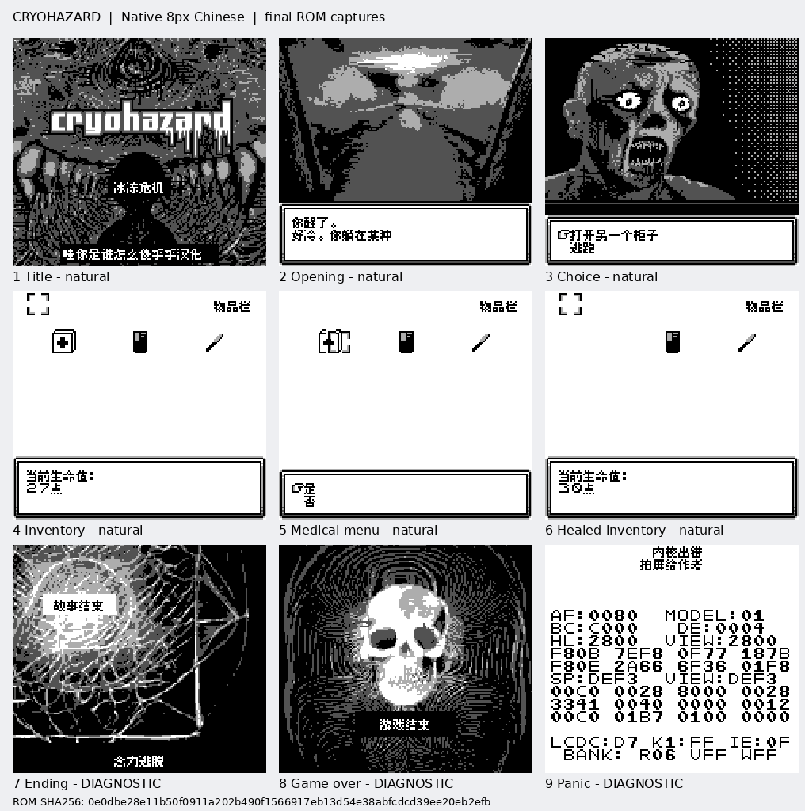

# 冰冻危机

原输入：Cryohazard

原输入完整SHA256：`7d6f512b66300934c7564f1fd4ee86619a1125eb56482c52972b5d4b025b3bc0`。此处“原输入”保留改版、既有汉化或地区修订身份，不一律称干净零售ROM。

| 字号 | 当前版本 | 音频 | 输出完整SHA256 |
| --- | --- | --- | --- |
| 8px | v0.1.0 | unchanged | `0e0dbe28e11b50f0911a202b490f1566917eb13d54e38abfcdcd39ee20eb2efb` |

## 源码与补丁

- 8px／v0.1.0／unchanged：源码包（完整性未独立确认）：[下载](https://github.com/shiyi1133/youxi-hanhua-releases/releases/download/source-migration-20261022-02a/cryohazard-current-source-905bd013a625-public-r01.zip)（ZIP SHA256 `b91f5ebe303f1677a8af934d60258f0526edc283efab9feea9be806c4c930f27`）；补丁：[下载](https://github.com/shiyi1133/youxi-hanhua-releases/releases/download/patch-migration-20261022/cryohazard-current-patches.zip)（ZIP SHA256 `3e7fcbad307597a0e29c2225fea1b10f158ccb9bd5b40588ba32b243f5b039d1`）。
  该包已核对对应版本与字节安全；完整修改源码覆盖范围未独立确认。

补丁须直接应用于完整SHA一致的实际原输入；普通字、大字和音乐变体分别核对。公开源码归档不表示本轮重新构建或通过新的运行验收。原作、字体、已有翻译及工具依赖的权利与许可，依各包对应许可保留。

## 范围与验证边界

- 8px／v0.1.0：普通原生8px，GB兼容图文版；无新增彩色/SGB增强。。
  普通原生8px，GB兼容图文版；无新增彩色/SGB增强。
  未自然全通五结局、实机、长时或独立QA；原作无玩家命名/自然保存读取，相关测试不适用。

本次资料搬运未新增模拟器、实机或全通验收；未记录或未测试的范围不写成通过。问题单开放只表示尚未关闭，已关闭也不单独证明全部场景都修复。

[公开反馈及问题状态](feedback.md) · [报告BUG](https://github.com/shiyi1133/youxi-hanhua-releases/issues/new?template=bug_report.md)

## 对应版本截图

第1–6格自然路线，第7–9格结局/Game Over/错误屏诊断，已明确标注。；对应 v0.1.0 8px 最终ROM。

图像SHA256：`43f097645e362c0a6d88de9e9894b0430c2a84c6b7aa4a201889ba9c9ef97286`；绑定ROM SHA256：`0e0dbe28e11b50f0911a202b490f1566917eb13d54e38abfcdcd39ee20eb2efb`。

