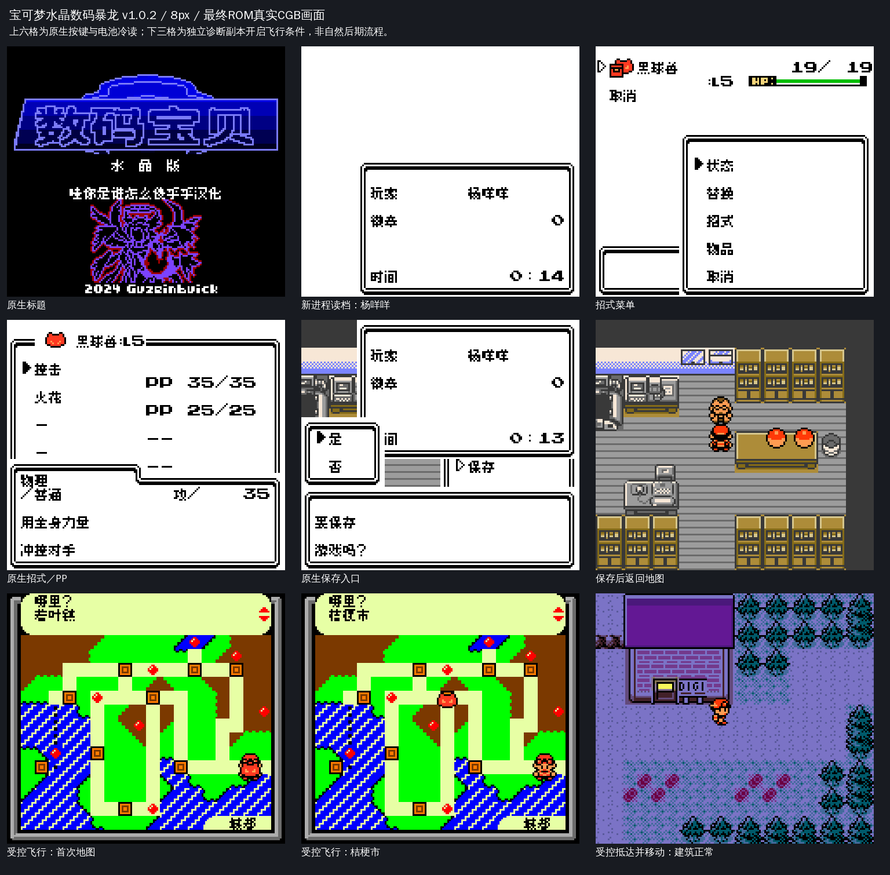
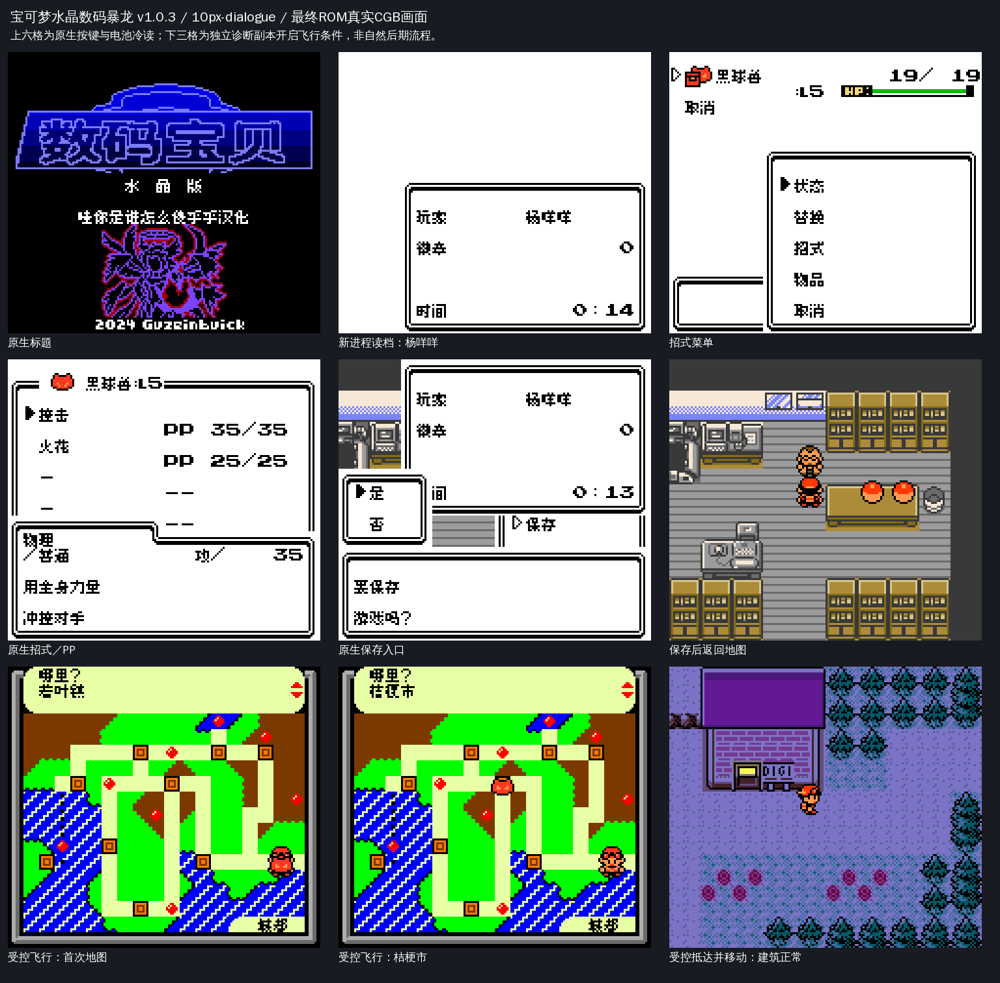

# 宝可梦水晶数码暴龙

原输入：Digimon Crystal (Guzeinbuick English ROM hack; exact upstream release date unverified)

原输入完整SHA256：`a333699c83a7a9adaf62c942aa8215e9a0f3d9d598c62a96093fc671781113ae`。此处“原输入”保留改版、既有汉化或地区修订身份，不一律称干净零售ROM。

| 字号 | 当前版本 | 音频 | 输出完整SHA256 |
| --- | --- | --- | --- |
| 8px | v1.0.2地图及招式限定修订测试版 | unchanged | `78049b698bc13a0aa2480db4550d74ff91f221e66c2df1a3da5930767360cd97` |
| 10px-dialogue | v1.0.3地图及招式限定修订测试版 | unchanged | `6af82acd8e3bc94709ab0c40f02df817a1f31eb9f6c91cca7d7ad2b48ae5e6c9` |

## 源码与补丁

- 8px／v1.0.2地图及招式限定修订测试版／unchanged：源码包（完整性未独立确认）：[下载](https://github.com/shiyi1133/youxi-hanhua-releases/releases/download/source-migration-20261022-02a/digimon-crystal-current-source-0b4529d79b70-public-r01.zip)（ZIP SHA256 `ce4bc74fcd4426e67141c801d44035417dd67af18a62826f093b5eb3413c48dd`）；补丁：[下载](https://github.com/shiyi1133/youxi-hanhua-releases/releases/download/patch-migration-20261022/digimon-crystal-current-patches.zip)（ZIP SHA256 `79d541817954c9f895bbd09df9b83850e10ac83ed429d31ae64dba84a8ea387c`）。
  该包已核对对应版本与字节安全；完整修改源码覆盖范围未独立确认。
- 10px-dialogue／v1.0.3地图及招式限定修订测试版／unchanged：源码包（完整性未独立确认）：[下载](https://github.com/shiyi1133/youxi-hanhua-releases/releases/download/source-migration-20261022-02a/digimon-crystal-current-source-0b4529d79b70-public-r01.zip)（ZIP SHA256 `ce4bc74fcd4426e67141c801d44035417dd67af18a62826f093b5eb3413c48dd`）；补丁：[下载](https://github.com/shiyi1133/youxi-hanhua-releases/releases/download/patch-migration-20261022/digimon-crystal-current-patches.zip)（ZIP SHA256 `79d541817954c9f895bbd09df9b83850e10ac83ed429d31ae64dba84a8ea387c`）。
  该包已核对对应版本与字节安全；完整修改源码覆盖范围未独立确认。

补丁须直接应用于完整SHA一致的实际原输入；普通字、大字和音乐变体分别核对。公开源码归档不表示本轮重新构建或通过新的运行验收。原作、字体、已有翻译及工具依赖的权利与许可，依各包对应许可保留。

## 范围与验证边界

- 8px／v1.0.2地图及招式限定修订测试版：8px / 10px-dialogue。
- 10px-dialogue／v1.0.3地图及招式限定修订测试版：8px / 10px-dialogue。

本次资料搬运未新增模拟器、实机或全通验收；未记录或未测试的范围不写成通过。问题单开放只表示尚未关闭，已关闭也不单独证明全部场景都修复。

[公开反馈及问题状态](feedback.md) · [报告BUG](https://github.com/shiyi1133/youxi-hanhua-releases/issues/new?template=bug_report.md)

## 对应版本截图

v1.0.2 8px最终ROM真实CGB；前六格原生菜单保存冷读，后三格显式受控飞行前置；未全通/实机

图像SHA256：`0b4785f9ca2019768ad25fe652f1ae25e357e76b9971187968984a26d811df8e`；绑定ROM SHA256：`78049b698bc13a0aa2480db4550d74ff91f221e66c2df1a3da5930767360cd97`。

v1.0.3 10px-dialogue最终ROM真实CGB；前六格原生菜单保存冷读，后三格显式受控飞行前置；未全通/实机

图像SHA256：`e065d6a78e916bc506d8419b6c217b4676a184a29cad26bf3428fbf12bfd1bc8`；绑定ROM SHA256：`6af82acd8e3bc94709ab0c40f02df817a1f31eb9f6c91cca7d7ad2b48ae5e6c9`。

