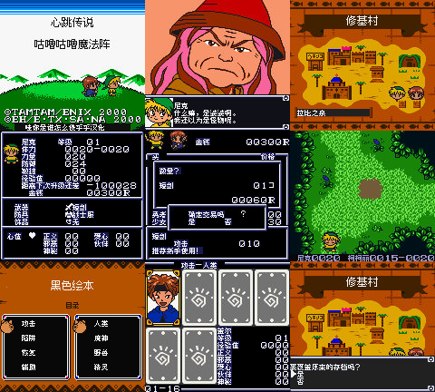

# 心跳传说：咕噜咕噜魔法阵 v0.1.0（限定测试版）

[源码与补丁Release](https://github.com/shiyi1133/youxi-hanhua-releases/releases/tag/dokidoki-densetsu-mahoujin-guruguru-v0.1.0) · [公开反馈](feedback.md) · [报告BUG](https://github.com/shiyi1133/youxi-hanhua-releases/issues/new?template=bug_report.md)

原游戏／实际输入：Dokidoki Densetsu - Mahoujin Guruguru (Japan)

原输入完整SHA-256：`9627630e771f5dd95163f29a5f034931d080b7a307d3f699f1535d2e4ecc109a`（4194304字节）。

范围：5895文本/3222种去重文字、菜单/地图/卡片及已识别图字；CGB-only。

## 8px v0.1.0

字号范围：普通8px，标题图字12px不是独立大字版；无10px。

目标完整SHA-256：`6b360af4ee4b85c23340cb09a73f7db3069ae8a19b248e23762150d5fe60245e`（4194304字节）。

补丁：`guruguru_v0.1.0_8px.bps`，SHA-256 `639ea5f169415bfdebd305e77db77412e2cd3c60e532d3d8e4d17eebc78c4dfb`。

[源码（完整性未独立确认）](https://github.com/shiyi1133/youxi-hanhua-releases/releases/download/dokidoki-densetsu-mahoujin-guruguru-v0.1.0/dokidoki-densetsu-mahoujin-guruguru-v0.1.0-source-public-r02.zip) · [补丁包](https://github.com/shiyi1133/youxi-hanhua-releases/releases/download/dokidoki-densetsu-mahoujin-guruguru-v0.1.0/dokidoki-densetsu-mahoujin-guruguru-v0.1.0-patch.zip)

心跳传说：咕噜咕噜魔法阵 v0.1.0 8px限定测试版；普通8px，标题图字12px不是独立大字版；无10px。 自然路径与诊断范围见测试说明，不代表全流程。

## 测试及限制

提供者自然路径：开场至村庄、七项菜单/地图、自然商店购买/金钱不足/取消，接受任务进入森林行走攻击；保存取消/确认/覆盖及新OS电池冷读。

提供者诊断路径：提供者字体/VRAM/肖像专项自测；不是全卡片和全部事件验收。

保存边界：提供者有8KiB电池村庄进度正常保存冷读记录；不保证所有旧档。

同一实现者自测，不是独立人员QA；维护未新增ROM运行或源码重建，未宣称实机或完整通关。

- 未验证：自然敌战胜利和首关过关
- 未验证：商店出售、深层任务及全部卡片
- 未验证：最长变量全组合、红外/联机、实机及全通
- 核对补丁还原、资产完整SHA和截图字节不等于全部游戏功能验收。

