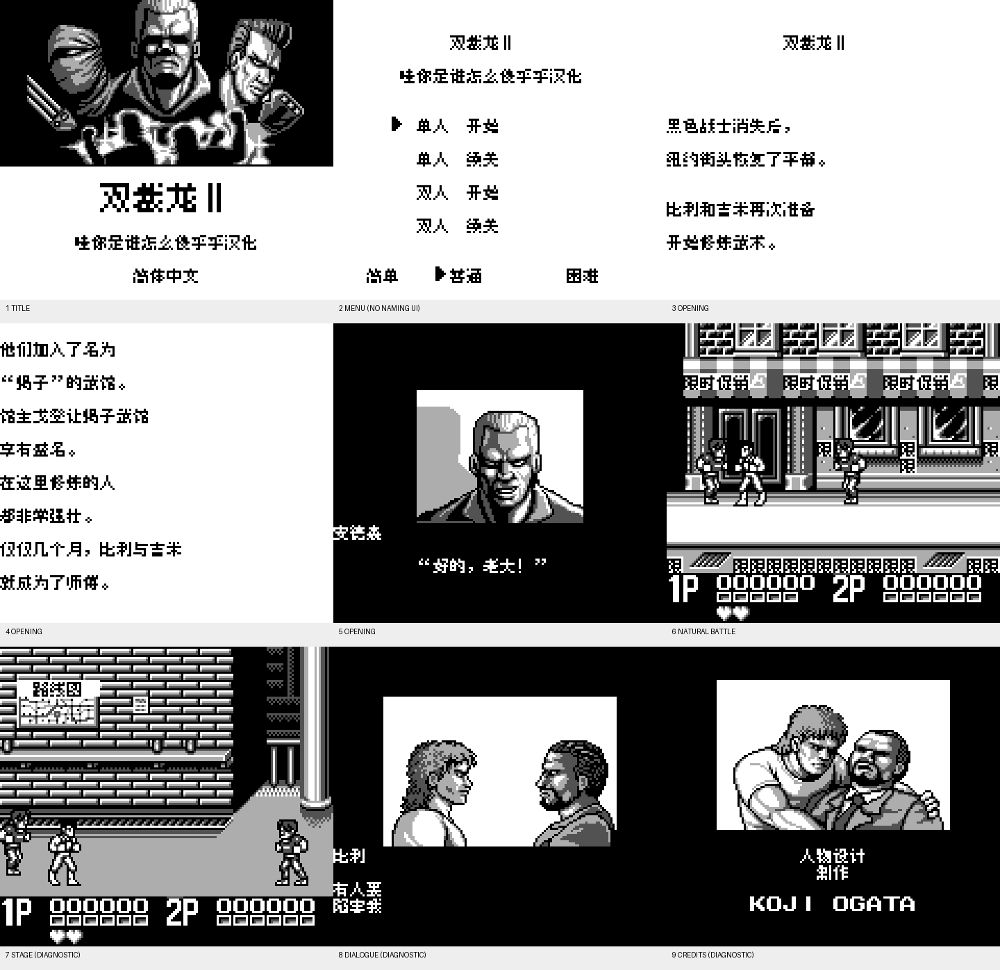

# 双截龙2（美国版）

原输入：Double Dragon II (USA; requester filename and DOUBLE DRAGON 2 header identity)

原输入完整SHA256：`21639689078496d4c2d000b120d493b69e7df603e5c2b5cd337974665e597878`。此处“原输入”保留改版、既有汉化或地区修订身份，不一律称干净零售ROM。

| 字号 | 当前版本 | 音频 | 输出完整SHA256 |
| --- | --- | --- | --- |
| 8px | v1.0.0测试版 | unchanged | `53552bf15a68b4293626673c5d64aee49e2bdb9bda2b7128ec4e9f180ac271f0` |

## 源码与补丁

- 8px／v1.0.0测试版／unchanged：完整修改源码：[下载](https://github.com/shiyi1133/youxi-hanhua-releases/releases/download/source-migration-20261022/double-dragon-2-current-source-78c59f2fa67f-public-r02.zip)（ZIP SHA256 `4a042aaafa3072740bdd1062ffb7263617364fce441a4b07bbee89f59dd2f3e0`）；补丁：[下载](https://github.com/shiyi1133/youxi-hanhua-releases/releases/download/patch-migration-20261022/double-dragon-2-current-patches.zip)（ZIP SHA256 `6b64ef0ed6b68dfcca57daa9f089d446b165bcb070fda05737a005d9706cb89f`）。

补丁须直接应用于完整SHA一致的实际原输入；普通字、大字和音乐变体分别核对。公开源码归档不表示本轮重新构建或通过新的运行验收。原作、字体、已有翻译及工具依赖的权利与许可，依各包对应许可保留。

## 范围与验证边界

- 8px／v1.0.0测试版：普通原生8×8 Fusion Pixel；标题艺术字16px整数放大不作为10px版。
  美国版Double Dragon II普通原生8px Fusion Pixel测试版。已审静态成品含标题、菜单三难度、单/双人开始与续关文字、开场、12段后期/结局对白、10项制作职务与已识别场景招牌。提供方有自然开场、首战移动攻击跳跃、暂停/死亡等有限测试；后期与结局使用明确诊断入口。维护只独立核补丁、头部、字形、控制记录和截图，未运行或重建。
  不是自然全流程验收：未自然打通首关/全作、未双机联机、未实机/闪卡。九格前6为自然按键、后3为诊断，不冒称后期自然通关。未证明全部语义换行分类或七规则/所有分支验收；未确认旧遗留ASCII片段的可达性，不把它们声称已消除。本包仅普通8px，无10px大字；标题16px艺术字是整数缩放。原作无玩家取名、SRAM或电池保存，不新增；跨版本即时状态不保证兼容，建议冷启动。

本次资料搬运未新增模拟器、实机或全通验收；未记录或未测试的范围不写成通过。问题单开放只表示尚未关闭，已关闭也不单独证明全部场景都修复。

[公开反馈及问题状态](feedback.md) · [报告BUG](https://github.com/shiyi1133/youxi-hanhua-releases/issues/new?template=bug_report.md)

## 对应版本截图

双截龙2 美国版 v1.0.0测试版 普通8px最终ROM：前6格自然按键，后3格诊断；DMG灰度原帧整数3×显示，不代表自然全通或大字号。

图像SHA256：`2584c69bf11b1d2028bb95ac5c4363775b90aa3d5d1e9b7e6a56c6a536b06475`；绑定ROM SHA256：`53552bf15a68b4293626673c5d64aee49e2bdb9bda2b7128ec4e9f180ac271f0`。

