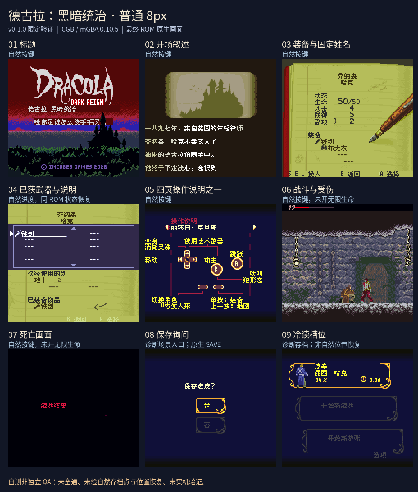

# 德古拉黑暗统治

原输入：Dracula Dark Reign

原输入完整SHA256：`632cb19b71cbda1876ba3a807ef2e05b6d2d0596130110d6da404bc2f0702758`。此处“原输入”保留改版、既有汉化或地区修订身份，不一律称干净零售ROM。

| 字号 | 当前版本 | 音频 | 输出完整SHA256 |
| --- | --- | --- | --- |
| 8px | v0.1.0 | unchanged | `21cf09649d8fe9072e985de00b580f8bfdfcd2fab7d453ae33c1cb57384a4773` |

## 源码与补丁

- 8px／v0.1.0／unchanged：源码包（完整性未独立确认）：[下载](https://github.com/shiyi1133/youxi-hanhua-releases/releases/download/source-migration-20261022-02a/dracula-dark-reign-current-source-b820bbb9046a-public-r01.zip)（ZIP SHA256 `ca0d7657de75c0870b5449e92d1c4863ce0fca0303fb45024794d3e605c69d72`）；补丁：[下载](https://github.com/shiyi1133/youxi-hanhua-releases/releases/download/patch-migration-20261022/dracula-dark-reign-current-patches.zip)（ZIP SHA256 `36a2cc1856e5154d8d6a4de1e9ff3e58f64e4391e66df8557ad7d758337c7564`）。
  该包已核对对应版本与字节安全；完整修改源码覆盖范围未独立确认。

补丁须直接应用于完整SHA一致的实际原输入；普通字、大字和音乐变体分别核对。公开源码归档不表示本轮重新构建或通过新的运行验收。原作、字体、已有翻译及工具依赖的权利与许可，依各包对应许可保留。

## 范围与验证边界

- 8px／v0.1.0：普通Fusion Pixel8px图像/tile分区汉化，四固定人物名；CGB，无独立大字或SGB。。
  普通Fusion Pixel8px图像/tile分区汉化，四固定人物名；CGB，无独立大字或SGB。
  未自然到达保存点；诊断冷读仅显示有效槽与字段，选择槽后原版和汉化都回开场，不称进度位置恢复。
  后段/全部物品技能/结局、全部最长变量、全通/实机未验；保留未确认可达旧调试素材，未新增取名。

本次资料搬运未新增模拟器、实机或全通验收；未记录或未测试的范围不写成通过。问题单开放只表示尚未关闭，已关闭也不单独证明全部场景都修复。

[公开反馈及问题状态](feedback.md) · [报告BUG](https://github.com/shiyi1133/youxi-hanhua-releases/issues/new?template=bug_report.md)

## 对应版本截图

v0.1.0 普通Fusion Pixel8px图像/tile分区汉化，四固定人物名；CGB，无独立大字或SGB。 音频：unchanged；自然前期与诊断保存严格区分；Source仅本地附原生PNG可与拼图精确对照。

图像SHA256：`d125e13f5cd621c49f5c61316d81e21182daf067541edb9bbedd4351ef5d11dd`；绑定ROM SHA256：`21cf09649d8fe9072e985de00b580f8bfdfcd2fab7d453ae33c1cb57384a4773`。

