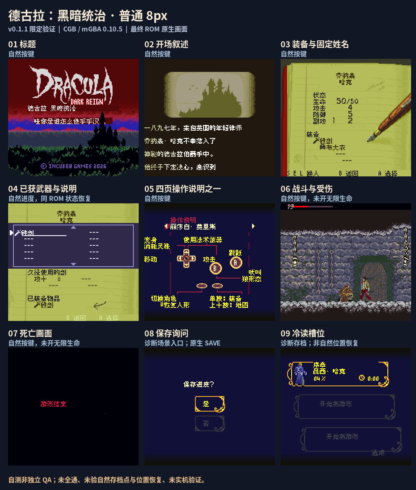

# 德古拉黑暗统治 v0.1.1（限定测试版）

[公开反馈](feedback.md) · [报告BUG](https://github.com/shiyi1133/youxi-hanhua-releases/issues/new?template=bug_report.md)

[公开源码与补丁Release](https://github.com/shiyi1133/youxi-hanhua-releases/releases/tag/dracula-dark-reign-v0.1.1)

原游戏／实际输入：Dracula Dark Reign

原输入完整SHA-256：`632cb19b71cbda1876ba3a807ef2e05b6d2d0596130110d6da404bc2f0702758`（4194304字节）。

## v0.1.1 8px unchanged

字号范围：普通 Fusion Pixel 原生8px；图像/tile分区与四固定人物名；CGB，无独立大字或SGB。

目标完整SHA-256：`369686ed731496074bf4c30acbd4e19200b41c3201adbc53a5fb7fb9843b4dbc`（4194304字节）。

补丁：`Dracula_Dark_Reign_zh_v0.1.1_8px.bps`；完整SHA-256 `9981d2531cabdf5090a3ed97f02b3abf48f59c8f158623c4c74e8abead6f6caa`。

[源码（完整性未独立确认）](https://github.com/shiyi1133/youxi-hanhua-releases/releases/download/dracula-dark-reign-v0.1.1/dracula-dark-reign-v0.1.1-source-public-r01.zip) · [补丁包](https://github.com/shiyi1133/youxi-hanhua-releases/releases/download/dracula-dark-reign-v0.1.1/dracula-dark-reign-v0.1.1-patches-public.zip)

v0.1.1 普通8px最终CGB九格；图8/9为诊断保存与槽位冷读，不表示自然存档位置恢复。

## 范围与限制

- 七张地点/人物标题卡调整；独立差分限于标题卡图像和全局校验和，未改VM或玩法逻辑。
- 提供方标题卡验证为1处自然开场、6处原生场景加载参数诊断；不能当自然到达全部后段地点。
- 普通九宫格9/9格与所附原生PNG像素精确一致；图8/9为诊断保存及槽位新进程冷读，不证明自然保存点或进度位置恢复。
- 自然前期开场/菜单/装备/操作/早期战斗/死亡等为提供方自测；后期、全物品技能、结局、全流程、实机未验收。
- 维护仅独立核完整输入/输出/补丁、ZIP、图证与源码静态安全；未执行附件源码、未重建、未新增ROM运行。

源码完整性未独立确认；维护源码执行、重建、ROM新增运行均未执行。

[此前完整版本记录](history/readme-0d4f55ef9842aba656c0.md)。
