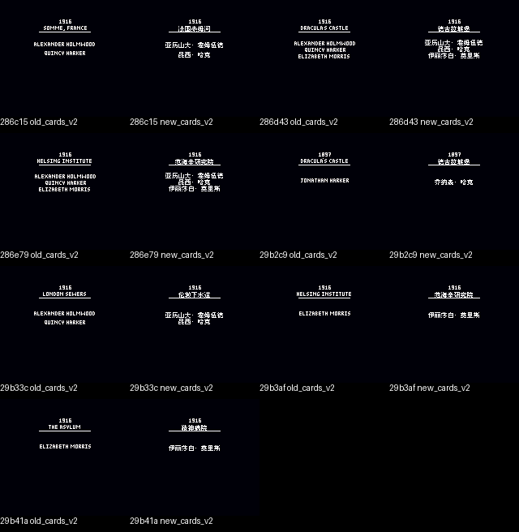

# 德古拉黑暗统治：公开反馈

以下为已公开证据摘录，不能自动当成已经复现或修复。下载／存档分享地址、本机路径或项目署名文字省略时逐条标记。

## 问题状态

当前导出未取得可关联的正式问题单；这不表示已完成全面测试。

问题单开放不等于正在修复；关闭不自动代表所有报告症状全部验收。玩家实际ROM SHA未知时仍保留未知，当前版本的参考SHA见[游戏页面](README.md)。

## 维护者版本更新：v0.1.1

[原楼实际答复](https://tieba.baidu.com/p/11092365551?pid=154063167766#p154063167766)（111楼，PID 154063167766）。以下是维护者已公开发送的版本通知，不是玩家测试结论。

> 《德古拉：黑暗统治》普通8px v0.1.1已更新到总分享，调整了7处地点、人物标题卡文字。请进入“GBC/德古拉黑暗统治”重新下载测试。
> 图1：v0.1.1普通8px最终ROM九宫格。图2：七张标题卡前后对照，1处自然开场、6处诊断载入。

v0.1.1 普通8px最终CGB九格；图8/9为诊断保存与槽位冷读，不表示自然存档位置恢复。

原PNG完整SHA-256：`50e6286153133edeb9ef7c348ace3c7076e43f315b9790d62c8a28c0bc606a57`。

v0.1.1七张地点/人物标题卡前后对照；1处自然开场、6处原生诊断载入。对照左侧为v0.1.0，不冒称另一字号或自然到达后段。

原PNG完整SHA-256：`98ce123dbde713ae39d55a0cb417b2e5393b7153f4b4b097b86c4af5c1bf05dd`。

上述全文及全部图像已按该PID公开核验；本次导出仅补充通知记录，不新增通关、实机、源码完整性或问题全部修复结论。
