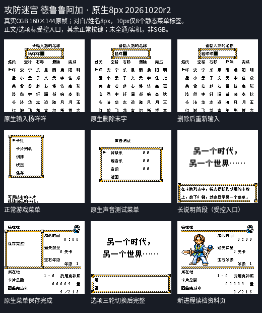
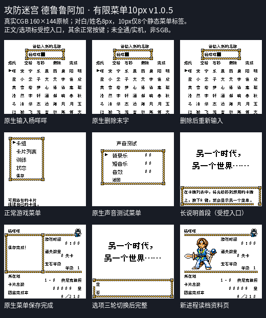

# 攻防迷宫 德鲁鲁阿加

原输入：Seme COM Dungeon - Drururuaga (Japan)

原输入完整SHA256：`c0e86d6e6d3c2bf6f7b823a2d99e97fb5a8f7ec333eb6f755d62defd90b565b5`。此处“原输入”保留改版、既有汉化或地区修订身份，不一律称干净零售ROM。

| 字号 | 当前版本 | 音频 | 输出完整SHA256 |
| --- | --- | --- | --- |
| 8px | 2026-10-20 r2 原生8px已接入正文排版修订 | unchanged | `b04e53e4c4b741452b11879f00fcdbe25328448dfabb4650514f70fc7e3f3b64` |
| 10px-limited-menu | v1.0.5 有限菜单10px已接入正文排版修订 | unchanged | `15039822b4ab57cfbffb48fc0f49f63a2e18219584c6a929595f8a0d1737a504` |

## 源码与补丁

- 8px／2026-10-20 r2 原生8px已接入正文排版修订／unchanged：完整修改源码：[下载](https://github.com/shiyi1133/youxi-hanhua-releases/releases/download/source-migration-20261022/drururuaga-current-source-08f297c724d6-public-r02.zip)（ZIP SHA256 `b4cf9131db2ac05ba7c3c92cb08b091226cebf2c4f048134b1afd2ae21b8f18e`）；补丁：[下载](https://github.com/shiyi1133/youxi-hanhua-releases/releases/download/patch-migration-20261022/drururuaga-current-patches.zip)（ZIP SHA256 `a518ec566d2a696c84a144dffb3d11631436809f45a9234a5acb69522ba3b2d7`）。
- 10px-limited-menu／v1.0.5 有限菜单10px已接入正文排版修订／unchanged：完整修改源码：[下载](https://github.com/shiyi1133/youxi-hanhua-releases/releases/download/source-migration-20261022/drururuaga-current-source-08f297c724d6-public-r02.zip)（ZIP SHA256 `b4cf9131db2ac05ba7c3c92cb08b091226cebf2c4f048134b1afd2ae21b8f18e`）；补丁：[下载](https://github.com/shiyi1133/youxi-hanhua-releases/releases/download/patch-migration-20261022/drururuaga-current-patches.zip)（ZIP SHA256 `a518ec566d2a696c84a144dffb3d11631436809f45a9234a5acb69522ba3b2d7`）。

补丁须直接应用于完整SHA一致的实际原输入；普通字、大字和音乐变体分别核对。公开源码归档不表示本轮重新构建或通过新的运行验收。原作、字体、已有翻译及工具依赖的权利与许可，依各包对应许可保留。

## 范围与验证边界

- 8px／2026-10-20 r2 原生8px已接入正文排版修订：8px / 10px-limited-menu。
- 10px-limited-menu／v1.0.5 有限菜单10px已接入正文排版修订：8px / 10px-limited-menu。

本次资料搬运未新增模拟器、实机或全通验收；未记录或未测试的范围不写成通过。问题单开放只表示尚未关闭，已关闭也不单独证明全部场景都修复。

[公开反馈及问题状态](feedback.md) · [报告BUG](https://github.com/shiyi1133/youxi-hanhua-releases/issues/new?template=bug_report.md)

## 对应版本截图

当前r2实际CGB原帧；对白姓名8px、菜单10px只8标签；正文/选择为明确受控入口，未全通/实机。

图像SHA256：`38a4f23d1b9ab9cca9c679650cbee2175b899b418e95bd7b988a9636aa6cbfec`；绑定ROM SHA256：`b04e53e4c4b741452b11879f00fcdbe25328448dfabb4650514f70fc7e3f3b64`。

当前r2实际CGB原帧；对白姓名8px、菜单10px只8标签；正文/选择为明确受控入口，未全通/实机。

图像SHA256：`c2f4882b8b6d03aac6e43f36498969f31426245744f10ed571c3bcf149e81873`；绑定ROM SHA256：`15039822b4ab57cfbffb48fc0f49f63a2e18219584c6a929595f8a0d1737a504`。

