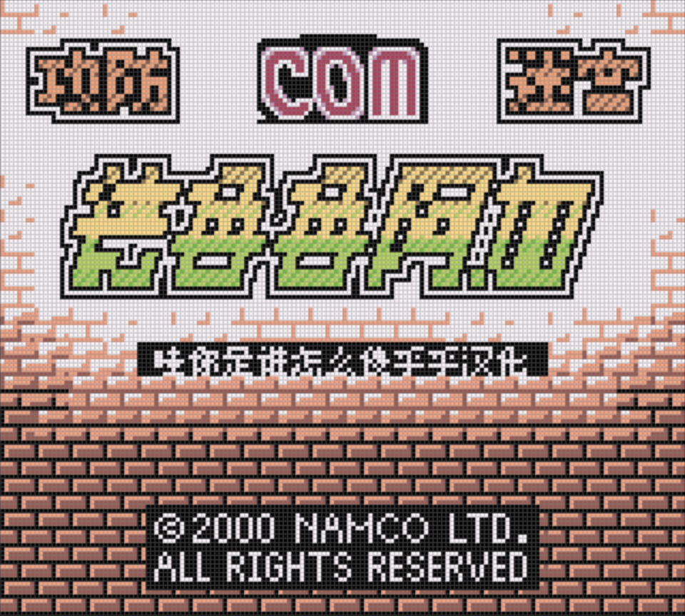
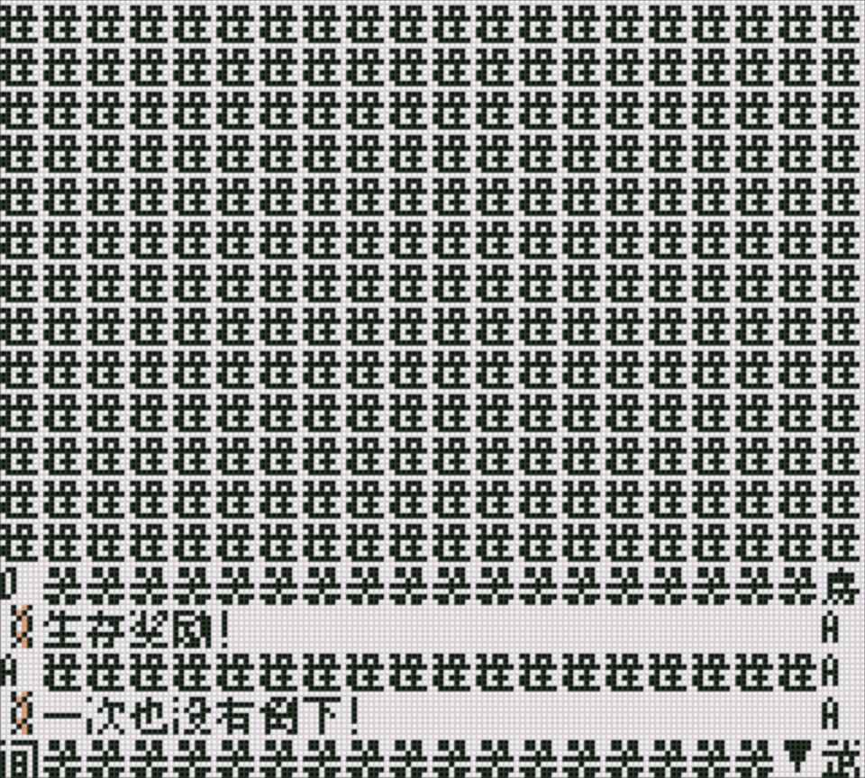
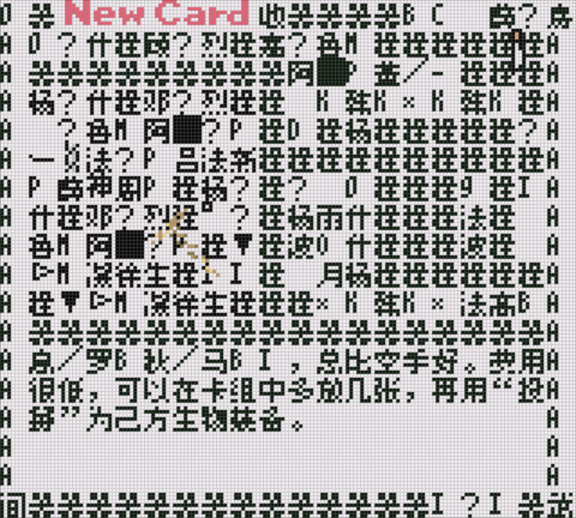
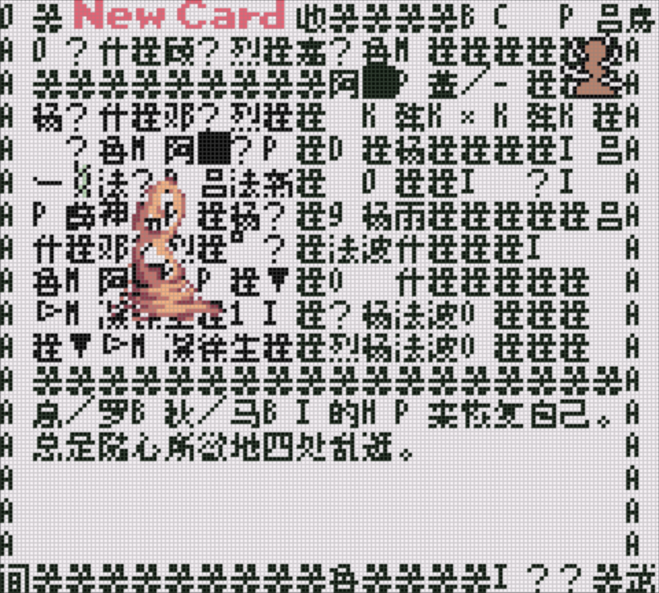

# 攻防迷宫 德鲁鲁阿加：公开反馈

以下为已公开证据摘录，不能自动当成已经复现或修复。下载／存档分享地址、本机路径或项目署名文字省略时逐条标记。

## 问题状态

当前导出未取得可关联的正式问题单；这不表示已完成全面测试。

问题单开放不等于正在修复；关闭不自动代表所有报告症状全部验收。玩家实际ROM SHA未知时仍保留未知，当前版本的参考SHA见[游戏页面](README.md)。

## 20261101-0442 增量反馈

玩家报告《攻防迷宫 德鲁鲁阿加》v1.0.5有限菜单10px版在过关结算获得新卡牌时出现乱码，并补充GBC和GB模拟器均发生；四张公开原图作为同一问题的证据。该问题已单独登记，不把历史正文排版验收当作新卡牌界面已通过。玩家实际ROM完整哈希未知，维护未运行重现或确认根因。

[原反馈](https://tieba.baidu.com/p/11092365551?pid=154091966443#154091966443)

> 楼主，反应一个问题《攻防迷宫 德鲁鲁阿加》在过关结算后得到新卡牌时会出现乱码，如图所示@哇你是谁怎么傻乎乎 

原字节SHA256 19cba34540279e4487a939e6a61ebe7be4c0b680c823b911b439a46ceddc32c7，851461字节。

原字节SHA256 5f82fb6850e11014141993206263caa79c0a6bb1390507f68b3051f49c1ad350，886320字节。

原字节SHA256 09601489363903abb3b40cb402e60aa322208f42dacd1b78c79d36f820f92d39，782288字节。

原字节SHA256 c3a91eeb8b2be95f8c9b340da0299d70714d437394d923433d86828354556a6b，768632字节。

[原反馈](https://tieba.baidu.com/p/11092365551?pid=154092005172#154092005172)

> 版本为《攻防迷宫_v1.0.5_有限菜单10px_已接入正文排版修订》，GBC和GB模拟器我都试了，都会出现乱码

[已核公开确认](https://tieba.baidu.com/p/11092365551?pid=154093241184#154093241184)：《攻防迷宫》v1.0.5 有限菜单10px版，过关获新卡牌后的乱码和四张图已记录，后续排查。

