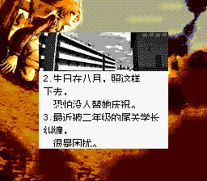
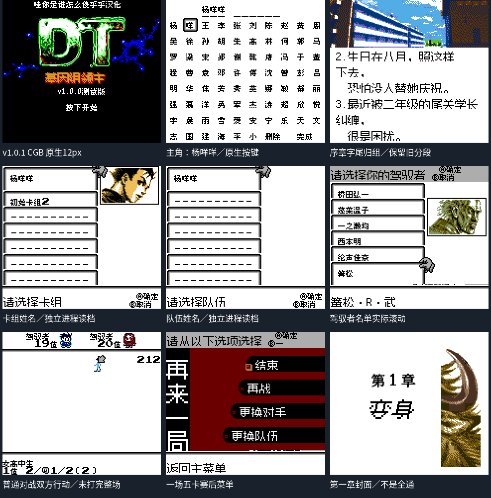

# DT：基因组领主

原输入：DT - Lords of Genomes (Japan) (SGB Enhanced) (GB Compatible)

原输入完整SHA256：`cc25aa1c06b5425f29f38af0cd7eb947b51cffa71e783612218e0325dff3654f`。此处“原输入”保留改版、既有汉化或地区修订身份，不一律称干净零售ROM。

| 字号 | 当前版本 | 音频 | 输出完整SHA256 |
| --- | --- | --- | --- |
| 12px | v1.0.1原生12px开场排版限定修订测试版 | unchanged | `2c0fdb4c7a1112bd665552ff7ff89916a8469872a26c6170f0eaaa357070c951` |

## 源码与补丁

- 12px／v1.0.1原生12px开场排版限定修订测试版／unchanged：完整修改源码：[下载](https://github.com/shiyi1133/youxi-hanhua-releases/releases/download/source-migration-20261022/dt-lords-of-genomes-current-source-d7b7b0618387-public-r02.zip)（ZIP SHA256 `16ac834f3da29e078de94ef09124246d5e1db9bc81af082fa5fa4f1feeb74114`）；补丁：[下载](https://github.com/shiyi1133/youxi-hanhua-releases/releases/download/patch-migration-20261022/dt-lords-of-genomes-current-patches.zip)（ZIP SHA256 `9c24d92851c2720d4c2f8aeec61a88780bf6bf1fa9704db569199b8cd91c788f`）。

补丁须直接应用于完整SHA一致的实际原输入；普通字、大字和音乐变体分别核对。公开源码归档不表示本轮重新构建或通过新的运行验收。原作、字体、已有翻译及工具依赖的权利与许可，依各包对应许可保留。

## 范围与验证边界

- 12px／v1.0.1原生12px开场排版限定修订测试版：12px。

本次资料搬运未新增模拟器、实机或全通验收；未记录或未测试的范围不写成通过。问题单开放只表示尚未关闭，已关闭也不单独证明全部场景都修复。

[公开反馈及问题状态](feedback.md) · [报告BUG](https://github.com/shiyi1133/youxi-hanhua-releases/issues/new?template=bug_report.md)

## 对应版本截图

v1.0.1实际原生SGB边框/调色板与序章，非GBC冒称SGB，无着色预设

图像SHA256：`c074c41f67e37e1b5fc54fe52ffaf2873d385da22f108c1cd29883f7a8c5447c`；绑定ROM SHA256：`2c0fdb4c7a1112bd665552ff7ff89916a8469872a26c6170f0eaaa357070c951`。

v1.0.1原生12px实际CGB九宫格：3域姓名/冷读、序章、名单、五卡与部分普通对战，非全通

图像SHA256：`166d567d4cfc63dab472dd77120e2c756d7e6ec1abc1b4cfd169e3cc321491b3`；绑定ROM SHA256：`2c0fdb4c7a1112bd665552ff7ff89916a8469872a26c6170f0eaaa357070c951`。

