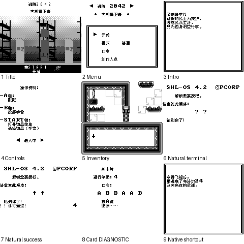

# 逃脱2042：真相捍卫者 v0.1.0（限定测试版）

[源码与补丁Release](https://github.com/shiyi1133/youxi-hanhua-releases/releases/tag/escape-2042-the-truth-defenders-v0.1.0) · [公开反馈](feedback.md) · [报告BUG](https://github.com/shiyi1133/youxi-hanhua-releases/issues/new?template=bug_report.md)

原游戏／实际输入：逃脱 2042Escape 2042 - The Truth Defenders (World) (En) (Aftermarket) (Unl).gb

原输入完整SHA-256：`6ee675c95c5a93aa6943abb728be966a092a7f68b99b012af85dce8021b71ca6`（32768字节）。

范围：开场、菜单、卡片及关卡终端文字。32KiB ROM ONLY基底扩为64KiB MBC1无RAM，映射兼容性需保留限制；不提供彩色增强。

## 8px v0.1.0

字号范围：普通8px；无独立大字版。

目标完整SHA-256：`f2f5f6da7771a664350745444650989bdbdac3c29d281d3e71cebf6435213cb1`（65536字节）。

补丁：`escape-2042-v0.1.0-8px.bps`，SHA-256 `2e95a43575f62d66af027119146f7e92099e2421dae4ffdb0af7e04f480bd019`。

[源码（完整性未独立确认）](https://github.com/shiyi1133/youxi-hanhua-releases/releases/download/escape-2042-the-truth-defenders-v0.1.0/escape-2042-the-truth-defenders-v0.1.0-source-public-r02.zip) · [补丁包](https://github.com/shiyi1133/youxi-hanhua-releases/releases/download/escape-2042-the-truth-defenders-v0.1.0/escape-2042-the-truth-defenders-v0.1.0-patch.zip)

逃脱2042：真相捍卫者 v0.1.0 8px限定测试版；普通8px；无独立大字版。 自然路径与诊断范围见测试说明，不代表全流程。

## 测试及限制

提供者自然路径：两模式菜单、六页开场、移动/手雷/物品栏、首关终端成功与失败及四密码含错误输入。

提供者诊断路径：卡片1–4、深层终端变量；结尾由原生SELECT+B捷径进入，不是全通。

保存边界：原作无SRAM保存，使用原生A/B密码；不冒称电池冷读。

同一实现者自测，不是独立人员QA；维护未新增ROM运行或源码重建，未宣称实机或完整通关。

- 未验证：完整路线和全部卡片
- 未验证：扩容映射在实机/闪存卡的兼容性
- 未验证：完整通关
- 核对补丁还原、资产完整SHA和截图字节不等于全部游戏功能验收。

