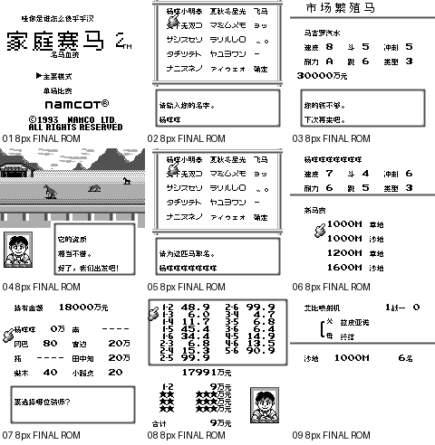

# 家庭赛马2：公开反馈

[报告BUG](https://github.com/shiyi1133/youxi-hanhua-releases/issues/new?template=bug_report.md)。请说明实际版本、字号、必要触发步骤和已有截图，不上传ROM、存档、即时状态或私人资料。

当前公开索引尚未登记本作BUG反馈；这不代表没有BUG、已全通或已实机验收。开放问题不等于正在修复。

[贴吧原需求](https://tieba.baidu.com/p/11092365551?pid=154051163806#154051163806)。

## 维护者交付通知：v0.1.0（限定测试版）

[贴吧实际答复](https://tieba.baidu.com/p/11092365551?pid=154064615059#p154064615059)（172楼，PID 154064615059；原关联楼层回复）。

以下为去除下载信息后的维护者通知摘要，不是玩家测试结论，也不是原文全文。

> 《家庭赛马2》v0.1.0限定测试版已发布。
> 字号：普通8px；原16px图字槽内部12px；不是全局12px，无10px或大字版。
> 范围：120普通脚本字段、319动态源记录/281去重记录、独立草泥HUD、命名/赛前/下注/赛后/领奖图字；195根/2489指令/382字段为静态枚举非自然全通
> 原答复中的ROM下载链接、提取码、网盘目录及下载指示已省略；私库保留完整原文证据。

原答复全文UTF-8 SHA-256：`0e53323be5d94f0ade3cd2ba4e1b74322d4af9c2ce1dcd340e4b6a94d88aa176`（262字节）。

家庭赛马2 v0.1.0 8px限定测试版；普通8px；原16px图字槽内部12px；不是全局12px，无10px或大字版 自然路径与诊断范围见测试说明，不代表全流程。

[贴吧该PID第1张实际公开图片](https://tiebapic.baidu.com/forum/pic/item/45b09416fdfaaf51c4ce34b8ca5494eef01f7a37.jpg?tbpicau=2026-11-04-05_d223043e904f119cf01035669fceb4ca)。

原PNG SHA-256：`a5e257f3ff241573bcecce76b8501d90b8dfd6abb0bdd19d6e1379ec3db8a4bf`；贴吧公开图片 SHA-256：`793241f80b73947429ca8bdc9cf48768b97b49b8b33ec989eea7bb0379ccb71c`。

原答复全文与全部图片已按该PID公开核验；此镜像不新增通关、实机、独立QA、源码完整性或BUG全部修复结论。
