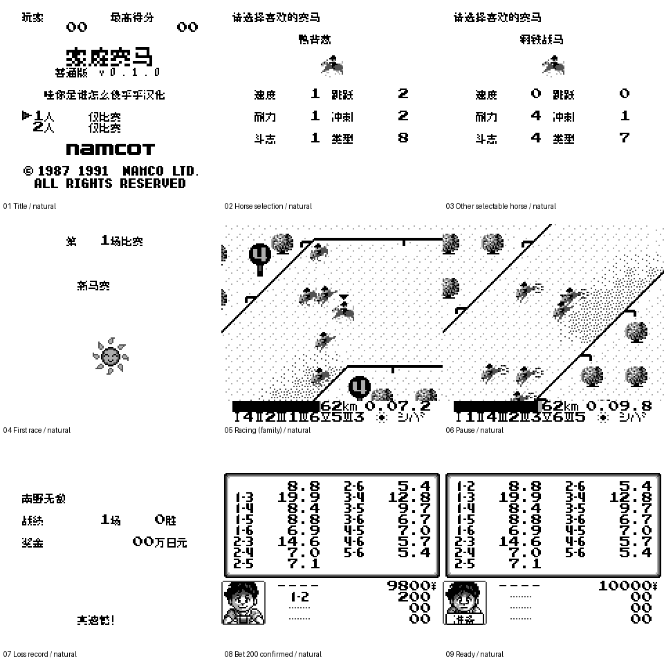

# 家庭赛马 v0.1.0（限定测试版）

[源码与补丁Release](https://github.com/shiyi1133/youxi-hanhua-releases/releases/tag/family-jockey-v0.1.0) · [公开反馈](feedback.md) · [报告BUG](https://github.com/shiyi1133/youxi-hanhua-releases/issues/new?template=bug_report.md)

原游戏／实际输入：Family Jockey (Japan)

原输入完整SHA-256：`ff53707dc590e3f837788d3cd20fe615a3baafdba051e4ecc59e9a410aa0f971`（131072字节）。

范围：157独立记录、65马名、赛程/距离/HUD/赛果与家庭下注；六赛名/胜利祝贺/准备图片另译

## 8px v0.1.0

字号范围：普通真实8px；标题独立图像2倍绘制，不是10px/大字正文，无另交大字版

目标完整SHA-256：`2cba6bc61bf5ef12723b44c1b90b507518e1d8d1ec9e0ac6a17289f2c292f3cd`（262144字节）。

补丁：`family-jockey_v0.1.0_8px.bps`，SHA-256 `56794e85dd993fa8484f124fd0251f6bd972864c61c71ca950c67a4c07407625`。

[源码（完整性未独立确认）](https://github.com/shiyi1133/youxi-hanhua-releases/releases/download/family-jockey-v0.1.0/family-jockey-v0.1.0-source-public-r02.zip) · [补丁包](https://github.com/shiyi1133/youxi-hanhua-releases/releases/download/family-jockey-v0.1.0/family-jockey-v0.1.0-patch.zip)

家庭赛马 v0.1.0 8px限定测试版；普通真实8px；标题独立图像2倍绘制，不是10px/大字正文，无另交大字版 自然路径与诊断范围见测试说明，不代表全流程。

## 测试及限制

提供者自然路径：标题/模式、前16马循环、赛前/比赛、暂停120帧关键位置计时不变、继续、失利战绩/返回标题；家庭模式选择投注组合、金额200、确认10000→9800和准备

提供者诊断路径：157记录逐字符tile及295字形VRAM比对/缓存换出；六赛名图与胜利图经原生加载器诊断显示，非自然胜利

保存边界：MBC1无RAM/电池，无原生永久存档；不声称保存冷读通过，旧即时状态不兼容扩容缓存方案

同一实现者自测，不是独立人员QA；维护未新增ROM运行或源码重建，未宣称实机或完整通关。

- 未验证：自然获胜/27赛程全通
- 未验证：家庭中奖与深层结算
- 未验证：真实双机联机
- 未验证：实机
- 核对补丁还原、资产完整SHA和截图字节不等于全部游戏功能验收。

