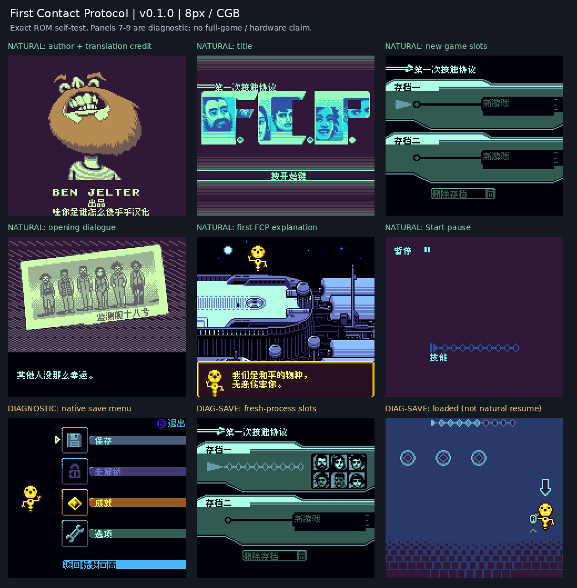

# 第一次接触协议

原输入：First Contact Protocol

原输入完整SHA256：`51827d69b91acc26c0cc209182d53002ff0ececd019114884a16622d4cec7613`。此处“原输入”保留改版、既有汉化或地区修订身份，不一律称干净零售ROM。

| 字号 | 当前版本 | 音频 | 输出完整SHA256 |
| --- | --- | --- | --- |
| 8px | v0.1.0 | unchanged | `d8ce2fa6ca3b6697e537f61d6b3187d3ee8f91b30eb823efa48445e1b00a5629` |

## 源码与补丁

- 8px／v0.1.0／unchanged：源码包（完整性未独立确认）：[下载](https://github.com/shiyi1133/youxi-hanhua-releases/releases/download/source-migration-20261022-04/first-contact-protocol-current-scope-source-public-r01.zip)（ZIP SHA256 `33a49fff0a51a6dffa659d2d44cb3b27828275b634aad13f25df784b557d6a0d`）；补丁：[下载](https://github.com/shiyi1133/youxi-hanhua-releases/releases/download/patch-migration-20261022/first-contact-protocol-current-patches.zip)（ZIP SHA256 `4a753e378ab11a8f9403567007386e863b56b5d1adfdb8ad41d9151d9d79deeb`）。
  该包已核对对应版本与字节安全；完整修改源码覆盖范围未独立确认。

补丁须直接应用于完整SHA一致的实际原输入；普通字、大字和音乐变体分别核对。公开源码归档不表示本轮重新构建或通过新的运行验收。原作、字体、已有翻译及工具依赖的权利与许可，依各包对应许可保留。

## 范围与验证边界

- 8px／v0.1.0：普通原生8px简体中文测试版，仅CGB；无大字版、无SGB增强。。
  普通原生8px简体中文测试版，仅CGB；无大字版、无SGB增强。
  自然到达存档站及原位置续玩未完成；保存/冷读为明确诊断入口且恢复不同场景；未知外星图案罗马字保留；未全通、实机或跨版本存档验证。

本次资料搬运未新增模拟器、实机或全通验收；未记录或未测试的范围不写成通过。问题单开放只表示尚未关闭，已关闭也不单独证明全部场景都修复。

[公开反馈及问题状态](feedback.md) · [报告BUG](https://github.com/shiyi1133/youxi-hanhua-releases/issues/new?template=bug_report.md)

## 对应版本截图

第1–6格自然开场，第7–9格诊断保存与冷读；不能视为自然存档站路线。；对应 v0.1.0 8px 最终ROM。

图像SHA256：`1ebf3876887fdc36a9554b7185e4e24c833141fc2b5e33cc912706b266a84261`；绑定ROM SHA256：`d8ce2fa6ca3b6697e537f61d6b3187d3ee8f91b30eb823efa48445e1b00a5629`。

