# 第一次接触协议：公开反馈

以下为已公开证据摘录，不能自动当成已经复现或修复。下载／存档分享地址、本机路径或项目署名文字省略时逐条标记。

## 问题状态

当前导出未取得可关联的正式问题单；这不表示已完成全面测试。

问题单开放不等于正在修复；关闭不自动代表所有报告症状全部验收。玩家实际ROM SHA未知时仍保留未知，当前版本的参考SHA见[游戏页面](README.md)。

## 20261025-0421 公开反馈补充

112楼 · 可可洛图书馆 · [原回帖](https://tieba.baidu.com/p/11092365551?pid=154067485113#154067485113)

> 全结局通关了，补充一份mGBA版的存档和问题截图说明：基本就是有些人物对话时头像会出现字符、数字和英文错行有时会不太好辨认，人物出现新文件提示时人物头像会撕裂之类的小问题。

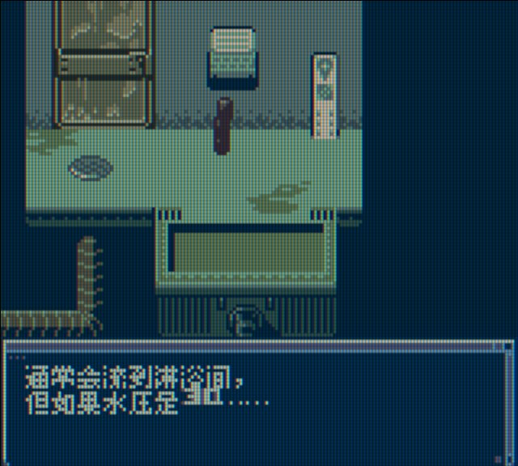

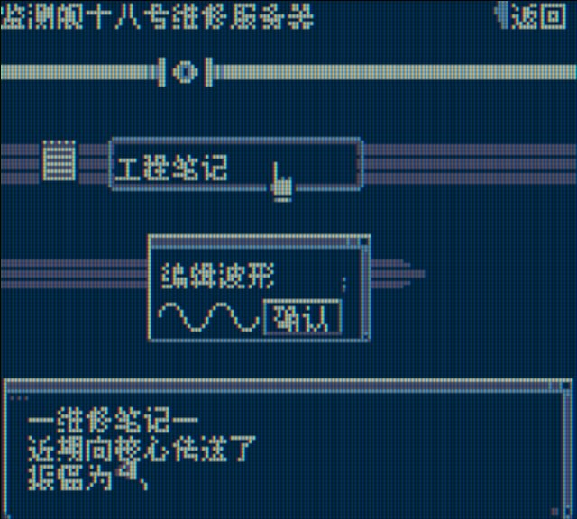

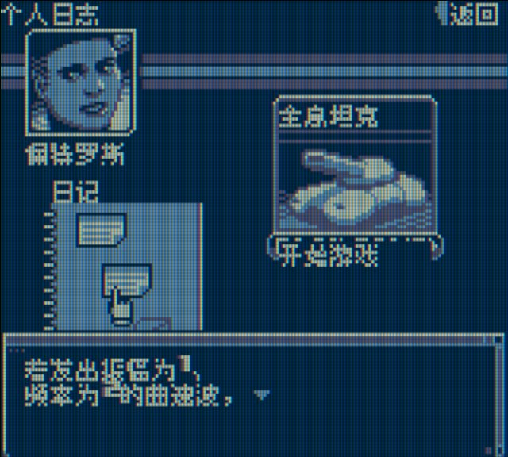

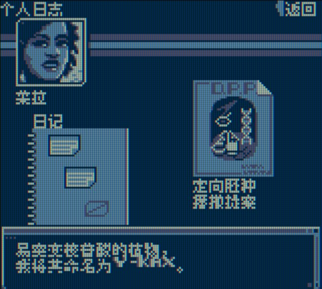

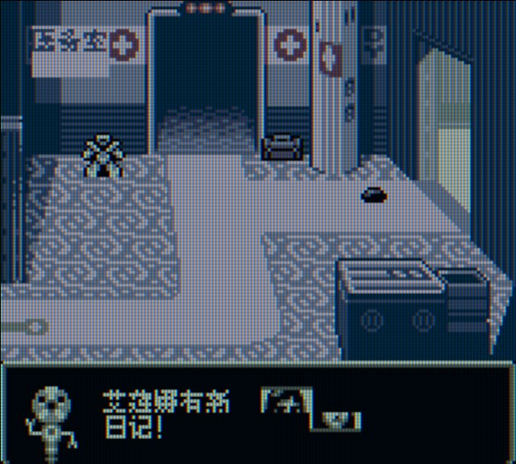

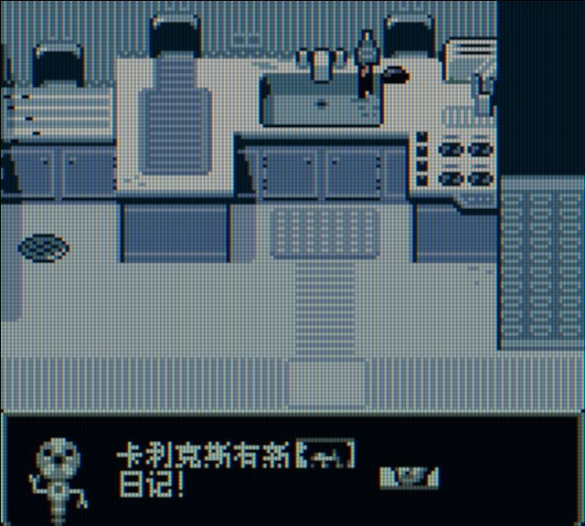

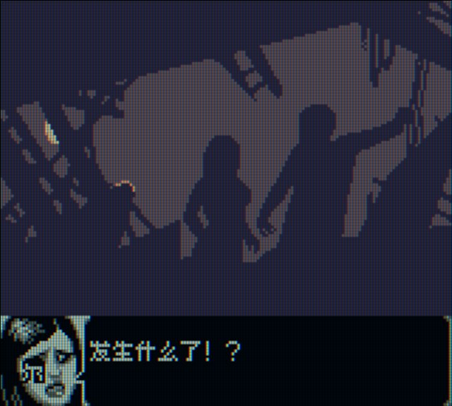

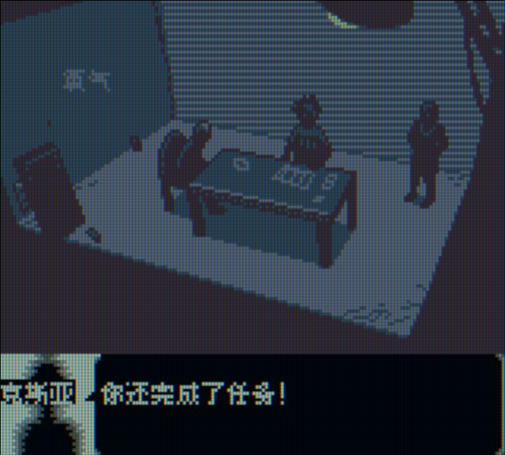

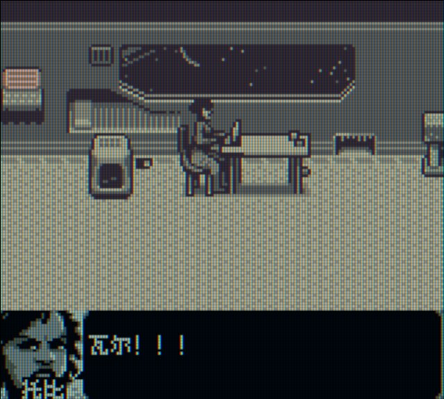

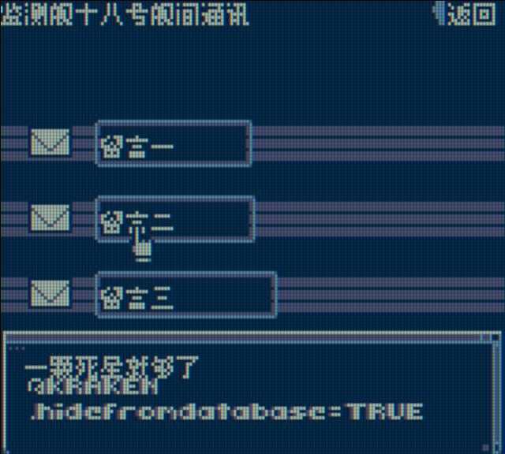

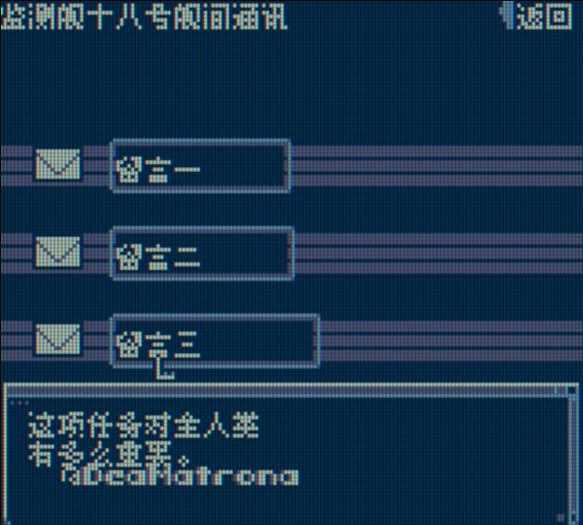

- [BUG待核版本] 第一次接触协议：头像区域字符与新文件提示时头像撕裂：已记录，开放待核。
- 第一次接触协议：数字与英文错行可读性反馈：已记录，开放待核。

[实际公开登记答复](https://tieba.baidu.com/p/11092365551?pid=154068345520#154068345520)：@可可洛图书馆 旧分享里的11张截图预览已看到，头像字符/撕裂、文件末尾英文字符和数字英文错行已一起记录，后续排查。

玩家完整ROM身份未知保留未知；静态图与玩家通关陈述不等于维护运行或全部场景验收。

## 20261025-1619 公开反馈更新

按当前实际未关闭问题去重：纯BUG 2 项，建议/覆盖等 0 项，分类待核 0 项。开放不代表正在修复。

- 人物对白头像字符覆盖和六人物新日记头像撕裂（记录版本：v0.1.1）：限定证据已核验；保持开放；该证据不代表当前最新版或整作全通。

玩家实际完整ROM字节未知时仍保留未知；自然流程、原生消费者诊断及静态证据分别记录，不外推实机或全流程。

## 20261026-0419 玩家反馈增量

- 第一次接触协议：四人物新日志头像回报（保持开放）：原报告者称流程头像与看过的4人物新日志提示头像正常；“应该全部都正常”仍属玩家推测，不扩为六人物实测。实际版本与完整SHA未知，原问题继续开放。

本次仅登记玩家证据和限定复测，未运行ROM、未新增修复；当前发布参考不代表玩家实际ROM字节。

[可可洛图书馆 · 112楼 · 154071453135](https://tieba.baidu.com/p/11092365551?pid=154071453135#154071453135)

> 测了下，流程头像正常了。看了4个人物提示新日志的头像应都正常了，应该全部都正常了的。
