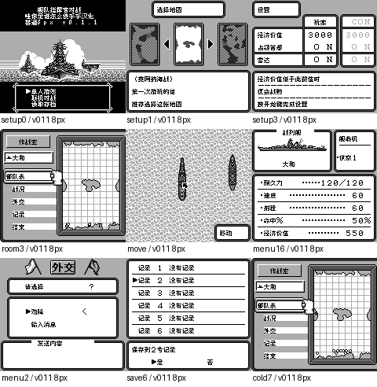

# 舰队指挥官VS

原输入：Fleet Commander VS.

原输入完整SHA256：`a6ac3d3a8c7144a5e1ed8ca9d0283fc34ab134210170297e53504ada4dccb485`。此处“原输入”保留改版、既有汉化或地区修订身份，不一律称干净零售ROM。

| 字号 | 当前版本 | 音频 | 输出完整SHA256 |
| --- | --- | --- | --- |
| 8px | v0.1.1 | unchanged | `83a50a20b91c5c1801e5f7b381fb50f89f3501a393052426fa7b3e5bc1797b9c` |

## 源码与补丁

- 8px／v0.1.1／unchanged：源码包（完整性未独立确认）：[下载](https://github.com/shiyi1133/youxi-hanhua-releases/releases/download/source-migration-20261022-02a/fleet-commander-vs-current-source-5923dac7875f-public-r01.zip)（ZIP SHA256 `0134c3fca22adfb6d83dde4aed4276f59d7aac848b979884d0bd0dcfb7d8fa33`）；补丁：[下载](https://github.com/shiyi1133/youxi-hanhua-releases/releases/download/patch-migration-20261022/fleet-commander-vs-current-patches.zip)（ZIP SHA256 `2b4299c69549219b32afc43bc59bba486d3f1608e53bcb90887fd2a40dc2f2b6`）。
  该包已核对对应版本与字节安全；完整修改源码覆盖范围未独立确认。

补丁须直接应用于完整SHA一致的实际原输入；普通字、大字和音乐变体分别核对。公开源码归档不表示本轮重新构建或通过新的运行验收。原作、字体、已有翻译及工具依赖的权利与许可，依各包对应许可保留。

## 范围与验证边界

- 8px／v0.1.1：Fusion Pixel普通8px，GB/DMG；未实现可靠真10px，无独立大字或SGB。。
  Fusion Pixel普通8px，GB/DMG；未实现可靠真10px，无独立大字或SGB。
  #94延迟仅降低仍比日版慢，不称全作卡顿已解决；玩家实际ROM SHA/设备未核。
  未自然战斗/港口商店/胜败结局/全通/实机/联机；外交字母通信不是命名，不新增键盘；旧8KB存档等兼容未验。

本次资料搬运未新增模拟器、实机或全通验收；未记录或未测试的范围不写成通过。问题单开放只表示尚未关闭，已关闭也不单独证明全部场景都修复。

[公开反馈及问题状态](feedback.md) · [报告BUG](https://github.com/shiyi1133/youxi-hanhua-releases/issues/new?template=bug_report.md)

## 对应版本截图

v0.1.1 Fusion Pixel普通8px，GB/DMG；未实现可靠真10px，无独立大字或SGB。 音频：unchanged；同目标DMG原生帧，有限自然路线/保存冷读；延迟数据是mGBA帧计数，非实机。

图像SHA256：`31e1162509d5880d473e60e59919c7c8ba7b9b830ca09294f0e632825709f229`；绑定ROM SHA256：`83a50a20b91c5c1801e5f7b381fb50f89f3501a393052426fa7b3e5bc1797b9c`。

