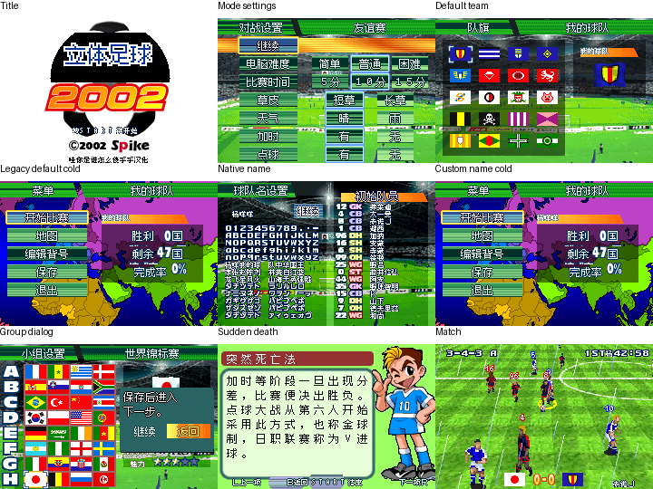

# 立体足球2002

原输入：Formation Soccer 2002 (Japan)

原输入完整SHA256：`5dfa54d26c3845a49e4258b3940e69f128796815f9c613b28211ff872a665b77`。此处“原输入”保留改版、既有汉化或地区修订身份，不一律称干净零售ROM。

| 字号 | 当前版本 | 音频 | 输出完整SHA256 |
| --- | --- | --- | --- |
| native16cell-8ui | v0.1.2限定修复测试版 | unchanged | `477e61ce5746f30d2b78518ef5e7530223e7029af1cf1b9df16773c767db66d3` |

## 源码与补丁

- native16cell-8ui／v0.1.2限定修复测试版／unchanged：源码包（完整性未独立确认）：[下载](https://github.com/shiyi1133/youxi-hanhua-releases/releases/download/source-migration-20261022-02a/formation-soccer-2002-current-source-1de6db50efbd-public-r01.zip)（ZIP SHA256 `5b0686fe983b0a9aa7db8a6817e160bc45afdf340b5ac091c6b408d63c774e72`）；补丁：[下载](https://github.com/shiyi1133/youxi-hanhua-releases/releases/download/patch-migration-20261022/formation-soccer-2002-current-patches.zip)（ZIP SHA256 `a8139bca8d95baca0d2f53be153841c60b49432df0bd2a1f93e118167d00f316`）。
  该包已核对对应版本与字节安全；完整修改源码覆盖范围未独立确认。

补丁须直接应用于完整SHA一致的实际原输入；普通字、大字和音乐变体分别核对。公开源码归档不表示本轮重新构建或通过新的运行验收。原作、字体、已有翻译及工具依赖的权利与许可，依各包对应许可保留。

## 范围与验证边界

- native16cell-8ui／v0.1.2限定修复测试版：原生16px单元内Fusion Pixel12px字形、密集姓名8px，无独立大字。。
  既有反馈限定修复：保留字底/主菜单透明斜边修复，补默认队名及旧默认名只显示转换、标题可见原足球合成；部分颜色报告未复现，既有反馈保持open。
  原生16px单元内Fusion Pixel12px字形、密集姓名8px，无独立大字。
  保留v0.1.1字底与主菜单透明斜边修复；v0.1.2补新默认队名“我的球队”及精确旧默认名只在显示层转换，原SRAM姓名字节不改，自定义名保留。
  标题保留原图可见足球、2002和版权；被旧日文遮住的未知底画用中性黑衔接，不冒称恢复未知原画。
  绿条与青绿确认框经提供方原件对照未复现为新调色板错误；保留原生背景，日文命名键盘输入选项保留。
  提供方自然短路线、三类取名/重复删除重输、8字上限、原生保存/新进程冷读、旧默认及自定义样本冷读、比赛操作暂停等是模拟器自测；不等于独立人员QA。
  本轮未全场终场、全赛事、全部问答自然访问、全部旧档组合、实机或联机；原生32KiB SRAM布局保持，先备份旧档，不跨ROM即时状态。
  玩家实际ROM SHA未知；十图差集仍有未复现范围，既有反馈本审计不具整单关闭资格。
  维护本轮仅ZIP/全SHA/清单/独立IPS/九宫格9帧逐像素验证；未执行源码、SO、重建或模拟器。

本次资料搬运未新增模拟器、实机或全通验收；未记录或未测试的范围不写成通过。问题单开放只表示尚未关闭，已关闭也不单独证明全部场景都修复。

[公开反馈及问题状态](feedback.md) · [报告BUG](https://github.com/shiyi1133/youxi-hanhua-releases/issues/new?template=bug_report.md)

## 对应版本截图

立体足球2002 v0.1.2限定修复测试版 普通原生16px单元/8px UI；提供方最终ROM画面，诊断/自然范围按图及证据明确标注，未新增维护运行。

图像SHA256：`4202b4bd97a202e1204fcafa55dcc1370a81140523b4a521c4ef31986b8f3f83`；绑定ROM SHA256：`477e61ce5746f30d2b78518ef5e7530223e7029af1cf1b9df16773c767db66d3`。

